# Crypto Brain Terminal (CBT) | AI Quant Sentinel

[](https://www.python.org/)
[](https://fastapi.tiangolo.com/)
[](https://nodejs.org/)
[](https://ai.google.dev/)
[](https://www.docker.com/)
[-success.svg)](tests/)
[](#12-layer-institutional-quantitative-architecture)

> **Crypto Brain Terminal (CBT)** is an institutional-grade quantitative research, paper trading, and automated risk governance platform designed according to the `FinalCBTaiTrading.tet` master specification. It implements a non-discretionary 12-layer quantitative architecture featuring point-in-time causal firewalls, high-dimensional standardized state vectors, empirical Smart Money Concepts (SMC), 10,000-path tri-model bootstrap trajectory simulations, uncertainty-penalized Net Expected Value (Net EV), multi-factor discounted Kelly allocation, an adversarial Bull/Bear/Skeptic debate council enforcing a ~70% NO-TRADE baseline, a 4-tier strategy quarantine league, 11-category loss autopsies, and a real-time dark "AI Exchange" web terminal with a bilingual Gemini 3.7 Flash copilot.

---

## Table of Contents

- [Key Highlights & Performance Posture](#key-highlights--performance-posture)
- [SKY — Professional Market Intelligence Engine](#sky--professional-market-intelligence-engine)
- [12-Layer Institutional Quantitative Architecture](#12-layer-institutional-quantitative-architecture)
- [11 Master Directives (Scientific Governance)](#11-master-directives-scientific-governance)
- [Quick Start Guide](#quick-start-guide)
  - [Option A: Local Python 3.13 Setup](#option-a-local-python-313-setup)
  - [Option B: Docker & Docker Compose](#option-b-docker--docker-compose)
  - [Option C: Turnkey Production Service (systemd)](#option-c-turnkey-production-service-systemd)
- [Web Desktop Terminal & User Experience](#web-desktop-terminal--user-experience)
- [REST & WebSocket API Reference](#rest--websocket-api-reference)
- [Test Suite & Empirical Verification](#test-suite--empirical-verification)
- [Directory Structure](#directory-structure)

---

## SKY — Professional Market Intelligence Engine

> **Comprehensive Architecture & Specification:** 👉 [SKY_MARKET_INTELLIGENCE_ENGINE.md](file:///c:/Users/azims/CBT/SKY_MARKET_INTELLIGENCE_ENGINE.md)

SKY treats Smart Money Concepts (SMC), market structure, liquidity, volume, volatility, and derivatives not as subjective trading lore, but as a **rigorously defined, measurable feature-engineering layer**.
- **Objective Mathematical Definitions:** Deterministic $(L, R)$ swing detection, BOS, CHoCH, MSS, liquidity sweeps with penetration/ATR metrics.
- **Anti-Repainting & Zero Lookahead:** Historical events record both `event_timestamp` and `confirmation_timestamp` and never mutate after confirmation.
- **Regime-Conditional Expectancy:** Historical $E[R \mid \text{Pattern}, \text{Regime}, \text{Timeframe}]$ evaluated out-of-sample before qualifying Setups A through E.
- **No-Trade Gate:** Rigorous enforcement of ~70% baseline `NO_TRADE` whenever odds are unfavorable.

---

## Key Highlights & Performance Posture

```
+-----------------------------------------------------------------------------------------------------------------+
| CBT QUANTITATIVE DESK | [Symbol: BTC/USDT v] [TF: 15m v] | Price: $88,450.00 | Net EV: +0.42R | Council: NO_TRADE|
+--------------------------------------------------------------------+--------------------------------------------+
| TRADINGVIEW LIGHTWEIGHT CHARTS v4+                                 | STRUCTURED EVIDENCE DOSSIER (74.5/100)     |
| - 100% Canvas High-Framerate Render                                | [✓] 4H Higher Timeframe Trend Bullish      |
| - FVG Boxes, Order Blocks, Liquidity Sweeps                        | [✓] 15M Asian Range Liquidity Swept & Rev  |
| - 10,000-Path Tri-Bootstrap Trajectory Cone (10th/50th/90th)        | [✓] CVD Hidden Bullish Absorption Confirmed|
|                                                                    | [⚠] Perpetual Funding Z-Score Elevated     |
+--------------------------------------------------------------------+--------------------------------------------+
| SMART ORDER ROUTER (SOR) & ORDERBOOK L2 DEPTH                      | COMPETING MECE SCENARIOS                   |
| - Binance / Bybit / Hyperliquid L2 Split Routing                   | A: Trend Continuation  [████████  ] 61%    |
| - Conservative Kelly Risk Calculator (Capped at 1.5%)              | B: Deep FVG Retest     [███       ] 24%    |
| - 1-Click AI Auto-Fill Setup                                       | C: Structural Reversal [██        ] 15%    |
+--------------------------------------------------------------------+--------------------------------------------+
| LIVE SHADOW PORTFOLIO & TRAILING AUTOMATION (Max Heat: 3.7% / 6.0%)| BILINGUAL GEMINI 3.7 FLASH COPILOT         |
| - Auto-Ratchet Trailing Stops & Breakeven (+1.5R Milestone)        | English, Bangla, and Banglish Grounded Q&A |
+-----------------------------------------------------------------------------------------------------------------+
```

---

## 12-Layer Institutional Quantitative Architecture

```mermaid
flowchart TD
    subgraph L0_L3["Data Foundation & Microstructure"]
        L0["Layer 0: Multi-DB SQLite WAL Persistence & Schema Registry"]
        L1["Layer 1: Pre-Decision Data Gate (Drift, Stale Feed, Spreads)"]
        L11["Layer 11: Causal Firewall (Point-in-Time Zero-Lookahead)"]
        L2["Layer 2: Standardized State Vector S_t & SHA-256 Hashing"]
        L3["Layer 3: Empirical SMC Expectancy & Vectorized Formations"]
        L3B["Layer 3B: Institutional CVD Absorption, Lead-Lag & Event Shocks"]
    end

    subgraph L4_L7["Scenario, Simulation & Risk Gates"]
        L4["Layer 4: Hierarchical Analogues (Hard Filter -> Top-50 KNN)"]
        L5["Layer 5: MECE Scenario Generation & Invalidation Watchdog"]
        L6["Layer 6: Tri-Model Bootstrap Path Simulation (10,000 Paths)"]
        L6B["Layer 6B: Platt Scaling Calibration & Immutable Prediction Freeze"]
        L7["Layer 7: Uncertainty-Penalized Net EV Engine (Hurdle > +0.25R)"]
        L8["Layer 8: Conservative Kelly Allocator (Max 1.5% Risk Cap)"]
        L9["Layer 9: Adversarial Debate Council (Bull vs Bear vs Skeptic)"]
    end

    subgraph L10_L12["Execution, Learning & Continuous Evolution"]
        L10A["Layer 10A: Strategy Quarantine League (4-Tier Pipeline)"]
        L10B["Layer 10B: 11-Category Loss Autopsies & Counterfactual What-If"]
        L10C["Layer 10C: Shapley Factor Alpha Attribution"]
        L12A["Layer 12A: 4-Type Continuous Drift Monitor"]
        L12B["Layer 12B: Governed Hot-Reload & Parameter Patch Governor"]
        L12C["Layer 12C: Smart Order Router (SOR) & Latency Watchdog"]
    end

    L0 --> L1 --> L11 --> L2 --> L3 --> L3B --> L4 --> L5 --> L6 --> L6B --> L7 --> L8 --> L9 --> L12C --> L10A --> L10B --> L10C --> L12A --> L12B
```



---

## 11 Master Directives (Scientific Governance)

1. **Directive 1: Statistical Significance Over Subjectivity** — Replaces discretionary assertions with $P(\text{Outcome} \mid S_t)$ from historical analogues ($K \ge 30$).
2. **Directive 2: Point-in-Time Causal Firewall** — Strict timestamp partitioning (`event_time`, `publish_time`, `ingest_time`, `decision_available_time`). Zero lookahead permitted.
3. **Directive 3: Friction-Deducted Net EV** — All candidate trades must exceed $+0.25R$ Net EV after taker fees, slippage, carry, and uncertainty deductions.
4. **Directive 4: Multi-Horizon Forecast Ladders** — Requires simultaneous forecasts across micro (5m), intraday (1h), and swing (4h) horizons.
5. **Directive 5: Immutable Forecast Freeze (Prediction Ledger)** — Freezes predictions in SQLite before outcome bars close; Brier scores ($BS \le 0.20$) tracked permanently.
6. **Directive 6: Adversarial Council (~70% NO-TRADE)** — Bull and Bear agents debate while a dominant Skeptic Judge enforces capital preservation.
7. **Directive 7: Uncertainty-Penalized Kelly Sizing** — Half-Kelly discounted for regime shift, drawdowns, and cross-asset correlation; capped at 1.5% max risk.
8. **Directive 8: 4-Tier Strategy Quarantine League** — Progression through Smoke Test $\rightarrow$ Preliminary $\rightarrow$ Robust $\rightarrow$ Production with Deflated Sharpe Ratio (DSR) selection guards.
9. **Directive 9: 11-Category Forensic Loss Autopsies** — Classifies every loss into root causes (`DATA_FAILURE`, `SIGNAL_FAILURE`, `REGIME_FAILURE`, `EXECUTION_FAILURE`, etc.).
10. **Directive 10: 4-Type Continuous Drift Monitor** — Tracks Data Drift, Concept Drift, Performance Drift, and Execution Drift in real time.
11. **Directive 11: Governed Hot-Reload** — Prohibits unsupervised live code mutations; requires sandbox backtest, OOS validation, and human sign-off.

---

## Quick Start Guide

### Option A: Local Python Setup

```bash
# 1. Clone repository & navigate to directory
cd c:\Users\azims\CBT

# 2. Activate virtual environment
.\.venv\Scripts\activate

# 3. Configure environment
cp .env.example .env

# 4. Run full test suite
pytest tests/ -v
# Lint gate (must pass before merging)
ruff check core/ tests/

# 5. Launch the terminal
uvicorn app:app --host 0.0.0.0 --port 8000 --reload
```
Open **http://localhost:8000** in your browser.

---

### Option B: Docker & Docker Compose

```bash
# Build and launch in containerized environment
docker compose up -d --build

# View real-time logs
docker compose logs -f
```

---

### Option C: Turnkey Production Service (systemd)

```bash
# One command: detects your user + checkout path, guards the Python-version
# trap (3.11–3.13 required), builds .venv, creates .env, installs the systemd
# unit with YOUR paths, enables it on boot, and health-checks the result.
bash deploy/install_bare_metal.sh

# Check service status / follow live logs
systemctl status ai_quant_sentinel.service
journalctl -u ai_quant_sentinel -f
```

> ⚠️ **Never `cp` the unit template directly.**
> `deploy/systemd/ai_quant_sentinel.service` contains `__CBT_USER__` /
> `__CBT_WORKDIR__` placeholders — a raw copy produces a unit pointing at
> `/root/CBT` that fails with `Result: resources`. Always install via
> `deploy/install_bare_metal.sh`.
>
> The bare-metal unit binds port 8000 and is **mutually exclusive** with the
> Docker Compose stack (Option B above) — run exactly one of the two.

---

## REST & WebSocket API Reference

| Method | Endpoint | Description |
| :--- | :--- | :--- |
| `GET` | `/` | Serves Obsidian Dark Web Desktop UI |
| `WS` | `/ws/terminal` | Real-time WebSocket streaming ticks, L2 orderbook, and macro vitals |
| `GET` | `/api/health` | System status, 4-type drift report, and API rate-limit health |
| `GET` | `/api/market/candles` | Returns OHLCV candles (`symbol`, `timeframe`, `limit`) |
| `GET` | `/api/market/state` | Returns versioned $S_t$ state vector with SHA-256 hash |
| `GET` | `/api/market/dossier` | Returns 6-pillar asset intelligence dossier |
| `GET` | `/api/smc/scan` | Returns SMC patterns (FVG, OB, Sweeps) with conditional expectancy |
| `GET` | `/api/scenarios` | Competing MECE probabilistic scenarios & deterministic invalidation |
| `GET` | `/api/path-simulation` | 10,000-path tri-model bootstrap trajectory cone |
| `GET` | `/api/prediction/ledger` | Immutable prediction freeze ledger & Brier scores |
| `GET` | `/api/prediction/calibration` | Reliability calibration curve & Platt scorecard |
| `GET` | `/api/decision/council` | Adversarial debate council decision & argumentation |
| `GET` | `/api/decision/allocation` | Conservative Kelly position sizing calculation |
| `GET` | `/api/shadow/positions` | Live shadow portfolio positions & trailing status |
| `POST`| `/api/shadow/trade` | Opens simulated shadow position with automatic trailing stop |
| `POST`| `/api/command/parse` | Natural language text/voice trade command parser |
| `POST`| `/api/desk/ask` | Bilingual (English/Bangla) Gemini 3.7 Flash AI Copilot |
| `GET` | `/api/league/leaderboard` | 4-tier strategy quarantine leaderboard & capital weights |
| `POST`| `/api/governance/approve` | Human approval & atomic hot-reload for parameter patch |
| `POST`| `/api/lab/backtest` | Zero-lookahead historical backtest replay |
| `POST`| `/api/lab/walk-forward` | Purged K-Fold walk-forward validation (70/30 OOS) |
| `POST`| `/api/lab/stress-test` | 10,000-path Monte Carlo sequence permutation stress test |

---

## Test Suite & Empirical Verification

Run the entire 12-layer test suite:
```bash
pytest tests/ -v
```

```
tests/test_analogues_and_scenarios.py::test_hierarchical_analogue_ensemble PASSED
tests/test_analogues_and_scenarios.py::test_mece_scenario_generator_probabilities_sum PASSED
tests/test_analogues_and_scenarios.py::test_scenario_collapse_monitor_breach PASSED
tests/test_autopsy_and_attribution.py::test_loss_autopsy_classification PASSED
tests/test_autopsy_and_attribution.py::test_counterfactual_what_if_simulator PASSED
tests/test_autopsy_and_attribution.py::test_shapley_alpha_attribution PASSED
tests/test_data_integrity.py::test_database_wal_mode_and_schemas PASSED
tests/test_data_integrity.py::test_data_quality_gate_stale_quote_rejection PASSED
tests/test_data_integrity.py::test_data_quality_gate_spread_anomaly PASSED
tests/test_data_integrity.py::test_causal_firewall_zero_lookahead_enforcement PASSED
tests/test_data_integrity.py::test_feature_registry_schema_validation PASSED
tests/test_drift_and_execution.py::test_4_type_drift_detection PASSED
tests/test_drift_and_execution.py::test_smart_order_router_execution PASSED
tests/test_drift_and_execution.py::test_governed_hot_reload_workflow PASSED
tests/test_ev_and_kelly.py::test_ev_engine_hurdle_rule PASSED
tests/test_ev_and_kelly.py::test_conservative_kelly_multi_factor_discount PASSED
tests/test_ev_and_kelly.py::test_adversarial_council_voting_and_skeptic_veto PASSED
tests/test_ev_and_kelly.py::test_portfolio_heat_cap_ceiling PASSED
tests/test_microstructure_and_macro.py::test_cvd_absorption_calculation PASSED
tests/test_microstructure_and_macro.py::test_lead_lag_macro_shocks PASSED
tests/test_microstructure_and_macro.py::test_event_shock_risk_switcher PASSED
tests/test_microstructure_and_macro.py::test_macro_sentinel_snapshot PASSED
tests/test_path_simulator_and_calibration.py::test_tri_model_bootstrap_path_simulation PASSED
tests/test_path_simulator_and_calibration.py::test_probability_calibrator_brier_score PASSED
tests/test_path_simulator_and_calibration.py::test_prediction_ledger_immutable_freeze_and_verification PASSED
tests/test_research_and_strategy_league.py::test_research_firewall_partitioning PASSED
tests/test_research_and_strategy_league.py::test_deflated_sharpe_ratio_and_multiple_testing_correction PASSED
tests/test_research_and_strategy_league.py::test_strategy_quarantine_league_tier_promotions PASSED
tests/test_research_and_strategy_league.py::test_purged_walk_forward_validator PASSED
tests/test_state_and_smc.py::test_market_state_vector_compilation_and_hashing PASSED
tests/test_state_and_smc.py::test_smc_engine_fvg_and_expectancy PASSED
tests/test_state_and_smc.py::test_candlestick_pattern_engine PASSED
tests/test_state_and_smc.py::test_regime_transition_detector PASSED
tests/test_system_integration.py::test_api_health_endpoint PASSED
tests/test_system_integration.py::test_api_market_candles PASSED
tests/test_system_integration.py::test_api_smc_scan PASSED
tests/test_system_integration.py::test_api_scenarios PASSED
tests/test_system_integration.py::test_api_decision_council PASSED
tests/test_system_integration.py::test_api_shadow_trade_and_ledger PASSED
tests/test_system_integration.py::test_api_command_parser PASSED
tests/test_system_integration.py::test_api_desk_copilot_fallback PASSED

============================= 41 passed in 14.68s =============================
```

---

## Directory Structure

```
CBT/
├── app.py                              # FastAPI Core, WebSocket Multiplexer & REST API
├── requirements.txt                    # Production quantitative package specifications
├── pytest.ini                          # Test configuration (pythonpath=.)
├── Dockerfile                          # Multi-stage production container
├── docker-compose.yml                  # Container orchestration & persistent storage
├── Makefile                            # Turnkey automation targets
├── .env.example                        # Comprehensive configuration template
│
├── core/                               # 12-Layer Quantitative Engine
│   ├── database.py                     # Multi-DB SQLite WAL manager (4 databases)
│   ├── causal_firewall.py              # Point-in-time causal integrity validator
│   ├── data_quality_gate.py            # Stale tick & spread anomaly gatekeeper
│   ├── venue_dislocation.py            # Cross-exchange basis dislocation monitor
│   ├── data_streamer.py                # Multi-exchange OHLCV streamer & synthetic engine
│   ├── gap_recovery.py                 # Sequence gap detector & backfill engine
│   ├── memory_vault.py                 # Dual-layer episodic & vector memory
│   ├── brain_backup.py                 # AES-256 encrypted database snapshot manager
│   ├── market_state.py                 # High-dimensional state vector S_t compiler
│   ├── smc_engine.py                   # Empirical FVG, OB, Liquidity Sweeps
│   ├── pattern_engine.py               # 12 candlestick formations with narrative logic
│   ├── regime_transition.py            # ADX & Bollinger Squeeze structural regime classifier
│   ├── cvd_absorption.py               # CVD orderflow delta & institutional absorption
│   ├── lead_lag_correlator.py          # Cross-asset macro velocity lead signals
│   ├── judas_sweep_hunter.py           # London/NY open Asian range sweep trap hunter
│   ├── event_shock_engine.py           # High-impact macro calendar risk switcher
│   ├── macro_sentinel.py               # Global macro vitals & GRI tracker
│   ├── sentiment_engine.py             # Time-decayed news NLP sentiment & Fear/Greed
│   ├── asset_dossier_engine.py         # 6-pillar asset intelligence dossier compiler
│   ├── analogue_engine.py              # 4-step hierarchical similarity matching
│   ├── scenario_engine.py              # MECE competing scenario probability generator
│   ├── scenario_monitor.py             # Real-time sub-second invalidation collapse watchdog
│   ├── path_simulator.py               # 10,000-path tri-model bootstrap simulator
│   ├── probability_calibrator.py       # Platt scaling & Brier score reliability calibrator
│   ├── prediction_ladder.py            # Multi-horizon directional forecast ladder
│   ├── prediction_ledger.py            # P0 immutable pre-outcome forecast freeze ledger
│   ├── uncertainty_engine.py           # Composite systemic uncertainty budget U
│   ├── ev_engine.py                    # Friction-deducted Net Expected Value engine
│   ├── conservative_kelly.py           # Multi-factor discounted Kelly allocator
│   ├── debate_committee.py             # Adversarial council (Bull/Bear/Skeptic ~70% NO-TRADE)
│   ├── portfolio_risk_matrix.py        # Total portfolio heat cap (<= 6.0%) & 99% VaR
│   ├── risk_manager.py                 # Daily 3.0% drawdown kill-switch circuit breaker
│   ├── tail_risk_engine.py             # Tail-risk correlation spike & liquidity guard
│   ├── dynamic_hedger.py               # Delta-neutral micro-hedge generator
│   ├── psychology_shield.py            # Behavioral tilt shield (3-loss cooldown lock)
│   ├── strategy_league.py              # 4-tier strategy quarantine pipeline & leaderboard
│   ├── sandbox_lab.py                  # Zero-lookahead replay backtester
│   ├── walk_forward_engine.py          # Purged K-Fold walk-forward engine (70/30 OOS)
│   ├── monte_carlo_stress.py           # 10,000-path trade reshuffler & ruin simulator
│   ├── multimodal_ingestor.py          # Media & PDF parser for research lessons
│   ├── github_researcher.py            # AST / PineScript / MQL5 code reader
│   ├── strategy_extractor.py           # JSON Strategy Genome synthesizer
│   ├── loss_autopsy.py                 # 11-category root cause forensic autopsy engine
│   ├── counterfactual_engine.py        # Post-trade "What-If" parameter perturbation simulator
│   ├── alpha_attribution.py            # Shapley-value factor attribution analyzer
│   ├── portfolio_shadow.py             # Virtual shadow ledger with trailing stop automation
│   ├── quant_mentor.py                 # Bilingual (English/Bangla) Gemini 3.7 Flash Copilot
│   ├── voice_interface.py             # Voice note audio transcription & speech bridge
│   ├── command_executor.py             # Natural language trade parser & execution bridge
│   ├── execution_gateway.py            # CEX/DEX Smart Order Router (SOR) & latency watchdog
│   ├── drift_monitor.py                # 4-type continuous drift detection engine
│   ├── system_evolver.py               # Predictive alpha decay forecaster
│   ├── api_health_guard.py             # Rate-limit monitor & multi-endpoint failover
│   └── patch_governor.py               # Governed atomic hot-reload manager
│
├── research/                           # Statistical Governance & Research Rigor
│   ├── feature_registry.py             # Feature schema v2.1.0 registry & validation bounds
│   ├── research_firewall.py            # 60/20/20 train/val/test data partitioner
│   ├── experiment_registry.py          # Research experiment lineage logger
│   └── strategy_selection_guard.py     # Deflated Sharpe Ratio (DSR) & Holm-Bonferroni guard
│
├── static/                             # Obsidian Dark Quantitative Web Terminal
│   ├── index.html                      # Modular terminal desktop layout
│   ├── style.css                       # JetBrains Mono styling, neon accents & tables
│   └── js/                             # Modular ES6 UI scripts
│       ├── app.js                      # Master UI controller & WebSocket client
│       ├── chart_engine.js             # Lightweight Charts v4+ & SMC overlays
│       ├── order_book.js               # L2 depth visualizer & bid/ask tape
│       ├── order_panel.js              # Order entry dock & Kelly calculator
│       ├── scenario_visualizer.js      # MECE scenario probability bars & invalidation
│       ├── evidence_dossier.js         # Evidence checklist & decision explanation
│       ├── prediction_ledger_tab.js    # Prediction freeze log & calibration chart
│       ├── live_positions_dock.js      # Live shadow positions & trailing status
│       ├── strategy_league_tab.js      # 4-tier quarantine leaderboard
│       ├── system_health_tab.js        # 4-type drift & API health cards
│       └── macro_ticker.js             # Top global macro vital scrolling ticker
│
├── tests/                              # Comprehensive Pytest Verification Suite
│   ├── test_data_integrity.py
│   ├── test_state_and_smc.py
│   ├── test_microstructure_and_macro.py
│   ├── test_analogues_and_scenarios.py
│   ├── test_path_simulator_and_calibration.py
│   ├── test_ev_and_kelly.py
│   ├── test_research_and_strategy_league.py
│   ├── test_autopsy_and_attribution.py
│   ├── test_drift_and_execution.py
│   └── test_system_integration.py
│
└── deploy/                             # 24/7 Production Deployment Assets
    ├── systemd/                        # Unit templates (__CBT_USER__/__CBT_WORKDIR__ placeholders)
    │   ├── ai_quant_sentinel.service   # Bare-metal systemd unit (install via install_bare_metal.sh)
    │   └── cbt-stack@.service          # Docker Compose stack unit (install via ubuntu_install.sh)
    ├── install_bare_metal.sh           # Path-agnostic bare-metal systemd installer
    ├── ubuntu_install.sh               # One-command Docker stack installer
    ├── install_deps.sh                 # Turnkey environment dependency installer
    └── run.sh                          # Production startup script with pre-flight checks
```

---

## License

This quantitative platform is licensed under the MIT License.
