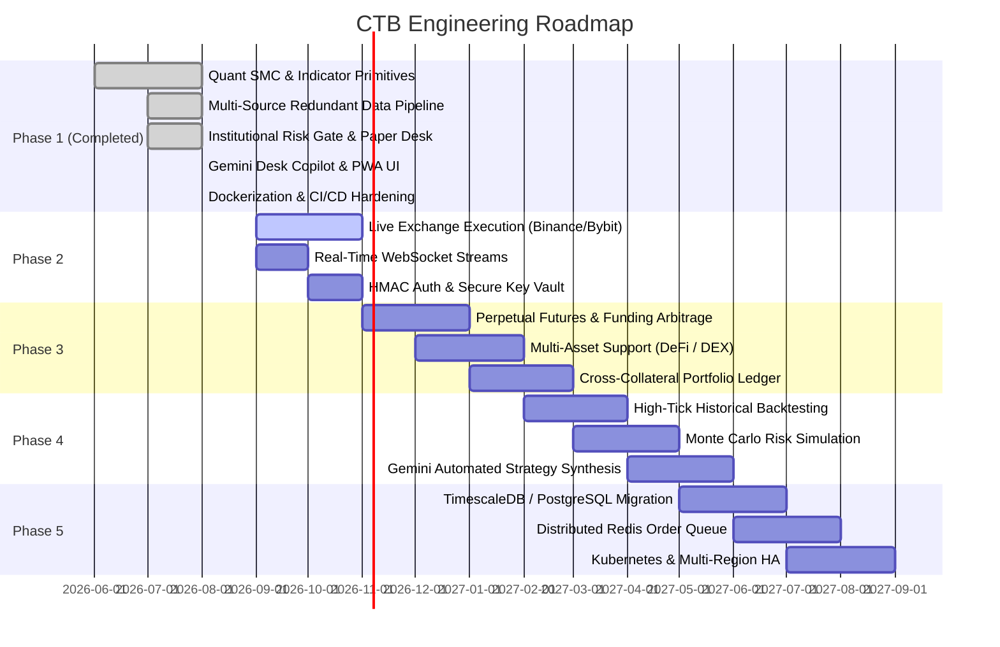

# ROADMAP.md — Project Roadmap & Future Milestones

## Vision
Crypto Brain Terminal (CTB) is evolving from an institutional-grade quantitative research and paper-trading sandbox into a comprehensive, multi-venue algorithmic trading terminal powered by real-time Smart Money Concepts (SMC) scanning and Gemini Desk Intelligence.

---

## Milestone Phases

---

### Phase 1: Institutional Core & Paper Trading Engine *(Completed)*
- [x] Resilient multi-tier market data pipeline (Binance REST -> Bybit V5 Public REST -> SQLite Persistent Cache -> 502 Bad Gateway).
- [x] Mathematical Smart Money Concepts engine (Fair Value Gaps, Order Blocks, Break of Structure, Swing Highs/Lows).
- [x] Multi-Timeframe indicator telemetry (EMA-14 trendline, Wilder's Smoothed RSI-14 momentum).
- [x] Pre-execution institutional Risk Gate (2.0% maximum equity risk, max 3 concurrent open positions).
- [x] Simulated paper trading desk with automated SL/TP position ledger in SQLite via Prisma ORM.
- [x] Google Gemini AI Desk Copilot for automated market briefs and grounded contextual Q&A.
- [x] React 18 + Vite + Tailwind CSS quantitative PWA terminal with custom SVG candlestick chart.
- [x] Service Worker caching and Web Push notifications for Risk Gate events.
- [x] Multi-stage Docker containerization and GitHub Actions automated CI pipeline.

---

### Phase 2: Live Exchange Execution
- [ ] **Live Order Routing**: Integration of Binance REST API v3 and Bybit V5 Private endpoints for live spot order execution.
- [ ] **HMAC-SHA256 & Ed25519 Request Signing**: Hardware-secured and environment-secured API credential manager.
- [ ] **Real-Time WebSocket Streams**: Bidirectional candle, book ticker, and depth stream subscriptions replacing polling.
- [ ] **Live Position Manager**: Real-time stop-loss and take-profit order management directly with exchange matching engines.

---

### Phase 3: Multi-Asset & Derivatives Support
- [ ] **Perpetual Futures & Funding Arbitrage**: Support for linear USDT perpetuals, funding rate history tracking, and basis arbitrage scanning.
- [ ] **Cross-Collateral Margin Ledger**: Unified margin tracking across multiple concurrent assets and collateral currencies.
- [ ] **Decentralized Exchange (DEX) & On-Chain Telemetry**: Integration with Uniswap V3, Raydium, and Hyperliquid APIs for decentralized order flow confluence.

---

### Phase 4: Advanced AI Backtesting & Simulation
- [ ] **High-Resolution Tick Backtesting Engine**: Event-driven backtesting engine with realistic slippage, liquidity depth simulation, and maker/taker fee modeling.
- [ ] **Monte Carlo Risk Stress-Testing**: Quantitative simulation of portfolio drawdowns under volatile and black-swan market conditions.
- [ ] **Gemini Strategy Synthesizer**: AI-assisted parameter tuning and natural language strategy prompt-to-code compiler.

---

### Phase 5: Distributed Scaling & High Availability
- [ ] **PostgreSQL & TimescaleDB Migration**: Scalable time-series storage for tick-level data and high-frequency trade journals.
- [ ] **Redis Pub/Sub & Job Queues**: Asynchronous event bus for distributed order routing and notification fanout.
- [ ] **Kubernetes Helm Charts**: Production deployment manifests for multi-region container orchestration with automated zero-downtime rolling updates.
