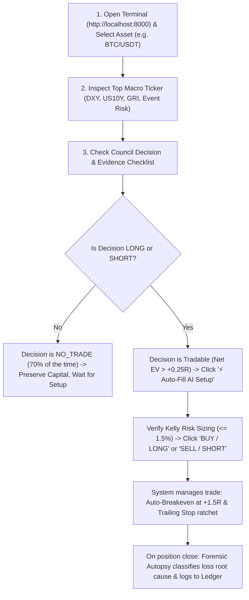

# 📖 Crypto Brain Terminal (CBT) — Comprehensive User Guide

Welcome to the **Crypto Brain Terminal (CBT) / AI Quant Sentinel** User Manual!  
This guide explains everything you need to know: how to launch the platform, how to read every element of the trading desk, how to use the bilingual AI Copilot, how the institutional risk engines protect your capital, and how to execute trades.

---

## Table of Contents

1. [Quick Start: Launching the Terminal](#1-quick-start-launching-the-terminal)
2. [Interface Overview (The 5 Main Tabs)](#2-interface-overview-the-5-main-tabs)
3. [Tab 1: Trading Desk (Deep Dive)](#3-tab-1-trading-desk-deep-dive)
   - [Top Macro Vital Bar](#top-macro-vital-bar)
   - [Left Sidebar & Controls](#left-sidebar--controls)
   - [Interactive Candlestick Chart & SMC Overlays](#interactive-candlestick-chart--smc-overlays)
   - [Structured Evidence Dossier & Confluence Score](#structured-evidence-dossier--confluence-score)
   - [Competing Probabilistic Scenarios (MECE)](#competing-probabilistic-scenarios-mece)
   - [Order Book & Conservative Kelly Execution Dock](#order-book--conservative-kelly-execution-dock)
   - [Live Shadow Portfolio & Auto-Trailing Stops](#live-shadow-portfolio--auto-trailing-stops)
4. [Using the Bilingual Gemini 3.7 Flash Copilot (English / বাংলা / Banglish)](#4-using-the-bilingual-gemini-37-flash-copilot)
   - [Natural Language Trade Commands](#natural-language-trade-commands)
   - [Market Q&A and Desk Briefings](#market-qa-and-desk-briefings)
5. [Tab 2: Prediction Ledger & Probability Calibration](#5-tab-2-prediction-ledger--probability-calibration)
6. [Tab 3: Strategy Quarantine League](#6-tab-3-strategy-quarantine-league)
7. [Tab 4: Research Sandbox Lab](#7-tab-4-research-sandbox-lab)
8. [Tab 5: System Drift & Health Sentinel](#8-tab-5-system-drift--health-sentinel)
9. [The 12 Quantitative Engines Explained Simply](#9-the-12-quantitative-engines-explained-simply)
10. [Step-by-Step Daily Trading Workflow](#10-step-by-step-daily-trading-workflow)
11. [SKY Market Intelligence Engine (SMC as a Measurable Layer)](#11-sky-market-intelligence-engine-smc-as-a-measurable-layer)
12. [Troubleshooting & FAQ](#12-troubleshooting--faq)

---

## 1. Quick Start: Launching the Terminal

### Starting the Server on Windows:
1. Open PowerShell or Command Prompt.
2. Navigate to your project folder:
   ```powershell
   cd c:\Users\azims\CBT
   ```
3. Run the application using the configured virtual environment:
   ```powershell
   .\.venv\Scripts\uvicorn.exe app:app --host 0.0.0.0 --port 8000 --reload
   ```
4. Open your web browser (Chrome, Edge, Brave, etc.) and go to:  
   👉 **`http://localhost:8000`**

---

## 2. Interface Overview (The 5 Main Tabs)

When you open `http://localhost:8000`, you will see an Obsidian Dark quantitative terminal with 5 tabs in the left sidebar:

| Tab | Icon | Purpose |
| :--- | :--- | :--- |
| **Trading Desk** | 🖥️ | Primary workspace: live charts, SMC overlays, evidence checklist, scenarios, Kelly sizing, order dock, and live shadow positions. |
| **Prediction Ledger** | 📜 | Auditable log of frozen pre-outcome forecasts and Platt reliability calibration curves (Brier score). |
| **Strategy League** | 🏆 | 4-tier quarantine pipeline (Smoke $\rightarrow$ Preliminary $\rightarrow$ Robust $\rightarrow$ Production) and dynamic capital allocation weights. |
| **Research Sandbox** | 🧪 | Statistical laboratory: run 300-bar replay backtests, purged walk-forward tests (70/30), and 10,000-path Monte Carlo stress tests. |
| **System Drift & Health** | 🛡️ | Real-time monitoring of 4 drift types (Data, Concept, Performance, Execution), exchange API health, and governed parameter hot-reloading. |

---

## 3. Tab 1: Trading Desk (Deep Dive)

### Top Macro Vital Bar
At the very top of the screen, you will see a real-time macroeconomic ticker:
- **DXY:** US Dollar Index with daily change %. (A falling DXY is generally bullish for BTC and Gold).
- **US10Y:** US 10-Year Treasury Yield. (Yield spikes trigger cross-asset risk-off shocks).
- **GOLD & WTI:** Live prices for Spot Gold (XAU/USD) and Crude Oil.
- **GRI (Global Risk Index):** Composite score out of 100 indicating whether the macro regime is `Risk-On Expansion` ($>60$) or `Risk-Off Flight to Safety` ($<40$).
- **EVENT RISK:** Status of upcoming high-impact economic news (e.g. FOMC, CPI, NFP). If a release is within 60 minutes, the system switches to `EVENT_RISK_MODE` (+50% Net EV hurdle, 50% position reduction).
- **Live Latency:** Sub-millisecond round-trip time (RTT) monitor (nominal: < 50ms).

---

### Left Sidebar & Controls
- **Asset Selector:** Switch instantly between **BTC/USDT Perpetual**, **ETH/USDT Perpetual**, and **XAU/USD (Gold)**.
- **Timeframe Selector:** Switch between `1m`, `5m`, `15m`, `1h`, `4h`, `1d`.
- **Adversarial Council Badge:** Displays the active decision (`LONG`, `SHORT`, or `NO_TRADE`), the friction-deducted Net EV (e.g. `+0.42R`), and the composite Uncertainty score.
- **Bilingual Copilot Dock:** Chat box to ask questions or issue trade commands in English, Bangla, or Banglish.

---

### Interactive Candlestick Chart & SMC Overlays
Powered by **TradingView Lightweight Charts v4**:
- **Candlestick Color Scheme:** Institutional green (`#10b981`) and red (`#ef4444`).
- **Feature Toggles (Top Right of Chart):**
  - `[x] FVG Zones`: Displays Fair Value Gaps with their conditional historical expectancy $E[R]$.
  - `[x] Order Blocks`: Highlights institutional supply/demand accumulation zones.
  - `[x] Sweeps`: Marks liquidity sweeps of key session highs and lows.
  - `[x] CVD Delta`: Tracks Cumulative Volume Delta orderflow.
- **10,000-Path Tri-Bootstrap Sparkline (Below Chart):**
  - Shows the empirical consensus probability of hitting Take Profit before Stop Loss ($P(\text{TP before SL})$).
  - Shows Model Disagreement ($\pm 3.2\%$).
  - Shows median bootstrap price path projection.

---

### Structured Evidence Dossier & Confluence Score
Instead of unstructured guesswork, the system presents a **Boolean Evidence Checklist**:
- `✓ 4H Higher Timeframe Trend Bullish (+0.72)`
- `✓ 15M Asian Range Liquidity Swept & Rejected`
- `✓ CVD Hidden Bullish Absorption Confirmed`
- `✓ DXY Negative Correlation (-0.68) Inverse Alignment`
- `⚠ Perpetual Funding Rate Z-Score Elevated (+1.8)`
- **Confluence Score:** Composite score from 0 to 100. (Green if $\ge 60/100$, Yellow if $< 60$).

---

### Competing Probabilistic Scenarios (MECE)
The system decomposes future price trajectories into **3 Mutually Exclusive, Collectively Exhaustive (MECE)** scenarios:
1. **Scenario A (Trend Continuation - e.g. 61%):** Price continues in the direction of the dominant regime toward the primary target.
2. **Scenario B (Deep FVG Retest - e.g. 24%):** Price pulls back into the nearest Fair Value Gap before resuming.
3. **Scenario C (Structural Reversal - e.g. 15%):** Price breaks structural market pivot.
- **Deterministic Invalidation Box:** Displays the exact price and candle close condition that mathematically invalidates the setup (e.g. *"15m candle close below $86,450.00"*).

---

### Order Book & Conservative Kelly Execution Dock
- **L2 Order Book:** Live bid/ask depth spread preview with basis points calculation.
- **Account Equity Input:** Enter your trading balance (e.g. `$100,000`).
- **Kelly Suggested Risk:** Automatically calculates the mathematically optimal risk dollar and percentage (discounted for uncertainty and hard-capped at **1.5% maximum risk**).
- **Calculated Position Size:** Shows the exact position units (e.g. `0.854 BTC`) and notional value.
- **Entry / SL / TP Inputs:** Customize or review prices.
- **⚡ Auto-Fill AI Setup Button:** 1-click button that automatically fills Entry, Stop Loss, and Take Profit from the dominant AI scenario.
- **BUY / LONG & SELL / SHORT Buttons:** Routes order to the Smart Order Router and registers it in the shadow portfolio.

---

### Live Shadow Portfolio & Auto-Trailing Stops
The table at the bottom tracks all active and historical shadow positions in real time:
- **Tick-by-Tick Unrealized PnL:** Updates continuously as market prices move.
- **Automated Breakeven Trigger:** When a trade reaches **+1.5R profit milestone**, the system automatically adjusts the Stop Loss to **Breakeven ($0.00 risk)**.
- **Automated Trailing Stop:** Ratchets the stop loss behind price action to lock in accumulated profits.
- **Total Portfolio Heat Monitor:** Displays open portfolio risk vs. the hard 6.0% heat ceiling (e.g. `Total Heat: 0.75% / 6.0% Max`).

---

## 4. Using the Bilingual Gemini 3.7 Flash Copilot

The Copilot is located in the bottom-left sidebar. It understands **English**, **বাংলা (Bangla)**, and **Banglish** fluently.

### Natural Language Trade Commands
You can type natural sentences directly into the chat box, and the system will automatically parse the levels and open a position in your shadow ledger:

#### Examples:
- **English:**
  > `"Entered Gold Long at 2675, SL 2668, TP 2695, 0.5 lot"`  
  > `"Buy BTC 88400 sl 87200 tp 91000 size 0.25"`
- **Bangla / Banglish:**
  > `"Gold 2675 e Buy korlam, SL 2668, TP 2695, size 0.5"`  
  > `"BTC kinlam at 88500 sl 87500 tp 90500 size 0.1"`

The system will respond:
```
✅ Order Executed Successfully!
• Position ID: POS_XAU_USD_1787817...
• Market: LONG 0.5 XAU/USD
• Entry: $2,675.00 | SL: $2,668.00 | TP: $2,695.00
• Status: Shadow Ledger Active with Automated Trailing Stop.
```

---

### Market Q&A and Desk Briefings
Ask questions about market bias, macro status, or trade setups:
- **English Prompt:** `"What is the current desk brief on BTC?"`  
  **AI Response:** Institutional breakdown of current price, council decision (`NO_TRADE`), Net EV (`+0.42R`), regime, and risk guidelines.
- **Bangla Prompt:** `"মার্কেট অবস্থা কেমন ভাই? BTC তে কি এখন ট্রেড নেয়া যায়?"`  
  **AI Response:**
  ```
  📊 মার্কেট ডেস্ক আপডেট (BTC/USDT):
  • বর্তমান প্রাইজ: $88,450.00
  • ডিসিশন কাউন্সিল: NO_TRADE (কনফ্লুয়েন্স: 74.5/100)
  • ডিরেকশনাল বায়াস: BULLISH (Net EV: +0.42R)
  • রিস্ক ম্যানেজমেন্ট: কনজারভেটিভ কেলি সাইজিং অ্যাক্টিভ (ম্যাক্স ১.৫% রিস্ক)।

  💡 অ্যাডভাইস: হাই-ইমপ্যাক্ট ইভেন্টে অতিরিক্ত এক্সপোজার পরিহার করুন। ক্যাপিটাল প্রিজারভেশনই ফার্স্ট প্রায়োরিটি!
  ```

---

## 5. Tab 2: Prediction Ledger & Probability Calibration

The **Prediction Ledger** tab enforces scientific accountability:
1. **P0 Immutable Forecast Freeze:** Every prediction is frozen into the database *before* the outcome candle closes with a SHA-256 state hash.
2. **Platt Reliability Calibration Curve:** Plots the expected forecast probability vs. the actual realized win rate across 5 reliability bins.
3. **Brier Score:** An objective mathematical metric of forecasting accuracy ($BS \in [0.0, 1.0]$). A score $< 0.20$ proves the system is well-calibrated and honest.
4. **Outcome Verification:** Clicking **"Verify Outcomes"** audits recent predictions against historical bar resolutions.

---

## 6. Tab 3: Strategy Quarantine League

The **Strategy League** tab prevents data-snooping and selection bias by organizing strategies into a **4-tier promotion pipeline**:
- **Tier 1 (Smoke Test):** 30 forward paper trades to verify basic execution.
- **Tier 2 (Preliminary Validation):** 100 forward trades + Walk-Forward Out-of-Sample stability $\ge 0.65$.
- **Tier 3 (Robust Evaluation):** 250+ forward trades across $\ge 2$ distinct regimes + Monte Carlo probability of ruin $< 1.0\%$.
- **Tier 4 (Production League):** Live strategies that receive dynamic capital allocation weights based on their rolling 30-day Sharpe and Net EV.

---

## 7. Tab 4: Research Sandbox Lab

Test and validate new or existing quantitative ideas in a strictly zero-lookahead environment:
- **▶ Run Chronological Replay:** Simulates backtest execution bar-by-bar including exchange taker fees (10 bps roundtrip) and slippage (3 bps).
- **📊 Run Purged Walk-Forward (70/30):** Evaluates In-Sample vs. Out-of-Sample stability ratio across rolling chronological folds with purge buffers.
- **🎲 Run 10k Monte Carlo Stress:** Reshuffles trade sequences 10,000 times to calculate median, 95th percentile, and 99th percentile worst-case drawdowns and Probability of Ruin ($P(\text{Ruin} \ge 20\%) < 1\%$).

---

## 8. Tab 5: System Drift & Health Sentinel

Continuously tracks the operational integrity of the entire machine:
1. **4-Type Continuous Drift Status:**
   - **Data Drift:** Monitors if input volatility (ATR percentile) moves out of historical bounds.
   - **Concept Drift:** Monitors if predictive calibration is decaying (Brier Score $> 0.22$).
   - **Performance Drift:** Monitors if rolling 30-day Sharpe decays $> 30\%$ from baseline.
   - **Execution Drift:** Monitors if fill slippage or latency is deteriorating.
   - *Automated Action:* If drift is detected, the system automatically increases the uncertainty penalty and throttles position sizing.
2. **API Vitals & Rate-Limit Guard:** Monitors Binance, Bybit, Coinbase, and Hyperliquid endpoint latency and auto-fails over if an endpoint degrades.
3. **Governed Hot-Reload Proposals:** Parameter adaptation proposals generated by the system evolver. Maintenance engineers can click **"✓ Approve & Hot-Reload"** to atomically update SQLite parameters without restarting the server.

---

## 9. The 12 Quantitative Engines Explained Simply

| Layer | Engine Name | What It Does in Plain English |
| :--- | :--- | :--- |
| **Layer 0** | Database WAL Persistence | Stores all ticks, models, logs, and experiments in 4 isolated SQLite databases with zero data corruption. |
| **Layer 1** | Pre-Decision Data Gate | Checks tick age and spread width. If data is stale (>3s) or spread spikes, forces `NO_TRADE`. |
| **Layer 11** | Causal Firewall | Strict point-in-time timestamping. Guarantees no algorithm can ever peak into future candles. |
| **Layer 2** | State Vector ($S_t$) | Compiles 20+ indicators across 5 timeframes into a normalized mathematical fingerprint with a SHA-256 hash. |
| **Layer 3** | Empirical SMC & Patterns | Scans for Fair Value Gaps, Order Blocks, and Sweeps, applying empirical probability tables rather than subjective drawing. |
| **Layer 3B**| Microstructure & Macro | Detects CVD hidden buying/selling absorption, macro velocity shocks (DXY/Yields), and event risk blackout windows. |
| **Layer 4** | Hierarchical Analogues | Searches past market history to find the 50 most mathematically similar market situations. |
| **Layer 5** | MECE Scenario Engine | Calculates the exact odds of 3 competing outcomes (Continuation vs Pullback vs Reversal) and sets invalidation stops. |
| **Layer 6** | Tri-Model Path Simulator | Runs 10,000 non-parametric bootstrap simulations to generate an honest trajectory probability cone. |
| **Layer 7** | Net EV Engine | Calculates Net Expected Value in R-multiples after subtracting fees, slippage, and uncertainty. Must be $> +0.25R$ to trade. |
| **Layer 8** | Conservative Kelly Allocator | Computes optimal position size using fractional Kelly discounted for uncertainty. Capped at 1.5% max risk. |
| **Layer 9** | Adversarial Debate Council | A Bull agent and Bear agent debate while a strict Skeptic Judge enforces capital preservation (~70% default NO-TRADE rate). |
| **Layer 10** | Loss Autopsies & Lineage | Investigates every losing trade across 11 root causes and tests counterfactual "What-If" parameter improvements. |
| **Layer 12** | Continuous Drift & Hot-Reload | Monitors 4 drift vectors in real time and safely hot-reloads approved parameter improvements without server downtime. |

---

## 10. Step-by-Step Daily Trading Workflow

Here is how an institutional trader or quant uses the platform:



1. **Step 1: Check Macro Regime:** Look at the top bar. Is GRI $>60$ (Risk-On)? Is there an impending FOMC or CPI event within 60 minutes?
2. **Step 2: Check Adversarial Council:** Look at the left council badge. If it says `NO_TRADE`, the market has high entropy or low Net EV. Stand aside and let capital remain safe.
3. **Step 3: Review Evidence & Scenarios:** When the Council indicates `LONG` or `SHORT`, check the Evidence Checklist and the Competing Scenarios probabilities.
4. **Step 4: Auto-Fill & Size:** Click **"⚡ Auto-Fill AI Setup"** in the execution dock. The system automatically populates Entry, Invalidation (SL), and Target (TP), and sizes your position using Conservative Kelly sizing.
5. **Step 5: Execute & Relax:** Click **BUY** or **SELL** (or issue a voice/chat command to the Copilot). The position is logged into the shadow portfolio.
6. **Step 6: Automated Trailing:** The system will monitor live ticks:
   - When the trade gains $+1.5R$, it automatically moves your Stop Loss to Breakeven.
   - It will ratchet the trailing stop upward as the trend progresses.
7. **Step 7: Post-Trade Autopsy:** If a stop loss is hit, the 11-category Loss Autopsy engine analyzes whether the loss was due to data, timing, slippage, or normal statistical variance.

---

## 11. SKY Market Intelligence Engine (SMC as a Measurable Layer)

For complete technical specifications, see 👉 [SKY_MARKET_INTELLIGENCE_ENGINE.md](file:///c:/Users/azims/CBT/SKY_MARKET_INTELLIGENCE_ENGINE.md).

SKY models market structure, liquidity pools, order blocks, Fair Value Gaps (FVG), volume delta, volatility percentiles, and derivatives data as a **verifiable, reproducible intelligence layer**:
- **Mathematical Structure Detection:** $(L, R)$ non-repainting swing detection, Breaks of Structure (BOS), Changes of Character (CHoCH), and Market Structure Shifts (MSS).
- **Liquidity Sweeps & Grabs:** Continuous calculation of penetration distance, penetration/$ATR_{14}$, rejection distance, and wick-to-body ratios.
- **Hypothesis-Driven Order Blocks:** Treated strictly as candidate zones until backed by measurable post-origin displacement and out-of-sample edge.
- **Calibrated Displacement Score (0–100):** Multi-factor velocity and range scoring.
- **Setups A through E:** Deterministic trade templates with explicit qualification conditions and strict NO_TRADE gatekeeping.

---

## 12. Troubleshooting & FAQ

#### Q: How do I know the AI is not just hallucinating random numbers?
**A:** Every probability is grounded in historical analogues ($K \ge 30$), 10,000-path bootstrap simulations, and Platt reliability calibration. All forecasts are frozen in the immutable SQLite prediction ledger before outcomes occur.

#### Q: What does "Net EV <= +0.25R" mean?
**A:** $R$ is your unit of risk (e.g. $1R = \$750$). Net Expected Value (EV) calculates what you make on average per trade after paying fees, slippage, and uncertainty deductions. If a trade does not yield at least $+0.25R$ of expected mathematical edge, the system forbids taking the trade.

#### Q: Can I run the test suite to verify everything works?
**A:** Yes! Simply open PowerShell in the project directory and run:
```powershell
.\.venv\Scripts\pytest.exe tests/ -v
```
All 41 tests will run and pass.

#### Q: Where are the database files stored?
**A:** All data is permanently stored in the `data/` directory:
- `data/market_data.db` — Candlesticks and orderbook tick feeds
- `data/brain_memory.db` — State vectors, prediction ledger, Platt calibration params
- `data/trading_logs.db` — Shadow portfolio, trade journal, execution audits
- `data/experiment_store.db` — Strategy genomes, backtest runs, research lineage

---

*Crypto Brain Terminal (CBT) / AI Quant Sentinel — Designed for institutional precision, scientific risk governance, and capital preservation.*
