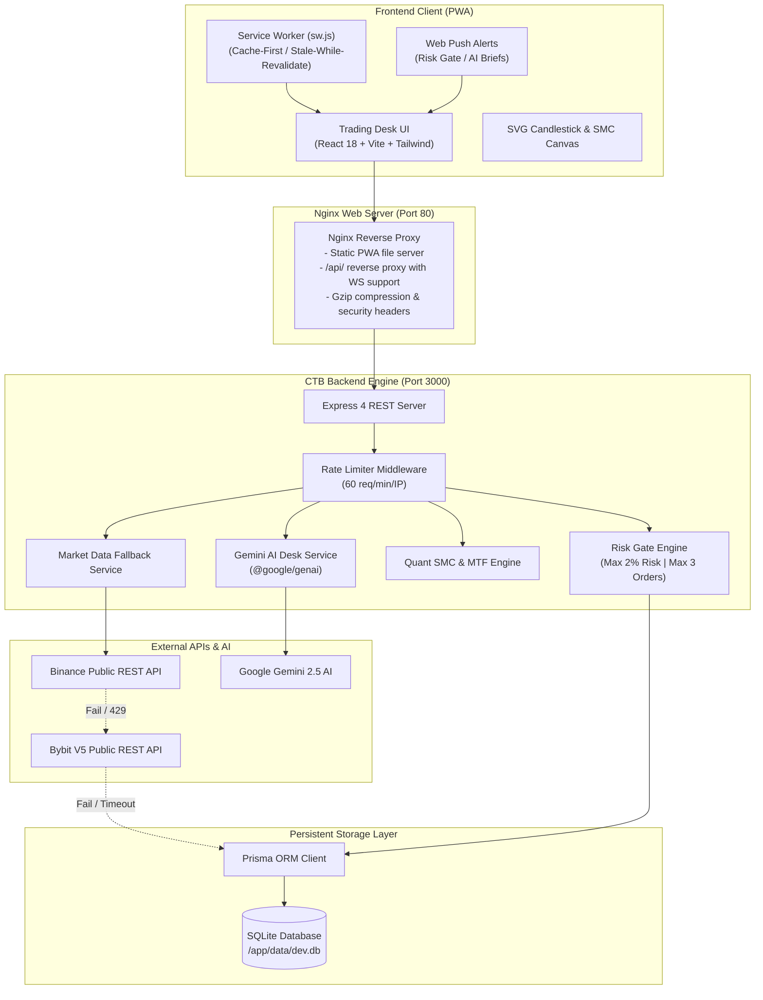

# ARCHITECTURE.md — System Architecture & Design

## 1. Executive Summary

**Crypto Brain Terminal (CTB)** is an institutional-grade quantitative paper trading, Smart Money Concepts (SMC) scanning, and desk intelligence platform for crypto markets. The architecture is engineered for deterministic execution, high resilience, multi-tier fallback redundancy, and strict capital risk preservation.

---

## 2. High-Level Architecture Diagram



---

## 3. Frontend Architecture (PWA & Terminal UI)

### 3.1 Stack & Framework
- **React 18.3 & TypeScript**: Component-driven UI with strong typing across market and trade schemas.
- **Vite 5**: Fast HMR during local development and optimized Rollup production bundling.
- **Tailwind CSS**: Custom dark terminal color palette tailored for Bloomberg/TradingView-style readability.

### 3.2 Key UI Components
- **`CandleChart.tsx`**: Custom SVG-based financial charting component rendering OHLCV candlesticks, volume bars, crosshair tracking, Fair Value Gap (FVG) highlight boxes, Order Block (OB) regions, and EMA trendlines.
- **`GeminiDeskCopilot.tsx`**: AI terminal widget delivering automated market briefs (Directional Bias, Support/Resistance zones, Invalidation points) and interactive quantitative Q&A.
- **`MTFPanel.tsx`**: Real-time Multi-Timeframe indicator telemetry (EMA-14 trend direction and Wilder's Smoothed RSI-14 momentum gauge).
- **`SMCScanPanel.tsx`**: Algorithmic scan results displaying active FVGs, Order Blocks, Swing Highs/Lows, and automated trade setup recommendations.
- **`PaperTradingPanel.tsx`**: Order placement terminal with automated risk calculation, stop-loss/take-profit configurators, and real-time open positions ledger.
- **`ToastContainer.tsx`**: Visual alert dispatcher for Risk Gate blocks and market events.

### 3.3 Progressive Web App (PWA) & Offline Shell
- **Service Worker (`sw.js`)**: Employs cache-first and stale-while-revalidate strategies for HTML, CSS, JavaScript, and SVG assets.
- **API Pass-Through**: All `/api/*` endpoints strictly bypass the service worker cache to ensure real-time telemetry accuracy.
- **Web Push Notifications (`notificationService.ts`)**: Dispatches instant browser notifications on Risk Gate rejections and newly generated AI Desk Briefs.

---

## 4. Reverse Proxy & Networking (Nginx)

The frontend container runs Nginx Alpine to serve static assets and proxy API requests:
- **Port Mapping**: Exposes port `80` to the host.
- **API Routing**: `location /api/` forwards directly to `http://backend:3000` with HTTP 1.1 keep-alive and WebSocket upgrade headers.
- **Asset Caching**: Immutable 1-year caching for `/assets/` and strict `no-cache` headers for `sw.js` and `manifest.json`.
- **SPA Fallback**: `try_files $uri $uri/ /index.html` facilitates client-side routing.
- **Gzip Compression**: Compresses text, JSON, CSS, JavaScript, and SVG payloads.

---

## 5. Backend API & Middleware Layer

The backend is built with Express on Node.js 20 LTS:

### 5.1 Middleware Pipeline
1. **CORS Middleware**: Allows cross-origin requests in development and containerized environments.
2. **JSON Parser**: Parses incoming request payloads up to standard body limits.
3. **Rate Limiting Middleware (`rateLimit.ts`)**: In-memory IP-based sliding window rate limiter (default: 60 req/min per IP) returning standard `RateLimit-*` headers and HTTP 429 responses.
4. **Risk Gate Middleware (`riskGate.ts`)**: Mandatory pre-trade validator enforcing risk thresholds before persisting orders.

### 5.2 Core API Endpoints
| Route | Method | Purpose |
|---|---|---|
| `/` | `GET` | API root status probe returning server metadata |
| `/health` | `GET` | Basic liveness probe returning `{ status: "ok" }` |
| `/api/readiness` | `GET` | Readiness probe returning `{ status: "ok", ready: true, timestamp }` |
| `/api/candles` | `GET` | Normalized OHLCV candlestick series with exchange fallback |
| `/api/mtf` | `GET` | Multi-Timeframe indicators (EMA, Wilder's Smoothed RSI) |
| `/api/scan` | `GET` | Algorithmic SMC scan for FVGs, Order Blocks, and Setups |
| `/api/paper/trade` | `POST` | Simulated order placement protected by Risk Gate |
| `/api/paper/positions` | `GET` | Open positions and trade execution ledger |
| `/api/desk/ai-brief` | `POST` | Automated structured Gemini market brief |
| `/api/desk/ask` | `POST` | Context-grounded quantitative Q&A |

---

## 6. Market Data Fallback Pipeline

High availability is guaranteed through a 4-tier fallback chain:

```
1. Binance Public REST (api.binance.com)
   ├── Success ─────────▶ Cache to SQLite ──▶ Return OHLCV
   └── Fail / 429 / Timeout
          │
2. Bybit V5 Public REST (api.bybit.com)
   ├── Success ─────────▶ Cache to SQLite ──▶ Return OHLCV
   └── Fail / 500 / Timeout
          │
3. SQLite Local Persistent Cache (candles_cache table)
   ├── Records Found ───▶ Return Cached Historical Data
   └── Cache Empty
          │
4. HTTP 502 Bad Gateway (Comprehensive error details returned)
```

---

## 7. Quantitative & Smart Money Concepts (SMC) Engine

The quant engine is implemented in pure TypeScript with zero external mathematical dependencies:
- **Exponential Moving Average (EMA)**: \(EMA_t = P_t \times \alpha + EMA_{t-1} \times (1 - \alpha)\) where \(\alpha = \frac{2}{N + 1}\).
- **Wilder's Smoothed RSI**: Uses Welles Wilder's smoothing technique for Average Gain and Average Loss over 14 periods.
- **Fair Value Gaps (FVG)**:
  - Bullish FVG: `Low(Candle[i]) > High(Candle[i-2])`
  - Bearish FVG: `High(Candle[i]) < Low(Candle[i-2])`
- **Order Blocks (OB)**:
  - Bullish OB: Last down-candle prior to a strong bullish breakout/expansion.
  - Bearish OB: Last up-candle prior to a strong bearish breakdown/expansion.
- **Break of Structure (BOS) & Swing Points**: Identifies local 5-bar pivot highs and lows to track market structure shifts.

---

## 8. Institutional Risk Gate & Paper Trading

The Risk Gate (`src/middleware/riskGate.ts`) protects simulated capital:
1. **Max Risk Per Trade**: Maximum dollar risk is capped at **2.0%** of total account equity ($2,000 max risk on a standard $100,000 account):
   \[ \text{Dollar Risk} = |\text{Entry Price} - \text{Stop Loss}| \times \text{Position Size} \]
2. **Max Open Positions**: Restricts simultaneous active trades to **3 positions** to prevent over-leverage and systemic correlation risk.
3. **Audit Trail**: Every approved trade is persisted in the SQLite database via Prisma ORM with precise timestamps, entry, SL, TP, and execution status.

---

## 9. Gemini AI Desk Intelligence

Leverages the Google Gemini SDK (`@google/genai`):
- **Structured Output**: Employs JSON schema extraction to deliver structured briefs containing Directional Bias (`BULLISH`, `BEARISH`, `NEUTRAL`), Key Levels (Support, Resistance, Invalidation), and Risk Assessments.
- **Market Action Grounding**: Queries to `/api/desk/ask` inject live OHLCV price action, MTF indicators, and SMC scan state directly into the prompt context to prevent hallucination.
- **Resilient Fallback**: Handles missing API keys or API rate limits gracefully with descriptive HTTP 503 responses without crashing the backend service.

---

## 10. Database & Data Persistence

- **Engine**: SQLite via Prisma ORM.
- **Container Path**: `/app/data/dev.db` mounted to persistent volume `ctb-sqlite-data`.
- **Key Models**:
  - `PaperTrade`: Stores trade ID, symbol, side (`BUY`/`SELL`), entry price, stop-loss, take-profit, position size, status (`OPEN`/`CLOSED`), and timestamps.
  - `RiskConfig`: Stores account equity, maximum risk percentage, and maximum open positions.
  - `CandlesCache`: Stores symbol, timeframe, timestamp, open, high, low, close, and volume for offline fallback.

---

## 11. Containerization & Docker Topology

- **Backend Container (`ctb-backend`)**: Built on `node:20-alpine`, runs as non-root `node` user, includes OpenSSL for Prisma engine compatibility, exposes port `3000`.
- **Frontend Container (`ctb-frontend`)**: Built on `node:20-alpine` (builder) and `nginx:alpine` (runner), exposes port `80`.
- **Network**: Shared bridge network `ctb-network` enabling internal DNS resolution (`http://backend:3000`).
- **Storage Volume**: Named volume `ctb-data` attached to `/app/data` to ensure persistence across container rebuilds.
