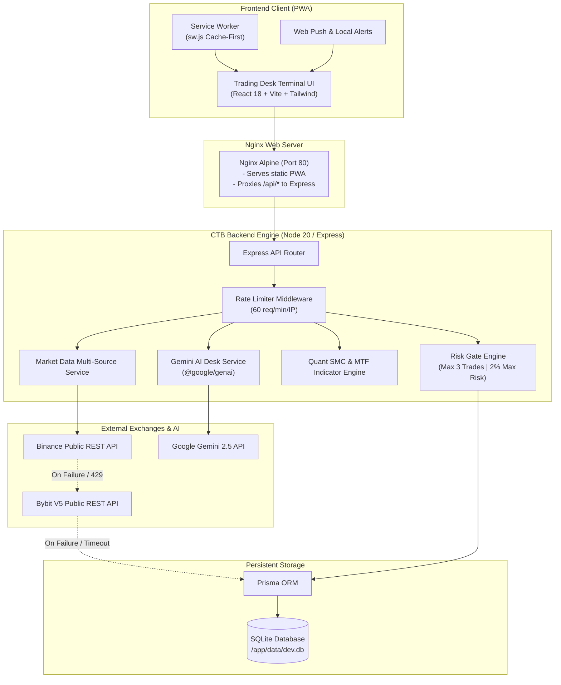

# Crypto Brain Terminal (CTB)

[](https://github.com/cloudshome/CTB/actions/workflows/ci.yml)


> **Crypto Brain Terminal (CTB)** is an institutional-grade quantitative research, paper trading, and market intelligence platform for digital assets. It integrates resilient multi-source market data pipelines, algorithmic Smart Money Concepts (SMC) scanning, automated risk gate controls, Gemini desk intelligence, and a dark quantitative Trading Desk PWA terminal.

---

## Table of Contents

- [Overview & Key Features](#overview--key-features)
- [System Architecture](#system-architecture)
- [Tech Stack](#tech-stack)
- [Market Data Fallback Pipeline](#market-data-fallback-pipeline)
- [Quick Start Guide](#quick-start-guide)
  - [Option A: Docker Compose (Recommended)](#option-a-docker-compose-recommended)
  - [Option B: Local Node.js Development](#option-b-local-nodejs-development)
- [Environment Variables](#environment-variables)
- [REST API Reference](#rest-api-reference)
- [Progressive Web App & Push Notifications](#progressive-web-app--push-notifications)
- [Testing & Code Quality](#testing--code-quality)
- [Project Directory Structure](#project-directory-structure)
- [License](#license)

---

## Overview & Key Features

```
+-----------------------------------------------------------------------------------------------+
| CTB QUANT TERMINAL | [Symbol: BTCUSDT v] [TF: 15m v] | Price: $77,350 (+2.4%) | Latency: 18ms |
+-------------------------------------------------------------+---------------------------------+
|                                                             | GEMINI DESK COPILOT             |
| CANDLESTICK CHART & SMC OVERLAYS                            | - Bias: [BULLISH]               |
| - Interactive OHLCV Candles                                 | - Exec Summary: "BTC expansion" |
| - Toggles: [x] FVG Zones  [x] Order Blocks  [x] Swings/BOS  | - Key Levels: Sup/Res/Inval     |
| - Volume Sub-panel                                          | - Risk Assessment               |
|                                                             | - Q&A Interactive Chat Box      |
+-------------------------------------------------------------+---------------------------------+
| MTF INDICATORS & CONFLUENCE                                 | PAPER TRADING DESK              |
| - EMA(14) Trend | RSI(14) Momentum Gauge | Setups Card      | - Order Entry (Buy/Sell, SL, TP)|
|                                                             | - Live Dollar Risk Calculator   |
|                                                             | - Active Open Positions Table   |
+-------------------------------------------------------------+---------------------------------+
```

- **Resilient Multi-Source Market Data Engine**:
  - High-performance OHLCV candlestick aggregation.
  - Multi-tier fallback chain: **Binance REST -> Bybit V5 Public REST -> SQLite Persistent Cache -> 502 Bad Gateway**.
  - Built-in rate limiting middleware protecting against traffic spikes.
- **Quantitative Smart Money Concepts (SMC) Scanner**:
  - Algorithmic detection of Fair Value Gaps (FVG) and institutional Order Blocks (OB).
  - Break of Structure (BOS), Swing High/Low pivots, and automated trade setup generation (Entry, Stop Loss, Take Profit).
- **Institutional Risk Gate & Simulated Paper Trading**:
  - Mandatory pre-execution Risk Gate validating position size, drawdown limits, and max open orders.
  - Rejects trades that exceed 2% account equity risk ($2,000 on a $100k account) or breach maximum open position limits (default: 3).
  - Persistent SQLite trade journal and positions ledger via Prisma ORM.
- **Gemini Desk Intelligence Copilot**:
  - Automated market briefs (`/api/desk/ai-brief`) extracting directional bias, support/resistance key levels, and risk summaries.
  - Interactive Q&A copilot (`/api/desk/ask`) grounded in live OHLCV price action, MTF indicators, and SMC scan state.
- **Trading Desk Terminal UI & Progressive Web App (PWA)**:
  - High-performance dark quantitative interface built with React 18, Vite, and Tailwind CSS.
  - Custom SVG candlestick chart with hover crosshair and toggleable SMC/EMA overlays.
  - Service Worker static asset caching for offline resilience.
  - Browser Web Push notifications for Risk Gate rejections and AI Brief releases.

---

## System Architecture



---

## Tech Stack

| Layer | Technologies | Purpose |
|---|---|---|
| **Backend** | Node.js 20, Express, TypeScript | REST API service, rate limiting, and business logic |
| **Database & ORM** | SQLite, Prisma ORM | Persistent storage for paper trades, risk configs, and candle cache |
| **Quant Engine** | Pure TypeScript Math | EMA, Wilder's Smoothed RSI, Swing Points, BOS, FVGs, Order Blocks |
| **AI / ML** | Google Gemini SDK (`@google/genai`) | Automated market briefs, contextual desk Q&A |
| **Frontend** | React 18, Vite, TypeScript, Tailwind CSS | Bloomberg/TradingView style dark terminal UI |
| **PWA & Offline** | Service Workers, Web Push API, Manifest | Offline asset loading and instant browser risk alerts |
| **Reverse Proxy** | Nginx Alpine | High-performance static serving, Gzip compression, and API proxying |
| **Containerization** | Docker, Docker Compose | Multi-stage container builds and volume persistence |
| **CI / CD** | GitHub Actions | Automated linting, test coverage, and build validation |

---

## Market Data Fallback Pipeline

The `/api/candles`, `/api/mtf`, and `/api/scan` routes utilize a multi-source fallback chain designed for 99.99% availability during exchange outages and rate limits:

```
[Request]
   │
   ├──▶ 1. Binance Public REST (api.binance.com)
   │        │
   │        ├── (Success) ──▶ Cache to SQLite ──▶ Return Normalized OHLCV
   │        └── (Fail / 429 / Timeout)
   │               │
   ├──▶ 2. Bybit V5 Public REST (api.bybit.com)
   │        │
   │        ├── (Success) ──▶ Cache to SQLite ──▶ Return Normalized OHLCV
   │        └── (Fail / 500 / Timeout)
   │               │
   ├──▶ 3. Local SQLite Cache (candles_cache table)
   │        │
   │        ├── (Records Found) ──▶ Return Cached Historical Data
   │        └── (Cache Empty)
   │               │
   └──▶ 4. 502 Bad Gateway ("Market data service unavailable across all providers")
```

---

## Quick Start Guide

### Option A: Docker Compose (Recommended)

Run the complete platform (Backend API + Nginx Frontend PWA + SQLite Volume) with a single command:

1. **Clone the repository**:
   ```bash
   git clone https://github.com/cloudshome/CTB.git
   cd CTB
   ```

2. **Configure Environment**:
   Create a `.env` file in the project root:
   ```env
   GEMINI_API_KEY=your_google_gemini_api_key_here
   ```

3. **Build & Start Containers**:
   ```bash
   docker compose up --build -d
   ```

4. **Access the Application**:
   - **Frontend Terminal & PWA**: [http://localhost](http://localhost) (Port 80)
   - **Direct Backend API**: [http://localhost:3000](http://localhost:3000) (Port 3000)

5. **Stop Containers**:
   ```bash
   docker compose down
   ```

---

### Option B: Local Node.js Development

1. **Install Dependencies**:
   ```bash
   # Install backend dependencies
   npm install

   # Install frontend dependencies
   npm run frontend:install
   ```

2. **Initialize SQLite Database**:
   ```bash
   npx prisma db push
   ```

3. **Configure `.env`**:
   ```env
   DATABASE_URL="file:./dev.db"
   PORT=3000
   GEMINI_API_KEY="your_google_gemini_api_key_here"
   ```

4. **Start Development Servers**:
   ```bash
   # Terminal 1: Start Backend Server (Port 3000)
   npm run dev

   # Terminal 2: Start Frontend Terminal (Port 5173)
   npm run frontend:dev
   ```

5. **Open Browser**:
   Navigate to [http://localhost:5173](http://localhost:5173).

---

## Environment Variables

| Variable | Required | Default | Description |
|---|---|---|---|
| `GEMINI_API_KEY` | **Yes** (for AI) | — | Google Gemini API key for automated briefs and Q&A |
| `DATABASE_URL` | No | `file:./dev.db` | Prisma SQLite database connection string |
| `PORT` | No | `3000` | Backend Express server port |
| `NODE_ENV` | No | `development` | Runtime environment (`development`, `production`, `test`) |
| `BINANCE_API_URL` | No | `https://api.binance.com` | Primary exchange REST base URL |
| `BYBIT_API_URL` | No | `https://api.bybit.com` | Secondary fallback exchange REST base URL |
| `RATE_LIMIT_WINDOW_MS`| No | `60000` (1 min) | Rate limiter window duration in milliseconds |
| `RATE_LIMIT_MAX` | No | `60` | Max allowable requests per IP within window |

---

## REST API Reference

### 1. `GET /api/candles`
Fetch normalized OHLCV candlestick series.
- **Query Params**:
  - `symbol`: e.g., `BTCUSDT`, `ETHUSDT` (Required)
  - `timeframe`: `5m`, `15m`, `1h`, `4h`, `1d` (Default: `15m`)
  - `limit`: `1` to `1000` (Default: `100`)
- **Response `200 OK`**:
  ```json
  {
    "symbol": "BTCUSDT",
    "timeframe": "15m",
    "source": "binance",
    "candles": [
      [1700000000000, 77150.0, 77300.0, 77100.0, 77250.0, 142.5],
      [1700000900000, 77250.0, 77480.0, 77220.0, 77450.0, 210.8]
    ]
  }
  ```

---

### 2. `GET /api/mtf`
Compute Multi-Timeframe indicators (EMA, Wilder's Smoothed RSI).
- **Query Params**:
  - `symbol`: e.g., `BTCUSDT`
  - `timeframe`: `15m`
  - `indicators`: `ema,rsi` (Comma-separated)
- **Response `200 OK`**:
  ```json
  {
    "symbol": "BTCUSDT",
    "timeframe": "15m",
    "indicators": {
      "ema": [{ "timestamp": 1700000900000, "value": 77280.45 }],
      "rsi": [{ "timestamp": 1700000900000, "value": 62.8 }]
    }
  }
  ```

---

### 3. `GET /api/scan`
Scan for Fair Value Gaps (FVGs), Order Blocks, Swing Points, and Setup Suggestions.
- **Query Params**:
  - `symbol`: `BTCUSDT`
  - `timeframe`: `15m`
  - `limit`: `100`
- **Response `200 OK`**:
  ```json
  {
    "symbol": "BTCUSDT",
    "timeframe": "15m",
    "fvg": [
      {
        "type": "BULLISH_FVG",
        "top": 77200.0,
        "bottom": 76950.0,
        "mitigated": false,
        "timestamp": 1700000900000
      }
    ],
    "order_blocks": [
      {
        "type": "BULLISH_OB",
        "high": 76800.0,
        "low": 76650.0,
        "mitigated": false,
        "timestamp": 1700000000000
      }
    ],
    "setup_suggestions": [
      {
        "type": "LONG",
        "entry": 77200.0,
        "stopLoss": 76600.0,
        "takeProfit": 78400.0,
        "rrRatio": 2.0,
        "confluence": ["BULLISH_FVG", "BULLISH_OB", "EMA_UPTREND"]
      }
    ]
  }
  ```

---

### 4. `POST /api/paper/trade`
Place a simulated order protected by the Risk Gate middleware.
- **Request Body**:
  ```json
  {
    "symbol": "BTCUSDT",
    "side": "BUY",
    "entryPrice": 77200.0,
    "sl": 76600.0,
    "tp": 78400.0,
    "size": 1.5
  }
  ```
- **Response `201 Created`**:
  ```json
  {
    "message": "Paper trade placed successfully",
    "trade": {
      "id": "clx...",
      "symbol": "BTCUSDT",
      "side": "BUY",
      "entryPrice": 77200.0,
      "sl": 76600.0,
      "tp": 78400.0,
      "status": "OPEN",
      "createdAt": "2026-08-24T16:00:00.000Z"
    }
  }
  ```
- **Error `403 Forbidden` (Risk Gate Rejection)**:
  ```json
  {
    "error": "Risk Gate Rejection: Trade risks $900.00 (2.50% of account), which exceeds the 2.00% maximum allowable risk per trade."
  }
  ```

---

### 5. `GET /api/paper/positions`
Retrieve all open and historical paper trading positions.
- **Response `200 OK`**:
  ```json
  {
    "positions": [
      {
        "id": "clx...",
        "symbol": "BTCUSDT",
        "side": "BUY",
        "entryPrice": 77200.0,
        "sl": 76600.0,
        "tp": 78400.0,
        "status": "OPEN"
      }
    ]
  }
  ```

---

### 6. `POST /api/desk/ai-brief`
Generate an automated Gemini AI desk brief.
- **Request Body**:
  ```json
  {
    "symbol": "BTCUSDT",
    "timeframe": "15m"
  }
  ```
- **Response `200 OK`**:
  ```json
  {
    "symbol": "BTCUSDT",
    "timeframe": "15m",
    "bias": "BULLISH",
    "executiveSummary": "BTCUSDT is expanding above the 15m EMA(14) with unmitigated bullish FVGs at $77,200.",
    "keyLevels": {
      "support": [77200.0, 76650.0],
      "resistance": [78400.0, 79000.0],
      "invalidation": 76600.0
    },
    "riskAssessment": "Favorable 2.0 R:R long opportunities with tight invalidation below $76,600."
  }
  ```

---

### 7. `POST /api/desk/ask`
Ask the Gemini Desk Copilot a quantitative question grounded in live market context.
- **Request Body**:
  ```json
  {
    "query": "What is the optimal entry given current RSI and Fair Value Gaps?",
    "context": {
      "symbol": "BTCUSDT",
      "lastPrice": 77350.0,
      "rsi": 62.8
    }
  }
  ```
- **Response `200 OK`**:
  ```json
  {
    "answer": "With RSI at 62.8 indicating bullish momentum without being overbought, optimal entry lies at the top of the Bullish FVG at $77,200."
  }
  ```

---

## Progressive Web App & Push Notifications

CTB is equipped as a full Progressive Web App:
1. **Desktop & Mobile Installation**: Meets all PWA criteria with manifest identity (`/manifest.json`) and neon app icons (`/icon.svg`).
2. **Offline Resilience**: Service Worker (`/sw.js`) intercepts UI requests with a stale-while-revalidate strategy while cleanly bypassing `/api/*` to maintain live telemetry accuracy.
3. **Web Push & Risk Alerts**:
   - **Risk Gate Violations**: Instant browser alert when orders exceed risk parameters.
   - **Gemini Desk Briefs**: Push notifications when new market briefs are synthesized.
   - **Header Toggle**: 1-click notification mute/unmute in the top navigation bar.

---

## Testing & Code Quality

CTB maintains a 100% automated test suite with full coverage across routes, mathematical primitives, fallback chains, and AI mocks:

```bash
# 1. Run full Jest test suite with coverage
npm test -- --coverage

# 2. Run ESLint code inspection
npm run lint

# 3. Compile backend TypeScript & frontend Vite PWA bundle
npm run build
```

---

## Project Directory Structure

```text
CTB/
├── .github/
│   └── workflows/
│       ├── ci.yml                             # GitHub Actions CI pipeline
│       └── jules-task.yml                     # Jules automated task runner
├── frontend/                                  # React 18 PWA Client
│   ├── public/
│   │   ├── icon.svg                           # Vector brand logo
│   │   ├── manifest.json                      # PWA web manifest
│   │   └── sw.js                              # Custom Service Worker
│   ├── src/
│   │   ├── components/
│   │   │   ├── CandleChart.tsx                # SVG Candlestick & SMC overlay renderer
│   │   │   ├── GeminiDeskCopilot.tsx          # AI Brief & Q&A terminal widget
│   │   │   ├── Header.tsx                     # Navigation, asset selector, PWA toggle
│   │   │   ├── MTFPanel.tsx                   # EMA & RSI momentum indicators
│   │   │   ├── PaperTradingPanel.tsx          # Order entry & open positions table
│   │   │   ├── SMCScanPanel.tsx               # Algorithmic FVG / OB setup cards
│   │   │   └── ToastContainer.tsx             # Risk & execution alert toasts
│   │   ├── services/
│   │   │   ├── api.ts                         # Centralized typed HTTP API service
│   │   │   └── notificationService.ts         # Web Push notification dispatcher
│   │   ├── utils/
│   │   │   └── registerServiceWorker.ts       # Service Worker registrar
│   │   ├── App.tsx                            # Root trading desk container
│   │   └── types.ts                           # TypeScript schema interfaces
│   ├── nginx.conf                             # Production Nginx reverse-proxy config
│   ├── package.json                           # Frontend dependencies
│   ├── tailwind.config.js                     # Dark terminal theme configuration
│   └── vite.config.ts                         # Vite build configuration & proxy
├── prisma/
│   └── schema.prisma                          # SQLite database schema (Trades, Risk, Cache)
├── src/                                       # Node.js Backend API
│   ├── db/
│   │   └── prisma.ts                          # Prisma database client instance
│   ├── middleware/
│   │   ├── rateLimit.ts                       # In-memory IP rate limiter (60 req/min)
│   │   └── riskGate.ts                        # Pre-trade risk calculation gate
│   ├── routes/
│   │   ├── candles.ts                         # GET /api/candles endpoint
│   │   ├── desk.ts                            # POST /api/desk/ai-brief & ask endpoints
│   │   ├── mtf.ts                             # GET /api/mtf endpoint
│   │   ├── paper.ts                           # POST /api/paper/trade & positions endpoints
│   │   └── scan.ts                            # GET /api/scan endpoint
│   ├── services/
│   │   ├── binanceService.ts                  # Binance public REST client
│   │   ├── bybitService.ts                    # Bybit V5 public REST client
│   │   ├── candlesCacheService.ts             # SQLite cache repository
│   │   ├── geminiService.ts                   # Google Gemini AI intelligence service
│   │   └── marketDataService.ts               # Multi-source fallback orchestrator
│   ├── utils/
│   │   ├── indicators.ts                      # Pure math for EMA and Wilder's RSI
│   │   ├── quantEngine.ts                     # SMC detection algorithms (FVG, OB, BOS)
│   │   └── validation.ts                      # Input validation schemas
│   └── server.ts                              # Express app bootstrap & route mount
├── tests/                                     # Automated Jest Test Suites (59 tests)
│   ├── candles.test.ts
│   ├── desk.test.ts
│   ├── indicators.test.ts
│   ├── mtf.test.ts
│   ├── paper.test.ts
│   └── scan.test.ts
├── .dockerignore                              # Docker build exclusions
├── docker-compose.yml                         # Multi-container orchestration
├── Dockerfile.backend                         # Multi-stage Node Alpine backend build
├── Dockerfile.frontend                        # Multi-stage Vite -> Nginx build
├── package.json                               # Root package scripts
├── tsconfig.json                              # TypeScript backend compiler options
└── README.md                                  # Canonical project documentation
```

---

## License

This project is licensed under the [MIT License](LICENSE).
