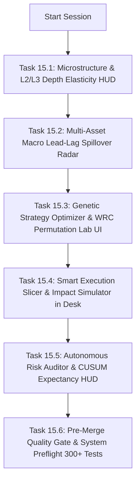

# SKY — Next Session Execution Plan & Institutional Roadmap

> **Document Version:** 2.0.0 (Frontier Systems Handoff)  
> **Date:** 2026-09-01  
> **Release Baseline:** `v3.1.0-frontier-systems-ready` (Active Baseline 🚀)  
> **Test Suite Health:** 289 / 289 passing (100% GREEN) — 191 Pytest, 98 Jest  
> **Preflight Quality Gates:** ALL 4 QUALITY GATES PASSED (100% GREEN)  
> **Governance Architecture:** 3-Tier Hierarchy (`AGENTS.md` + `.specify/memory/constitution.md` + `docs/QUANT_RESEARCH_PROTOCOL.md`)  

---

## 1. Executive Summary

This document establishes the formal engineering and quantitative roadmap for **Phase 15: Visual Frontier HUDs & Autonomous Live Sandbox Dashboard**.

All Phase 14 backend engines (Microstructure, Macro Network, Genetic Optimizer, Smart Execution, and Autonomous Auditor) are fully implemented, equipped with API key guards in `app.py`, typed in `frontend/src/services/api.ts`, and verified with 100% green test suites.

The upcoming session focuses on **institutional visualization, realtime interactive terminal integration, and autonomous paper burn-in controls**.

---

## 2. Phase 15 Sprint Breakdown: Visual Frontier Terminal



### Task 15.1: Microstructure & L2/L3 Depth Elasticity Visualizer
* **Target File:** `frontend/src/components/MicrostructurePanel.tsx`
* **Specification:**
  - Connect to `/api/microstructure/analytics` and `/api/microstructure/toxicity`.
  - Render dynamic depth tier imbalance bars ($L_1, L_5, L_{10}, L_{20}, L_{50}$).
  - Display Slope Elasticity gauge ($\frac{\Delta Q}{\Delta P}$ Bid vs Ask stiffness).
  - Real-time VPIN toxicity meter, Kyle's Lambda impact score, and Iceberg footprint alerts.
* **Acceptance Criteria:**
  - Zero-Shake UI: updates incrementally without re-rendering parent layouts.

### Task 15.2: Multi-Asset Macro Cross-Correlation & Lead-Lag Spillover Radar
* **Target File:** `frontend/src/components/MacroNetworkRadar.tsx`
* **Specification:**
  - Connect to `/api/macro/network` and `/api/macro/spillover`.
  - Render interactive $N \times N$ correlation heatmap across Core Crypto (BTC, ETH, SOL), Macro Gold (PAXG), and Yield proxies.
  - Display PCA Systemic Absorption Ratio gauge ($> 75\%$ Risk-Off Contagion alert).
  - Render directional Lead-Lag Granger Causality network arrows indicating information flow.

### Task 15.3: Genetic Strategy Optimizer & WRC Permutation Lab UI
* **Target File:** `frontend/src/components/GeneticStrategyLab.tsx`
* **Specification:**
  - Connect to `/api/strategy/optimize/genetic` and `/api/strategy/optimize/results`.
  - Interactive parameter evolution controls (population size, generation counter, mutation rate).
  - Real-time fitness convergence charts (Best vs Average fitness per generation).
  - Out-of-Sample Deflated Sharpe Ratio (DSR) & White's Reality Check bootstrap $p$-value cards.

### Task 15.4: Smart Order Routing (SOR) & Almgren-Chriss Slicer in Order Desk
* **Target File:** `frontend/src/components/RiskFirstOrderDesk.tsx`
* **Specification:**
  - Integrate `/api/execution/slice` and `/api/execution/simulate_impact`.
  - Add Execution Algorithm selector (`PASSIVE_LIMIT`, `TWAP`, `VWAP`, `ALMGREN_CHRISS`, `IOC_SWEEP`).
  - Render interactive child order schedule timeline and non-linear market impact preview.

### Task 15.5: 24/7 Autonomous Risk Auditor & CUSUM Expectancy Drift HUD
* **Target File:** `frontend/src/components/AutonomousAuditorHUD.tsx`
* **Specification:**
  - Connect to `/api/auditor/telemetry` and `/api/auditor/drift`.
  - Display real-time telemetry metrics: fill latency, slippage distribution, peak drawdown.
  - Regime-conditional expectancy breakdown card ($E[R \mid \text{Regime}]$ vs historical baseline).
  - Live forensic loss autopsy feed and Strategy Quarantine circuit status indicator.

---

## 3. Resume Commands for Next Session

```bash
# 1. Inspect repository state & baseline
git status
git log -n 3 --oneline

# 2. Run test suites to verify 100% green baseline (289 passing tests)
.venv\Scripts\pytest
npm test

# 3. Execute System Preflight Verification
python scripts/system_preflight.py

# 4. Start local development servers
# Terminal 1: Python FastAPI (:8000)
.venv\Scripts\uvicorn app:app --host 0.0.0.0 --port 8000

# Terminal 2: Node.js Express (:3000)
npm run dev

# Terminal 3: React Vite Terminal (:5173)
npm --prefix frontend run dev
```

---

## 4. Quality Gate Checklist (Pre-Session Target)
- [x] 289 / 289 tests green (191 Pytest, 98 Jest).
- [x] 3-Tier Governance Architecture locked (`AGENTS.md`, `constitution.md`, `QUANT_RESEARCH_PROTOCOL.md`).
- [x] 5 Institutional Frontier engines active and verified.
- [ ] Phase 15 Visual Frontier HUDs built and integrated into `localhost:5173`.
- [ ] Preflight verification suite passing with 300+ total tests.
