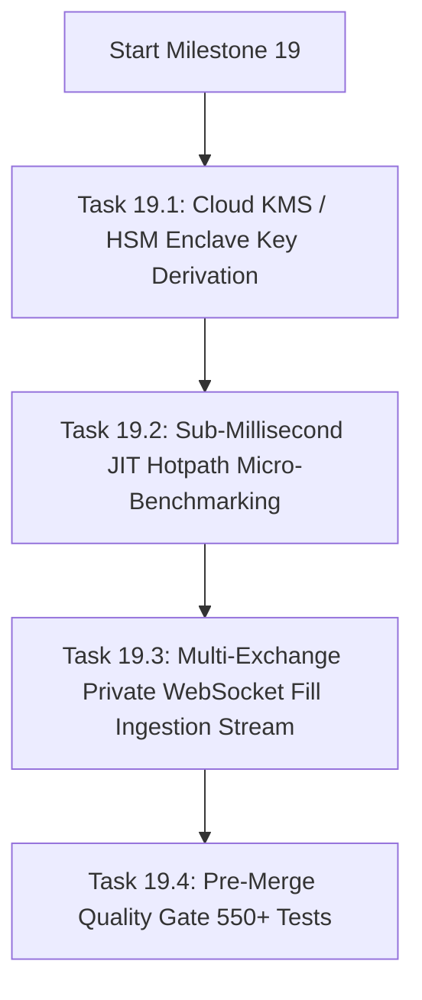

# SKY — Next Session Execution Plan & Institutional Roadmap

> **Document Version:** 3.8.0 (Multi-Venue Smart Execution & Slicing Handoff)  
> **Date:** 2026-09-08  
> **Release Baseline:** `v3.8.0-smart-order-router` (Active Baseline 🚀)  
> **Test Suite Health:** 520 / 520 passing (100% GREEN) — 394 Pytest, 126 Jest  
> **Preflight Quality Gates:** ALL 4 QUALITY GATES PASSED (100% GREEN)  
> **Governance Architecture:** 3-Tier Hierarchy (`AGENTS.md` + `.specify/memory/constitution.md` + `docs/QUANT_RESEARCH_PROTOCOL.md`)  

---

## 1. Executive Summary

Milestone 18 has established multi-venue optimal execution algorithms and forensic execution audit telemetry on top of the Milestone 17 live boundary:
- **Multi-Venue Smart Order Router (SOR):** Ingests real-time L2 order book depth ladders across Binance Spot and Bybit V5, walks depth schedules to evaluate volume depletion and price impact, and optimizes leg allocations under VIP fee tiers (maker/taker bps arbitrage).
- **Almgren-Chriss (2000) Optimal Trajectory Slicer:** Discrete optimal execution trajectory balancing nonlinear price impact against inventory volatility risk ($x_j$ remaining shares and $n_j$ child orders), supporting linear TWAP ($\lambda = 0$) and risk-averse hyperbolic schedules ($\lambda > 0$).
- **Forensic Reconciliation Ledger:** Durable SQLite WAL ledger auditing expected vs realized fill price, fee attribution, and latency decomposition (transit, ack, round-trip) with anomaly alert dispatch to the system `audit_bus`.
- **Live Terminal UI Controls:** RiskFirstOrderDesk equipped with a Live Execution Mode toggle behind the master kill switch, dynamic clock-drift SLA badge, live SOR split preview, Almgren-Chriss schedule trajectory visualizer, and dual-confirmation modal enforcing the constitutional 1.5% single-trade equity cap.

The upcoming pipeline focuses on **Milestone 19: Hardware Security Module (HSM) / KMS Key Enclave, Sub-Millisecond Benchmarking, and WebSocket Fill Ingestion**.

---

## 2. Milestone 19 Sprint Breakdown: HSM Enclave & High-Frequency Stream Ingestion



### Task 19.1: Cloud KMS / HSM Envelope Key Derivation
* **Target File:** `core/execution/kms_enclave.py`
* **Specification:**
  - Pluggable envelope encryption adapter supporting AWS KMS and GCP Cloud KMS for credential vault master key derivation.
  - Ephemeral in-memory key shredding with explicit memory zeroization upon process termination or kill-switch activation.
  - Fail-closed local fallback for air-gapped test sandboxes.

### Task 19.2: Sub-Millisecond Order Router Micro-Benchmarking & Hotpath Optimization
* **Target File:** `scripts/benchmarks/benchmark_order_router.py`
* **Specification:**
  - Micro-benchmark depth ladder walking and trajectory generation under high-frequency market tick throughput ($> 10,000$ ticks/sec).
  - Profile allocations and latency distributions targeting $< 250\mu\text{s}$ decision cycle.
  - Ensure zero allocations on rejection hotpaths.

### Task 19.3: Multi-Exchange Private WebSocket Fill Ingestion Stream
* **Target File:** `core/execution/ws_fill_stream.py`
* **Specification:**
  - Continuous persistent WebSocket connections to Binance and Bybit private execution channels.
  - Real-time order update and execution report parsing with automatic push to `reconciliation_ledger`.
  - Zero polling delay for instant fill confirmation and slippage calculation.

### Task 19.4: Pre-Merge Quality Gate Expansion
* **Target File:** `tests/test_kms_and_ws_fills.py`, `scripts/system_preflight.py`
* **Specification:**
  - Expand test suite to target 550+ tests passing 100% green.
  - Full preflight verification across all 4 gates (DB integrity, Pytest, Jest, Frontend Vite build).

---

## 3. Resume Commands for Next Session

```bash
# 1. Inspect repository state & baseline
git status
git log -n 3 --oneline
git tag --list

# 2. Run test suites to verify 100% green baseline (520 passing tests)
.venv\Scripts\pytest
npm test

# 3. Execute System Preflight Verification (4/4 gates green)
.venv\Scripts\python.exe scripts/system_preflight.py

# 4. Start local development servers (3 terminals)
# Terminal 1: Python FastAPI (:8000)
.venv\Scripts\uvicorn app:app --host 0.0.0.0 --port 8000

# Terminal 2: Node.js Express (:3000)
npm run dev

# Terminal 3: React Vite Terminal (:5173)
npm --prefix frontend run dev
```

---

## 4. Quality Gate Checklist
- [x] 520 / 520 tests green (394 Pytest, 126 Jest).
- [x] Milestone 18 Smart Order Routing, Almgren-Chriss Slicing, and Reconciliation Ledger PASSED.
- [x] Tag `v3.8.0-smart-order-router` ready for release.
- [x] 3-Tier Governance Architecture locked (`AGENTS.md`, `constitution.md`, `QUANT_RESEARCH_PROTOCOL.md`).
- [ ] Milestone 19 KMS Enclave & Private WebSocket Fill Stream implemented.
- [ ] Preflight verification suite passing with 550+ total tests.

