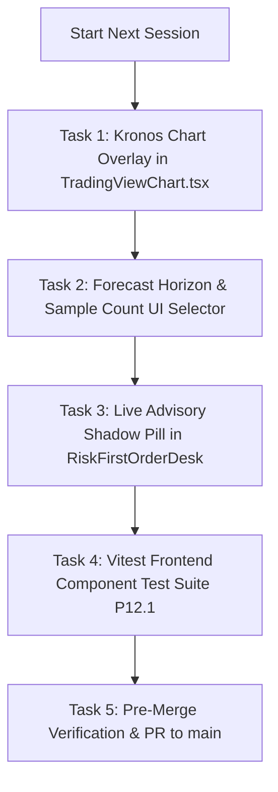

# SKY — Next Session Execution Plan & Spec Kit Handoff

> **Document Version:** 1.0.0 (Handoff Specification)  
> **Date:** 2026-08-31  
> **Current Release:** `v2.8.1-speckit-governance-active`  
> **Test Health:** 255 / 255 passing (100%) — 164 Pytest, 91 Jest  
> **Branch:** `feature/institutional-quant-platform-and-chart-tools`  
> **Governance Standard:** GitHub Spec Kit (Spec First — Evidence First — Code Second)  

---

## 1. Executive Summary

This document establishes the formal engineering and quantitative research plan for the **next development session**. All previous core roadmap milestones (Priority 1 through 13) and Phase K backend milestones (K0 through K7) have been completed, verified with unit/integration tests, and pushed to GitHub.

The next session focuses on **Sprint K-UI & Telemetry**:
1. **Feature 1: Kronos Forecast Path & Trajectory Cone Visual Overlay on TradingView Chart UI (`localhost:5173`)**
2. **Feature 2: Shadow Paper Trading Live Telemetry & Counterfactual Auto-Verification**
3. **Feature 3: Frontend Component Test Suite with Vitest & React Testing Library (Priority 12.1)**

---

## 2. Next Session Task Breakdown (Tasks.md)



### Task 1: Kronos Neural Forecast Overlay on Chart
* **Target File:** `frontend/src/components/TradingViewChart.tsx`
* **Specification:**
  - Add a `"KRONOS"` forecast toggle button to the chart header toolbar alongside `EMA`, `VWAP`, `SMC`, and `JUDAS`.
  - When active, call `api.getKronosForecast()` for the active symbol and timeframe.
  - Render the median trajectory path ($\text{median}$) as a distinct indigo dashed line series on Lightweight Charts v4.
  - Render upper $p_{90}$ and lower $p_{10}$ envelope bands (forecast cone) showing probabilistic dispersion.
  - Display an inline badge with Directional Bias (`BULLISH` / `BEARISH` / `NEUTRAL`), Expected Return %, and Consensus %.
* **Acceptance Criteria:**
  - Preserves Zero-Shake UI Stability principle: chart instance is never destroyed or remounted.
  - Toggling Kronos does not reset user viewport zoom or pan state.

### Task 2: Live Advisory Shadow Pill in Order Desk
* **Target File:** `frontend/src/components/RiskFirstOrderDesk.tsx`
* **Specification:**
  - Fetch `api.getKronosAdvisory()` for the current setup.
  - Display an advisory banner/pill:
    - 🟢 `CONFIRM_TRADE` (with sizing multiplier $1.15\times$)
    - 🟡 `DIVERGENCE_CAUTION` (warning of counter-trend neural path, sizing $0.50\times$)
    - ⚪ `NEUTRAL` (standard SKY risk)
* **Acceptance Criteria:**
  - Strictly advisory; does not bypass the deterministic `RiskGate` or `PsychologyShield`.

### Task 3: Frontend Component Test Suite (Priority 12.1)
* **Target Files:** `frontend/package.json`, `frontend/src/components/__tests__/`
* **Specification:**
  - Install `vitest`, `@testing-library/react`, and `jsdom`.
  - Write unit tests for:
    - `TradingViewChart.test.tsx` (overlay toggles, bar rendering)
    - `RiskFirstOrderDesk.test.tsx` (sizing math, advisory pill)
    - `PaperTradingPanel.test.tsx` (reconciliation trigger, PnL format)
* **Acceptance Criteria:**
  - `npm run test` executes in frontend with 100% passing tests.

---

## 3. Step-by-Step Commands to Resume in Next Session

### 1. Verify Environment & Services
```bash
# Check git status and latest commit
git status
git log -n 3 --oneline

# Run full backend test suite to verify baseline
.venv\Scripts\pytest
npm test
```

### 2. Start Dev Stack (if not already running)
```bash
# Terminal 1: Python Quant Engine (:8000)
.venv\Scripts\uvicorn app:app --host 0.0.0.0 --port 8000

# Terminal 2: Node.js Market Desk (:3000)
npm run dev

# Terminal 3: Vite React Terminal (:5173)
npm --prefix frontend run dev
```

---

## 4. Research Quality Gate Verification
- [x] All 255 Pytest and Jest test cases passing (100%).
- [x] Zero lookahead bias verified across all 8 pillar and Kronos engines.
- [x] Spec Kit governance protocol formalized in `AGENTS.md`.
- [x] All commits pushed to GitHub tracking branch `origin/feature/institutional-quant-platform-and-chart-tools`.
