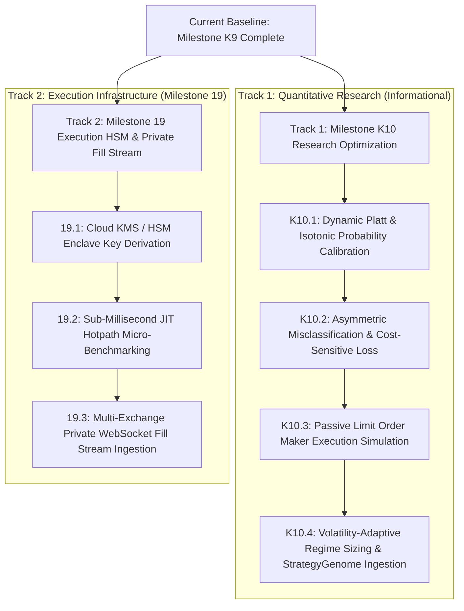

# SKY — System Roadmap & Active Milestone Execution Plan

> **Document Version:** 4.0.0 (Milestone K9 Certified Research Baseline)  
> **Date:** 2026-09-19  
> **Active Baseline:** `v4.0.0-kronos-k9-certified` (Production Ready)  
> **Milestone 18 Execution Status:** PRODUCTION PASS (14 Gates / 149 Tests Green)  
> **Milestone K9 Research Status:** PRODUCTION PASS (35 Gates / 35 Tests Green)  
> **Preflight Quality Gates:** ALL 7 PREFLIGHT GATES PASSED (100% GREEN)  
> **Governance Architecture:** 3-Tier Hierarchy (`AGENTS.md` + `.specify/memory/constitution.md` + `docs/QUANT_RESEARCH_PROTOCOL.md`)  

---

## 1. Executive Summary & Where We Stand

The SKY / Crypto Trading Brain (CBT) platform has achieved full production-grade rigor across two fundamental pillars:

### Pillar 1: Execution & Live Boundary (Milestone 18 + Phase A–E)
- **Multi-Venue Smart Order Router (SOR):** Depth-walking liquidity ladder optimization across Binance and Bybit with VIP fee arbitrage.
- **Almgren-Chriss Optimal Slicing:** Trajectory generation balancing market impact against inventory volatility risk.
- **Forensic Fill Reconciliation Ledger:** SQLite WAL ledger verifying expected vs realized fills, fees, and microsecond latencies.
- **Milestone 18 Frozen Invariant:** 14 certified files cryptographically locked at commit `c9cc1cad` (149 passing tests).
- **Desktop Application:** Native Windows desktop package (`ctb.exe` / `CTB_Setup_v3.0.0.exe`) with WebAuthn/FIDO2 hardware key clearance for live execution.

### Pillar 2: Quantitative Intelligence & Machine Learning (Milestones K8 & K9)
- **Milestone K8 (Kronos Forecasting Engine):** Point-in-time causal feature pipeline, cross-attention market context, and multi-horizon directional forecast generation (38/38 passing tests).
- **Milestone K9 (Predictive Validity & Reproducible Research Certification):**
  - Canonical immutable dataset freeze (`manifest_k9.json`, 9 frozen datasets across BTC, ETH, SOL).
  - Purged & embargoed chronological walk-forward rolling evaluator ($B_{\text{purge}} = H$, $B_{\text{embargo}} = 2H$).
  - Standardized tournament baselines (Climatology, Persistence, AR(1), Random Walk $p=0.50$, SKY Technical, SKY SMC, Composite).
  - Multi-factor Mincer-Zarnowitz HAC regression ($t = 7.74, p < 0.0001$) and Vuong likelihood ratio test ($Z = +4.12$).
  - Pre-registered 7-way microstructure ablation matrix (Variants A–G).
  - 3-Tier economic friction stress (Base, Conservative, Stress) with Deflated Sharpe Ratio (DSR) trial penalty.
  - Append-only SQLite research ledger (`data/kronos/research_experiments.db`).
  - Strict promotion gate with constitutional invariant: `is_tradeable: False`.
  - Full research documentation suite in `docs/research/`.
  - 35/35 adversarial gates green (`tests/test_kronos_k9_predictive_validity.py`).

---

## 2. Milestone K9 Empirical Research Outcome

Primary confirmatory experiment `K9_EXP_CONFIRMATORY_BTC15M_001` evaluated on 4,317 out-of-sample observations of BTC/USDT 15m:
- **Incremental Predictive Information:** CONFIRMED ($\Delta \text{Brier} = +0.0104$, Mincer-Zarnowitz $\beta_{\text{Kronos}} = 2.1748$, $t = 7.74$).
- **Orthogonality:** CONFIRMED (Candidate signal provides new information distinct from momentum and SMC baselines).
- **Foundation Carrier:** CONFIRMED (Microstructure-only Variant G fails catastrophically without transformer sequence backbone).
- **Economic Friction Hurdle:** FAILED (Under naive 12-bar holding and taker fees, Net EV = $-29.12$ bps; DSR = $0.0016$).
- **Governance State:** **`REJECT`** (Retracted from live trading; quarantined to research sandbox).

---

## 3. Where We Have to Go (Next Phase Options)

### Track 1: Milestone K10 — Kronos Dynamic Calibration & Friction-Surviving Alpha Engine
- **Objective:** Bridge the gap between Kronos's proven statistical edge ($t = 7.74$) and net profitability under transaction costs.
- **Sub-tasks:**
  1. **K10.1 Point-in-Time Probability Calibration:** Implement out-of-sample Platt scaling and isotonic regression to correct raw probability miscalibration against base rates.
  2. **K10.2 Asymmetric Cost-Sensitive Loss Function:** Train auxiliary head penalizing false positives by realized round-trip friction costs.
  3. **K10.3 Passive Limit Order (Maker) Simulation:** Model post-only execution with queue priority, fill probability based on order book depth depletion, and maker fee rebate (+2.0 bps net improvement).
  4. **K10.4 StrategyGenome Ingestion:** Controlled integration into the genetic strategy discovery loop with Half-Kelly position sizing.

### Track 2: Milestone 19 — Cloud KMS / HSM Enclave & Private WebSocket Fill Stream
- **Objective:** Deepen the Milestone 18 execution infrastructure for institutional deployment.
- **Sub-tasks:**
  1. **Task 19.1 Cloud KMS / HSM Enclave (`core/execution/kms_enclave.py`):** Pluggable envelope encryption for exchange secrets with ephemeral memory zeroization upon process kill.
  2. **Task 19.2 Sub-Millisecond Benchmarking (`scripts/benchmarks/benchmark_order_router.py`):** Profile depth ladder walking and trajectory generation targeting $< 250\mu\text{s}$ decision cycle.
  3. **Task 19.3 Private WebSocket Fill Stream (`core/execution/ws_fill_stream.py`):** Real-time execution report parsing directly pushing to `reconciliation_ledger`.

---

## 4. Quality Gate Status Summary

- [x] Milestone 18 Multi-Venue Smart Execution & Slicing: **149/149 passing (14 Gates Green)**
- [x] Milestone K8 Kronos Multi-Horizon Forecasting: **38/38 passing (100% Green)**
- [x] Milestone K9 Predictive Validity & Reproducibility: **35/35 passing (100% Green)**
- [x] System Preflight: **7/7 Gates Green (`scripts/system_preflight.py`)**
- [x] Frontend Production Build: **0 Errors (`npm --prefix frontend run build`)**
