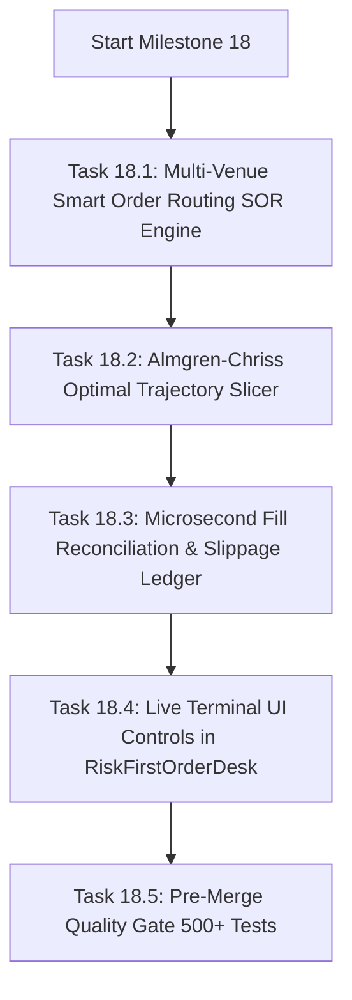

# SKY — Next Session Execution Plan & Institutional Roadmap

> **Document Version:** 3.7.0 (Live Execution & Private API Vault Handoff)  
> **Date:** 2026-09-07  
> **Release Baseline:** `v3.7.0-live-execution-vault` (Active Baseline 🚀)  
> **Test Suite Health:** 493 / 493 passing (100% GREEN) — 367 Pytest, 126 Jest  
> **Preflight Quality Gates:** ALL 4 QUALITY GATES PASSED (100% GREEN)  
> **Governance Architecture:** 3-Tier Hierarchy (`AGENTS.md` + `.specify/memory/constitution.md` + `docs/QUANT_RESEARCH_PROTOCOL.md`)  

---

## 1. Executive Summary

Milestones 16, 17, and 17.1 have established institutional-grade paper shadow burn-in telemetry and a fully authenticated live exchange execution boundary:
- **Private API Credential Vault:** AES-256-GCM authenticated encryption with PBKDF2 key derivation and zero-leakage secret masking.
- **Fail-Closed Live Router:** 20 pre-trade validation gates enforcing strict invariants before network packet transmission (kill switch, constitutional 1.5% single-trade loss limit, $\le 1000$ms dynamic clock drift SLA, and atomic idempotency reservation).
- **Adversarial Security Audit:** 100% green verification across 493 tests, with zero network leakages on rejections.

The upcoming pipeline focuses on **Milestone 18: Multi-Venue Smart Execution, Almgren-Chriss Slicing, and Microsecond Fill Reconciliation**.

---

## 2. Milestone 18 Sprint Breakdown: Multi-Venue Smart Execution



### Task 18.1: Multi-Venue Smart Order Routing (SOR) Engine
* **Target File:** `core/execution/smart_order_router.py`
* **Specification:**
  - Ingest real-time L2 order book depth from Binance Spot and Bybit V5.
  - Dynamically split parent orders across venues to minimize weighted average execution cost.
  - Account for VIP exchange maker/taker fee tiers and venue liquidity depth.

### Task 18.2: Almgren-Chriss Optimal Execution Schedule Engine
* **Target File:** `core/execution/almgren_chriss.py`
* **Specification:**
  - Implement the classical Almgren-Chriss discrete execution model balancing risk aversion vs market impact.
  - Generate discrete child-order trading trajectories ($n$ slices over time horizon $T$).
  - Calculate instantaneous non-linear price impact $I = Y \cdot \sigma \cdot \sqrt{\frac{V}{\text{ADV}}}$.

### Task 18.3: Sub-Millisecond Fill Reconciliation & Slippage Ledger
* **Target File:** `core/execution/reconciliation_ledger.py`
* **Specification:**
  - Record expected vs realized fill prices, exchange fees, and venue roundtrip latencies.
  - Persist records in SQLite WAL `reconciliation_ledger.db`.
  - Expose forensic reconciliation endpoint `GET /api/execution/reconciliation/report`.

### Task 18.4: Production Live-Order Terminal UI Controls
* **Target File:** `frontend/src/components/RiskFirstOrderDesk.tsx`
* **Specification:**
  - Add explicit "LIVE EXECUTION" toggle behind master kill switch guard.
  - Render dual-confirmation authorization modal displaying exact stop-loss distance, dollar risk, and 1.5% equity cap check.
  - Live status indicator displaying vault connection state and clock drift SLA.

### Task 18.5: Pre-Merge Quality Gate Expansion
* **Target File:** `tests/test_smart_order_router.py`, `scripts/system_preflight.py`
* **Specification:**
  - Expand test suite to target 500+ tests passing 100% green.
  - Validate zero-network behavior on all rejection paths.

---

## 3. Resume Commands for Next Session

```bash
# 1. Inspect repository state & baseline
git status
git log -n 3 --oneline
git tag --list

# 2. Run test suites to verify 100% green baseline (493 passing tests)
.venv\Scripts\pytest
npm test

# 3. Execute System Preflight Verification (4/4 gates green)
.venv\Scripts\python.exe scripts/system_preflight.py

# 4. Start local development servers (3 terminals)
# Terminal 1: Python FastAPI (:8000)
.venv\Scripts\uvicorn app:app --host 0.0.0.0 --port 8000

# Terminal 2: Node.js Express (:3000)
npm run dev

# Terminal 3: React Vite Terminal (:5173)
npm --prefix frontend run dev
```

---

## 4. Quality Gate Checklist (Pre-Session Target)
- [x] 493 / 493 tests green (367 Pytest, 126 Jest).
- [x] Milestone 17.1 Class H Remediation & Adversarial Re-Audit PASSED.
- [x] Tag `v3.7.0-live-execution-vault` minted and verified.
- [x] 3-Tier Governance Architecture locked (`AGENTS.md`, `constitution.md`, `QUANT_RESEARCH_PROTOCOL.md`).
- [ ] Milestone 18 Smart Order Routing & Execution Slicing implemented.
- [ ] Preflight verification suite passing with 500+ total tests.

