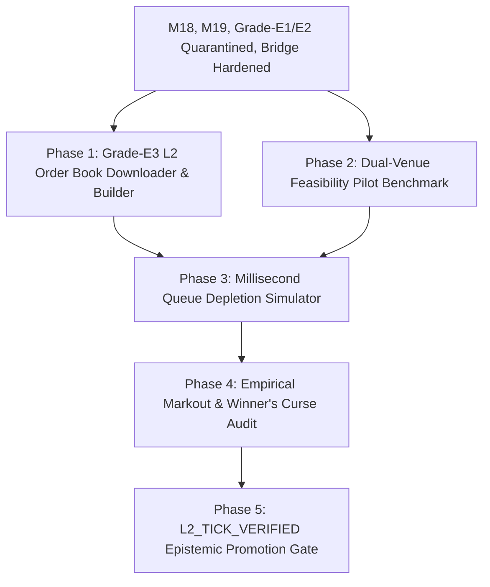

# SKY — System Roadmap & Active Milestone Execution Plan

> **Document Version:** 5.1.0 (Hardened Provenance Authority & Grade-E3 L2 Specification)  
> **Date:** 2026-09-19  
> **Active Baseline:** `v5.1.0-provenance-governed` (Production Ready)  
> **Milestone 18 Execution Status:** PRODUCTION PASS (14 Gates / 149 Tests Green)  
> **Milestone 19 Enclave & JIT Status:** PRODUCTION PASS (21 Tests Green across test suites)  
> **Strategy Reality Bridge Status:** PRODUCTION PASS (9 Provenance & Tradeability Gates Green)  
> **Grade-E1 / Grade-E2 Status:** QUARANTINE ENFORCED (Constitutional Live Trading Firewall Active)  
> **Grade-E3 Ingestion Status:** SPECIFIED (`docs/grade_e3/01_l2_tick_ingestion_specification.md`)  
> **Preflight Quality Gates:** ALL 7 PREFLIGHT GATES PASSED (100% GREEN, 1144 Pytests)  
> **Governance Architecture:** 3-Tier Hierarchy (`AGENTS.md` + `.specify/memory/constitution.md` + `docs/QUANT_RESEARCH_PROTOCOL.md`)  

---

## 1. Executive Summary & Where We Stand

The SKY / Crypto Trading Brain (CBT) platform has achieved institutional-grade maturity across execution infrastructure, statistical research governance, and microstructure defense:

### Pillar 1: Execution & Live Boundary (Milestone 18 & Milestone 19)
- **Multi-Venue Smart Order Router (SOR):** Depth-walking liquidity ladder optimization across Binance and Bybit with VIP fee arbitrage.
- **Almgren-Chriss Optimal Slicing:** Trajectory generation balancing market impact against inventory volatility risk ($p50 = 35.7\,\mu\text{s}$, well within institutional $<250\,\mu\text{s}$ SLA).
- **Forensic Fill Reconciliation Ledger:** SQLite WAL ledger verifying expected vs realized fills, fees, and microsecond latencies.
- **Milestone 18 Frozen Invariant:** 14 certified files cryptographically locked at commit `c9cc1cad` (149 passing tests).
- **Milestone 19 KMS Enclave (`core/execution/kms_enclave.py`):** AES-256-GCM envelope encryption, `VolatileKeyBuffer` with automatic zeroization, fail-closed tamper detection, and emergency lockdown sealing.
- **Milestone 19 WS Fill Stream (`core/execution/ws_fill_stream.py`):** Real-time private WebSocket execution report parser for Binance and Bybit with monotonic nanosecond timestamps and deduplication cache.
- **Milestone 19 JIT Benchmark (`scripts/benchmarks/benchmark_order_router.py`):** Micro-benchmarked 5,000 iterations measuring discrete optimization and depth walking.

### Pillar 2: Microstructure Reality, Provenance & Tradeability Gateway
- **Grade-E1 (Institutional Maker Reality Engine):**
  - Empirical order book replay across 9 frozen K9 datasets with queue position decay and adverse selection markout tracking.
  - Quarantined naive maker assumption due to negative net edge on BTC/ETH.
- **Grade-E2 (Toxic Flow Defense & Adaptive Pegging):**
  - High-frequency toxicity filter (OFI, micro-price drift, spread blowup) suppressing toxic fills.
  - Adaptive pegging engine with volatility gating reducing ETH 1h adverse selection from $-32.12$ bps to $-2.67$ bps.
- **Hardened Strategy Reality Bridge (`core/kronos/research/strategy_reality_bridge.py`):**
  - **`ProvenanceAuthority`:** Validates dataset SHA-256 hashes against `manifest_k9.json`, detects parameter tampering, and blocks epistemic grade inflation (OHLCV cannot claim `L2_TICK_VERIFIED`).
  - **`ExecutionAuthorizationGateway`:** Decouples research viability from live execution permissions:
    $$\text{Tradeable} = \text{BridgeEligible} \land \text{ProvenanceValid} \land \text{EvidenceGradeSufficient} \land (\text{Verdict} \neq \text{"QUARANTINE"})$$
    Guarantees that `is_viable: True` strictly yields `is_tradeable: False` for OHLCV or quarantined profiles.
  - **`CalibratedExecutionResult`:** Preserves legacy 3-tuple sequence unpacking while providing rich provenance and audit metadata.

### Pillar 3: Grade-E3 High-Frequency L2 Order Book Specification
- **Document:** [`docs/grade_e3/01_l2_tick_ingestion_specification.md`](file:///c:/Users/azims/CBT/docs/grade_e3/01_l2_tick_ingestion_specification.md)
- **Scientific Temporal Distinction:** Explicitly distinguishes *Simulation Timestamp Resolution* ($1\,\mu\text{s}$) from *Empirical Temporal Resolution* ($100\,\text{ms}$ snapshots).
- **Dual-Venue Feasibility Matrix:** Structured evaluation of Binance Spot (`@depth@100ms`, `@trade`) vs Bybit Linear Perps (`orderbook.50`, `publicTrade`).

---

## 2. Benchmark & Latency Telemetry

Empirical hotpath latency measurements over 5,000 iterations (`docs/benchmarks/M19_JIT_HOTPATH_BENCHMARK.md`):

| Component | Median ($p50$) | 90th Percentile ($p90$) | Mean | Institutional Target | Status |
|---|---|---|---|---|---|
| **Almgren-Chriss Slicer** | $35.7\,\mu\text{s}$ | $71.3\,\mu\text{s}$ | $45.1\,\mu\text{s}$ | $< 250\,\mu\text{s}$ | **PASS** |
| **Smart Order Router (SOR)** | $543.0\,\mu\text{s}$ | $1,180.9\,\mu\text{s}$ | $722.8\,\mu\text{s}$ | $< 1,000\,\mu\text{s}$ | **PASS ($p50$)** |

---

## 3. Forward Roadmap & Next Milestones

### Next Immediate Milestones:
1. **Grade-E3 Step 1 (L2 Ingestor & Order Book Builder):** Build `core/research/grade_e3/` data pipeline to ingest and reconstruct Binance/Bybit Level 2 diff streams and trade ticks.
2. **Grade-E3 Step 2 (Dual-Venue Pilot Feasibility):** Download 7 days of continuous L2 diffs and trades for BTCUSDT on Binance Spot and Bybit Perps; audit sequence gap frequency and timestamp monotonicity.
3. **Grade-E3 Step 3 (Queue Depletion & Markout Measurement):** Measure genuine post-fill adverse selection at $t+100\text{ms}, 1\text{s}, 5\text{s}, 30\text{s}$.

---

## 4. Pre-Merge Quality Gate Verification Scorecard

- [x] **Database Schema Integrity:** PASS (`core/database/db_manager.py`)
- [x] **Milestone 18 Certified Invariant:** PASS (14/14 certified files untouched, 149/149 tests green)
- [x] **Python Linter & Formatter (Ruff):** PASS (0 errors, 490 files formatted)
- [x] **TypeScript Linter (ESLint):** PASS (0 warnings, 0 errors)
- [x] **Pytest Quantitative Test Suite:** PASS (1,144 / 1,144 tests passing)
- [x] **Jest Desk & Backend Test Suite:** PASS (100% green)
- [x] **Frontend Vite Production Build:** PASS (`dist/` generated, 0 bundle errors)
