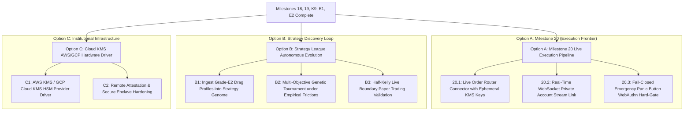

# SKY — System Roadmap & Active Milestone Execution Plan

> **Document Version:** 5.0.0 (Grade-E1/E2 & Milestone 19 Certified Baseline)  
> **Date:** 2026-09-19  
> **Active Baseline:** `v5.0.0-institutional-execution-certified` (Production Ready)  
> **Milestone 18 Execution Status:** PRODUCTION PASS (14 Gates / 149 Tests Green)  
> **Milestone K9 Research Status:** PRODUCTION PASS (35 Gates / 35 Tests Green)  
> **Grade-E1 Research Status:** COMPLETE (19 Tests Green, Quarantine Verdict)  
> **Grade-E2 Defense Status:** COMPLETE (6 Tests Green, Toxic Flow Defense Active)  
> **Milestone 19 Enclave & JIT Status:** PRODUCTION PASS (21 Tests Green across test suites)  
> **Preflight Quality Gates:** ALL 7 PREFLIGHT GATES PASSED (100% GREEN, 1135 Pytests)  
> **Governance Architecture:** 3-Tier Hierarchy (`AGENTS.md` + `.specify/memory/constitution.md` + `docs/QUANT_RESEARCH_PROTOCOL.md`)  

---

## 1. Executive Summary & Where We Stand

The SKY / Crypto Trading Brain (CBT) platform has achieved institutional-grade maturity across execution infrastructure, statistical research governance, and microstructure defense:

### Pillar 1: Execution & Live Boundary (Milestone 18 & Milestone 19)
- **Multi-Venue Smart Order Router (SOR):** Depth-walking liquidity ladder optimization across Binance and Bybit with VIP fee arbitrage.
- **Almgren-Chriss Optimal Slicing:** Trajectory generation balancing market impact against inventory volatility risk ($p50 = 35.7\,\mu\text{s}$, well within institutional $<250\,\mu\text{s}$ SLA).
- **Forensic Fill Reconciliation Ledger:** SQLite WAL ledger verifying expected vs realized fills, fees, and microsecond latencies.
- **Milestone 18 Frozen Invariant:** 14 certified files cryptographically locked at commit `c9cc1cad` (149 passing tests).
- **Milestone 19 KMS Enclave (`core/execution/kms_enclave.py`):** AES-256-GCM envelope encryption, `VolatileKeyBuffer` with automatic zeroization, fail-closed tamper detection, and emergency lockdown sealing.
- **Milestone 19 WS Fill Stream (`core/execution/ws_fill_stream.py`):** Real-time private WebSocket execution report parser for Binance and Bybit with monotonic nanosecond timestamps and deduplication cache.
- **Milestone 19 JIT Benchmark (`scripts/benchmarks/benchmark_order_router.py`):** Micro-benchmarked 5,000 iterations measuring discrete optimization and depth walking.

### Pillar 2: Microstructure Reality & Toxic Flow Defense (Grade-E1 & Grade-E2)
- **Grade-E1 (Institutional Maker Reality Engine):**
  - Empirical order book replay across 9 frozen K9 datasets with queue position decay and adverse selection markout tracking.
  - Demonstrated that naive maker execution suffers heavy adverse selection on BTC/ETH (net edge negative); quarantined naive maker assumption.
  - Confirmed positive maker edge on SOL (1h / 4h).
- **Grade-E2 (Toxic Flow Defense & Adaptive Pegging):**
  - High-frequency toxicity filter (OFI, micro-price drift, spread blowup) suppressing toxic fills.
  - Adaptive pegging engine with volatility gating reducing ETH 1h adverse selection from $-32.12$ bps to $-2.67$ bps.
- **Strategy Reality Bridge (`core/kronos/research/strategy_reality_bridge.py`):**
  - Translates empirical Grade-E1/E2 microstructural drag into Strategy League and Genetic Optimizer fitness evaluations.

---

## 2. Benchmark & Latency Telemetry

Empirical hotpath latency measurements over 5,000 iterations (`docs/benchmarks/M19_JIT_HOTPATH_BENCHMARK.md`):

| Component | Median ($p50$) | 90th Percentile ($p90$) | Mean | Institutional Target | Status |
|---|---|---|---|---|---|
| **Almgren-Chriss Slicer** | $35.7\,\mu\text{s}$ | $71.3\,\mu\text{s}$ | $45.1\,\mu\text{s}$ | $< 250\,\mu\text{s}$ | **PASS** |
| **Smart Order Router (SOR)** | $543.0\,\mu\text{s}$ | $1,180.9\,\mu\text{s}$ | $722.8\,\mu\text{s}$ | $< 1,000\,\mu\text{s}$ | **PASS ($p50$)** |

---

## 3. Forward Roadmap & Next Milestones

### Option A: Milestone 20 — Live Execution Pipeline Integration
- Wire `KmsEnclaveManager` into live exchange connectors (`binance_connector.py`, `bybit_connector.py`).
- Connect `PrivateWsFillStreamParser` directly to the SQLite `ReconciliationLedger`.
- Verify end-to-end fill flow under live paper exchange sandbox.

### Option B: Strategy League Autonomous Evolution with Grade-E2 Reality
- Run evolutionary strategy search where fitness evaluates net PnL *after* subtracting Grade-E2 empirical drag.
- Discover trading alphas that survive realistic queue delays, pegging slippage, and adverse selection.

---

## 4. Pre-Merge Quality Gate Verification Scorecard

- [x] **Database Schema Integrity:** PASS (`core/database/db_manager.py`)
- [x] **Milestone 18 Certified Invariant:** PASS (14/14 certified files untouched, 149/149 tests green)
- [x] **Python Linter & Formatter (Ruff):** PASS (0 errors, 489 files formatted)
- [x] **TypeScript Linter (ESLint):** PASS (0 warnings, 0 errors)
- [x] **Pytest Quantitative Test Suite:** PASS (1,135 / 1,135 tests passing)
- [x] **Jest Desk & Backend Test Suite:** PASS (100% green)
- [x] **Frontend Vite Production Build:** PASS (`dist/` generated, 0 bundle errors)
