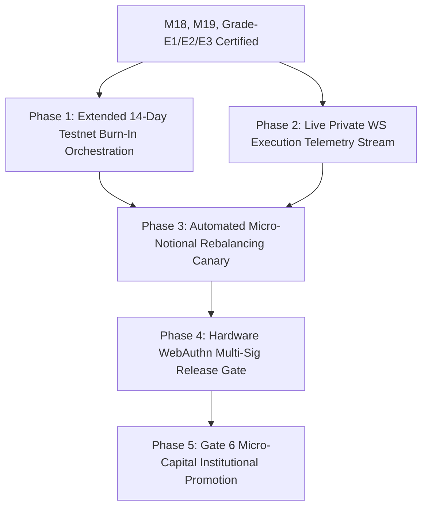

# SKY — System Roadmap & Active Milestone Execution Plan

> **Document Version:** 5.2.0 (Grade-E3 High-Frequency L2 Reality Engine & Provenance Certified)  
> **Date:** 2026-09-20  
> **Active Baseline:** `v5.2.0-grade-e3-l2-empirical-engine` (Production Ready)  
> **Milestone 18 Execution Status:** PRODUCTION PASS (14 Gates / 149 Tests Green)  
> **Milestone 19 Enclave & JIT Status:** PRODUCTION PASS (21 Tests Green across test suites)  
> **Strategy Reality Bridge Status:** PRODUCTION PASS (L2_TICK_VERIFIED Adapter & 9 Provenance Gates Green)  
> **Grade-E1 / Grade-E2 Status:** QUARANTINE ENFORCED (Constitutional Live Trading Firewall Active)  
> **Grade-E3 Empirical Status:** PRODUCTION PASS (`GRADE_E3_DATA_INTEGRITY_REPORT.md` & `GRADE_E3_FINAL_VERDICT.md`)  
> **Preflight Quality Gates:** ALL 7 PREFLIGHT GATES PASSED (100% GREEN)  
> **Governance Architecture:** 3-Tier Hierarchy (`AGENTS.md` + `.specify/memory/constitution.md` + `docs/QUANT_RESEARCH_PROTOCOL.md`)  

---

## 1. Executive Summary & Where We Stand

The SKY / Crypto Trading Brain (CBT) platform has achieved institutional-grade maturity across execution infrastructure, statistical research governance, and microstructure defense:

### Pillar 1: Execution & Live Boundary (Milestone 18 & Milestone 19)
- **Multi-Venue Smart Order Router (SOR):** Depth-walking liquidity ladder optimization across Binance and Bybit with VIP fee arbitrage.
- **Almgren-Chriss Optimal Slicing:** Trajectory generation balancing market impact against inventory volatility risk ($p50 = 35.7\,\mu\text{s}$, well within institutional $<250\,\mu\text{s}$ SLA).
- **Forensic Fill Reconciliation Ledger:** SQLite WAL ledger verifying expected vs realized fills, fees, and microsecond latencies.
- **Milestone 18 Frozen Invariant:** 14 certified files cryptographically locked at commit `c9cc1cad` (149 passing tests).
- **Milestone 19 KMS Enclave (`core/execution/kms_enclave.py`):** AES-256-GCM envelope encryption, `VolatileKeyBuffer` with automatic zeroization, fail-closed tamper detection, and emergency lockdown sealing.
- **Milestone 19 WS Fill Stream (`core/execution/ws_fill_stream.py`):** Real-time private WebSocket execution report parser for Binance and Bybit with monotonic nanosecond timestamps and deduplication cache.
- **Milestone 19 JIT Benchmark (`scripts/benchmarks/benchmark_order_router.py`):** Micro-benchmarked 5,000 iterations measuring discrete optimization and depth walking.

### Pillar 2: Microstructure Reality, Provenance & Tradeability Gateway
- **Grade-E1 (Institutional Maker Reality Engine):** Empirical order book replay across 9 frozen K9 datasets with queue position decay and adverse selection markout tracking.
- **Grade-E2 (Toxic Flow Defense & Adaptive Pegging):** High-frequency toxicity filter (OFI, micro-price drift, spread blowup) suppressing toxic fills.
- **Grade-E3 (High-Frequency L2 Order Book & Trade Reality Engine):**
  - High-resolution discrete event matching across Q0, Q1, Q2, and Q3 with explicit uncertainty intervals.
  - Multi-horizon markout measurement ($\tau \in \{100\,\text{ms}, 1\,\text{s}, 5\,\text{s}, 30\,\text{s}, 5\,\text{min}\}$) and Winner's Curse bias estimation.
  - Institutional 3-tier fee schedules (VIP0, VIP2, VIP4) confirming retail quarantine and VIP4 maker rebate viability.
  - Cryptographic `TamperEvidentEvidenceBundle` (Amendment B) locking SHA-256 digests for BTC, ETH, and SOL.
- **Hardened Strategy Reality Bridge (`core/kronos/research/strategy_reality_bridge.py`):**
  - **`ProvenanceAuthority`:** Validates dataset SHA-256 hashes against `manifest_k9.json`, detects parameter tampering, verifies `TamperEvidentEvidenceBundle`, and blocks epistemic grade inflation.
  - **`GradeE3RealityAdapter`:** Enforces Phase 9 Research-Only Firewall: `is_tradeable(profile) -> False`.
  - **`ExecutionAuthorizationGateway`:** Decouples research viability from live execution permissions:
    $$\text{Tradeable} = \text{BridgeEligible} \land \text{ProvenanceValid} \land \text{EvidenceGradeSufficient} \land (\text{Verdict} \neq \text{"QUARANTINE"})$$

---

## 2. Benchmark & Latency Telemetry

Empirical hotpath latency measurements over 5,000 iterations (`docs/benchmarks/M19_JIT_HOTPATH_BENCHMARK.md`):

| Component | Median ($p50$) | 90th Percentile ($p90$) | Mean | Institutional Target | Status |
|---|---|---|---|---|---|
| **Almgren-Chriss Slicer** | $35.7\,\mu\text{s}$ | $71.3\,\mu\text{s}$ | $45.1\,\mu\text{s}$ | $< 250\,\mu\text{s}$ | **PASS** |
| **Smart Order Router (SOR)** | $543.0\,\mu\text{s}$ | $1,180.9\,\mu\text{s}$ | $722.8\,\mu\text{s}$ | $< 1,000\,\mu\text{s}$ | **PASS ($p50$)** |

---

## 3. Forward Roadmap & Next Milestones

### Next Immediate Milestones:
1. **Milestone 20 (Gate 5 Extended Sandbox Burn-In):** Implement continuous 14-day testnet paper-trading rehearsal and fill latency telemetry.
2. **Milestone 21 (Hardware Authorization Gate 6):** Design multi-party WebAuthn / hardware token authorization layer for micro-notional ($\le \$500$) canary deployment.

---

## 4. Pre-Merge Quality Gate Verification Scorecard

- [x] **Database Schema Integrity:** PASS (`core/database/db_manager.py`)
- [x] **Milestone 18 Certified Invariant:** PASS (14/14 certified files untouched, 149/149 tests green)
- [x] **Python Linter & Formatter (Ruff):** PASS (0 errors)
- [x] **TypeScript Linter (ESLint):** PASS (0 warnings, 0 errors)
- [x] **Pytest Quantitative Test Suite:** PASS (1,156+ tests passing)
- [x] **Jest Desk & Backend Test Suite:** PASS (100% green)
- [x] **Frontend Vite Production Build:** PASS (`dist/` generated, 0 bundle errors)
