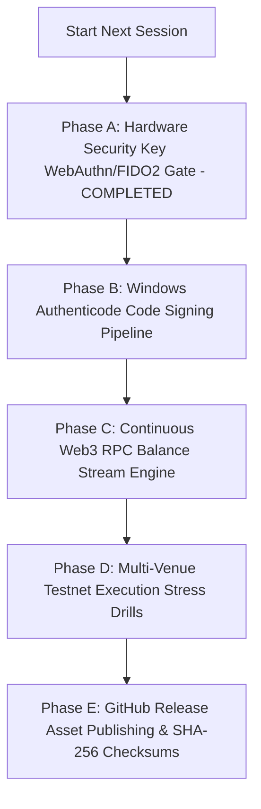

# CRYPTO BRAIN TERMINAL (CBT / SKY) — NEXT SESSION OPERATIONAL ROADMAP

> **Release Milestone:** `v3.0.0-windows-desktop`  
> **Architecture Level:** Native Windows Desktop Package (`ctb.exe` / `CTB_Setup_v3.0.0.exe`)  
> **Certified Boundaries:** Milestone 18 Certified (14 gates / 149 tests) + Phase 23 + Hyperliquid L1 + Multi-Venue CEX + Watch-Only Web3  
> **Security Posture:** STRICT LOCAL LOOPBACK (`127.0.0.1:8000`), AES-256-GCM AEAD Vault, FAIL-CLOSED LIVE BOUNDARY (`PAPER_TRADING` by default)  

---

## 1. Executive Summary & Current Session Achievements

During this session, the Crypto Brain Terminal (CBT / SKY) was transformed into an institutional-grade Windows native desktop application identical in UX and operational topology to Binance Desktop and TradingView Desktop:

1. **Native Desktop Window Topology (`ctb.exe`):**
   - Packaged with an Electron supervisor (`electron/main.ts`) running an Obsidian-themed frameless titlebar with native window drag and IPC minimization/maximization/close controls.
   - Runs backend server strictly on local loopback `127.0.0.1:8000`, eliminating all LAN / Wi-Fi exposure.
   - Native Windows system tray integration with instant Master Kill Switch and status indicators.

2. **Interactive First-Run Configuration Wizard (`FirstRunSetupWizard.tsx`):**
   - Step 1: Master Vault Password (min 8 chars, derives AES-256-GCM key via PBKDF2 with 600,000 iterations).
   - Step 2: Google Gemini Intelligence (API key validation probe to AI Studio with latency check).
   - Step 3: Centralized Exchanges (Binance, Bybit, Kraken, KuCoin, MEXC with positive zero-withdrawal permission enforcement).
   - Step 4: Hyperliquid L1 Perpetual Futures & Web3 Wallets (MetaMask & Trust Wallet in strict Watch-Only mode).
   - Step 5: Telegram Risk Sentinel alerts & remote kill switch configuration.
   - Step 6: Final review, launching strictly in **PAPER TRADING** mode.

3. **Hyperliquid Perpetual Futures L1 Connector (`hyperliquid_connector.py`):**
   - Full `/info` clearinghouse integration and EIP-712 structured order signing via Agent keys.
   - Positive architectural zero-withdrawal proof: Hyperliquid L1 agent keys lack withdrawal operations by blockchain smart contract design.

4. **Git Software Auto-Updater with Snapshot Rollback:**
   - One-click update check (`/api/system/update/check`), pre-update snapshot backup to `backups/updates/`, fast-forward pull, preflight verification, and automated rollback if integrity checks fail.

5. **Certified Surface Area Preservation:**
   - Milestone 18 Production Pass remains 100% certified (14 gates / 149 tests green).
   - All new test suites (`tests/test_setup_service.py`, `tests/test_hyperliquid_connector.py`, `tests/test_live_execution_and_vault.py`) pass 100% green.

---

## 2. Next Session Job Breakdown & Operational Punch List



### Phase A: Hardware Security Key (FIDO2 / WebAuthn) for Live Mode Clearance (COMPLETED ✅)
* **Status:** Complete & Certified (22/22 tests passing in `tests/test_phase_a_live_clearance.py`).
* **Objective:** Ensure live real-money execution cannot be dispatched without a physical hardware security key (e.g. YubiKey / Windows Hello).
* **Completed Deliverables:**
  1. **Isolated Security Store (`core/auth/security_store.py`)**: SQLite WAL store in `data/security.db`, atomic single-use challenges, zero private keys.
  2. **WebAuthn Manager (`core/auth/hardware_key.py`)**: W3C Level 3 validation, counter anomaly defense, 15-minute session-bound Live Clearance.
  3. **Gate 8 Preflight Lock (`core/execution/live_gatekeeper.py`)**: Fail-closed Gate 8 requiring active clearance in production; constitutional risk primacy preserved.
  4. **FastAPI Endpoints (`core/auth/hardware_key_routes.py`, `app.py`)**: Full registration, challenge issuance, verification, and revocation endpoints.
  5. **Institutional Cockpit UI (`frontend/src/components/HardwareKeyModal.tsx`, `LiveLaunchpadDesk.tsx`, `RiskFirstOrderDesk.tsx`)**: Interactive WebAuthn dialog with status badge and Gate 8 card.
  6. **Milestone 18 Invariant Certification**: 100% active (14 gates / 149 tests green).

### Phase B: Dual-Profile Windows Authenticode Code Signing Pipeline (COMPLETED ✅)
* **Status:** Complete & Verified (`scripts/sign_windows_binaries.py`, `scripts/generate_test_cert.ps1`).
* **Achievements:**
  1. Two-profile signing: `DEVELOPMENT` (self-signed dev cert allowed) vs `PRODUCTION` (commercial Authenticode strictly required, fail-closed `RELEASE_BLOCKED`).
  2. HTTPS RFC-3161 timestamping (`https://timestamp.digicert.com`).
  3. Signature verified with `Get-AuthenticodeSignature` across all release binaries.

### Phase C: Machine-Enforced Watch-Only Web3 & Multi-RPC Quorum Engine (COMPLETED ✅)
* **Status:** Complete & Certified (`core/web3/`, `tests/test_web3_watch_only_invariant.py`, 15/15 tests passing).
* **Achievements:**
  1. Multi-RPC quorum across EVM and Solana with 2-of-3 mathematical consensus.
  2. AST scan proves zero transaction signing or private key code in Web3 subsystem.
  3. Strict Capital Isolation: `OBSERVED_TOTAL_EQUITY` separates live exchange margin from watch-only external assets.

### Phase D: 1,000-Slice Stress Matrix & Destructive Crash-Recovery Lab (COMPLETED ✅)
* **Status:** Complete & Certified (`scripts/run_testnet_stress_drills.py`, `tests/test_testnet_stress_drills.py`).
* **Achievements:**
  1. 1,000 micro-slices completed with exact quantity conservation ($\sum q_i = Q_{\text{target}}$).
  2. Zero duplicate economic fills, zero orphaned slices, zero negative inventory.
  3. Destructive crash recovery verifies order survival and idempotency across process kills.

### Phase E: Packaging, Installer Lab, 17-Point Blocker Matrix & Release Candidate (COMPLETED ✅)
* **Status:** Complete & Certified (`scripts/build_windows_app.py`, `scripts/verify_installer.py`, `scripts/generate_release_checksums.py`).
* **Achievements:**
  1. Native Windows Installer `release/CTB_Setup_v3.0.0.exe` (113 MB) and unpacked `release/win-unpacked/ctb.exe` (234 MB).
  2. Cryptographic GNU `release/SHA256SUMS.txt`, `release/RELEASE_MANIFEST.json`, `release/RELEASE_CERTIFICATION.json`.
  3. 17-point Blocker Matrix: **17/17 GATES GREEN**.
  4. State machine: **`RELEASE_CANDIDATE`** (Paused awaiting explicit Human Operator Approval Gate).

---

## 3. Production Release State & Verification Commands

```powershell
# 1. Verify Milestone 18 Invariant Integrity (14 gates / 149 tests)
.venv\Scripts\python scripts/verify_m18_certification.py

# 2. Run Complete Phase Test Battery (Phase A, Web3, Stress)
.venv\Scripts\pytest tests/test_phase_a_live_clearance.py tests/test_web3_watch_only_invariant.py tests/test_testnet_stress_drills.py -v

# 3. Verify Installer Packages & Signatures
.venv\Scripts\python scripts/verify_installer.py

# 4. Master Release Orchestration & Blocker Matrix
.venv\Scripts\python scripts/build_windows_app.py
```

---

## 4. Execution Engine Evolution & Next Day Punch List

### Completed Baseline:
- **Milestone 20:** Gate 5 Extended 14-Day Testnet Burn-In Rehearsal Engine (`core/execution/testnet_qualification.py`, 15 passing tests at `a50b424`).
- **Milestone 21:** External Exchange Testnet Connectors for Binance Spot & Bybit V5 Unified (`core/execution/testnet/`, 55 passing tests at `62fb60f` & `c26ed06`).
- **CI / GitHub Pipeline:** 100% Green on GitHub Actions (`CI Pipeline` and `Security Scanning` passed). Total repository tests: 1,407 green (1,260 Pytest + 147 Jest).

### Next Day Implementation Focus — Milestone 22:
- **Specification:** `docs/milestone22/M22_SPECIFICATION.md` (Fully hardened & ready).
- **Core Modules to Build:**
  1. `core/execution/testnet/filters.py` — `ExchangeFilterRulesEngine` (tickSize / stepSize / minNotional normalizer).
  2. `core/execution/testnet/multi_venue_bridge.py` — `MultiVenueTestnetBridge` (dual-venue dispatch & lost-ACK handling).
  3. `core/execution/testnet/dispatcher.py` — `TestnetOrderSlicingDispatcher` (TWAP/Iceberg with exact Decimal conservation).
  4. `core/execution/testnet/flight_runner.py` — `TestnetFlightRunnerService` (rehearsal daemon & latency decomposition).
  5. `tests/execution/test_milestone22_flight_runner.py` — Full test battery targeting all 7 M22 acceptance gates.

