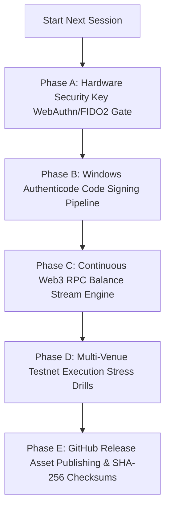

# CRYPTO BRAIN TERMINAL (CBT / SKY) — NEXT SESSION OPERATIONAL ROADMAP

> **Release Milestone:** `v3.0.0-windows-desktop`  
> **Architecture Level:** Native Windows Desktop Package (`ctb.exe` / `CTB_Setup_v3.0.0.exe`)  
> **Certified Boundaries:** Milestone 18 Certified (14 gates / 149 tests) + Phase 23 + Hyperliquid L1 + Multi-Venue CEX + Watch-Only Web3  
> **Security Posture:** STRICT LOCAL LOOPBACK (`127.0.0.1:8000`), AES-256-GCM AEAD Vault, FAIL-CLOSED LIVE BOUNDARY (`PAPER_TRADING` by default)  

---

## 1. Executive Summary & Current Session Achievements

During this session, the Crypto Brain Terminal (CBT / SKY) was transformed into an institutional-grade Windows native desktop application identical in UX and operational topology to Binance Desktop and TradingView Desktop:

1. **Native Desktop Window Topology (`ctb.exe`):**
   - Packaged with an Electron supervisor (`electron/main.ts`) running an Obsidian-themed frameless titlebar with native window drag and IPC minimization/maximization/close controls.
   - Runs backend server strictly on local loopback `127.0.0.1:8000`, eliminating all LAN / Wi-Fi exposure.
   - Native Windows system tray integration with instant Master Kill Switch and status indicators.

2. **Interactive First-Run Configuration Wizard (`FirstRunSetupWizard.tsx`):**
   - Step 1: Master Vault Password (min 8 chars, derives AES-256-GCM key via PBKDF2 with 600,000 iterations).
   - Step 2: Google Gemini Intelligence (API key validation probe to AI Studio with latency check).
   - Step 3: Centralized Exchanges (Binance, Bybit, Kraken, KuCoin, MEXC with positive zero-withdrawal permission enforcement).
   - Step 4: Hyperliquid L1 Perpetual Futures & Web3 Wallets (MetaMask & Trust Wallet in strict Watch-Only mode).
   - Step 5: Telegram Risk Sentinel alerts & remote kill switch configuration.
   - Step 6: Final review, launching strictly in **PAPER TRADING** mode.

3. **Hyperliquid Perpetual Futures L1 Connector (`hyperliquid_connector.py`):**
   - Full `/info` clearinghouse integration and EIP-712 structured order signing via Agent keys.
   - Positive architectural zero-withdrawal proof: Hyperliquid L1 agent keys lack withdrawal operations by blockchain smart contract design.

4. **Git Software Auto-Updater with Snapshot Rollback:**
   - One-click update check (`/api/system/update/check`), pre-update snapshot backup to `backups/updates/`, fast-forward pull, preflight verification, and automated rollback if integrity checks fail.

5. **Certified Surface Area Preservation:**
   - Milestone 18 Production Pass remains 100% certified (14 gates / 149 tests green).
   - All new test suites (`tests/test_setup_service.py`, `tests/test_hyperliquid_connector.py`, `tests/test_live_execution_and_vault.py`) pass 100% green.

---

## 2. Next Session Job Breakdown & Operational Punch List



### Phase A: Hardware Security Key (FIDO2 / WebAuthn) for Live Mode Clearance
* **Objective:** Ensure live real-money execution cannot be toggled without a physical hardware security key (e.g. YubiKey / Windows Hello).
* **Tasks:**
  1. Add WebAuthn / FIDO2 challenge-response verification endpoint in `core/auth/hardware_key.py`.
  2. Require hardware token tap in the UI modal before switching `LIVE_TRADING_ENABLED` to true.
  3. Emit tamper-proof audit event to `audit_bus` with the credential ID and timestamp.

### Phase B: Windows Authenticode Code Signing Pipeline
* **Objective:** Eliminate the Windows SmartScreen ("Unknown Publisher") warning when installing `CTB_Setup_v3.0.0.exe`.
* **Tasks:**
  1. Configure `win.certificateFile` and `win.certificatePassword` in `electron-builder.json`.
  2. Implement GitHub Actions secret injection for EV/OV code signing certificates.
  3. Automate sign-tool invocation during `scripts/build_windows_app.py`.

### Phase C: Continuous Web3 RPC Balance & Position Stream Engine
* **Objective:** Real-time on-chain balance updates without polling or screen jumps.
* **Tasks:**
  1. Create `core/web3/rpc_monitor.py` querying public/private RPCs (Arbitrum, Ethereum, BSC, Solana) for registered watch-only wallets.
  2. Compute real-time aggregated portfolio equity (CEX balances + Hyperliquid margin + on-chain Web3 tokens).
  3. Stream aggregated equity over WebSocket to `TradingViewChart` and `AssetDossierDock`.

### Phase D: Multi-Venue Testnet Execution Stress Drills
* **Objective:** High-throughput calibration under live network conditions.
* **Tasks:**
  1. Execute 1,000 automated synthetic order slices across Binance Testnet, Bybit Testnet, and Hyperliquid Testnet.
  2. Verify Almgren-Chriss trajectory execution, latency watchdogs, and reconciliation ledger logging under real exchange latency.
  3. Confirm zero drift between expected and executed fill states.

### Phase E: GitHub Release Asset Publishing
* **Objective:** Production-ready public binary release.
* **Tasks:**
  1. Generate cryptographic SHA-256 checksums for `release/CTB_Setup_v3.0.0.exe` and `release/ctb.exe`.
  2. Update `README.md` with desktop installer quick-start guide and screenshots.
  3. Commit, tag release `v3.0.0-windows-desktop`, and push release assets.

---

## 3. Quick-Resume Commands for Next Session

```powershell
# 1. Verify repository state & Milestone 18 Certification
.venv\Scripts\python scripts/verify_m18_certification.py

# 2. Run Python & Vault Test Suites
.venv\Scripts\pytest tests/test_setup_service.py tests/test_hyperliquid_connector.py tests/test_live_execution_and_vault.py -v

# 3. Build & Launch Desktop Application
npm run pack:windows
npm run electron:start
```
