# SKY / Crypto Brain Terminal (CBT)
# Master Project Topology & Modular "Keyboard Key" Architecture Tree

> **Authoritative Specification & Topological Reference**  
> **Version:** 8.0.0 (Generation 8 Quantitative Microstructure Architecture)  
> **Target Audience:** Both Autonomous AI Agents (Antigravity, Jules, Copilot, AI Studio) and Human Engineers.  
> **Core Guarantee:** Zero-Blast-Radius Decoupling — any branch or leaf can be inspected, refactored, upgraded, or replaced in total isolation without side-effects on the broader system.

---

## 1. THE "KEYBOARD KEY" DECOUPLING ARCHITECTURE

In a professional mechanical keyboard, each key switch operates as a completely independent, hot-swappable module:

```
┌─────────────────────────────────────────────────────────────────────────────┐
│                       THE KEYBOARD KEY ANALOGY                              │
├─────────────────────────────────────────────────────────────────────────────┤
│ 1. KEY SWITCH (Leaf Module)     : Fully encapsulated logic & state          │
│ 2. HOT-SWAP SOCKET (Contract)   : Standardized Protocol / Abstract Base     │
│ 3. DIODE BUFFER (Firewall)      : Anti-ghosting fail-closed sandbox         │
│ 4. MATRIX SIGNAL (Output DTO)   : Immutable event / report payload          │
│ 5. SWITCH TESTER (Sandbox Test) : Runs in isolation with zero PCB contact   │
│ 6. STEEL BACKPLATE (Freeze M18) : Certified surface area never bent/drilled │
└─────────────────────────────────────────────────────────────────────────────┘
```

When you lubricate, modify, or replace the switch on the `"A"` key:
- The `"B"` key, `"Spacebar"`, and microcontroller firmware are **100% unaware and unaffected**.
- If the `"A"` key switch experiences a physical mechanical jam, the anti-ghosting diode prevents electrical shorts across the row/column matrix.
- If the `"A"` key is removed entirely, the rest of the keyboard operates flawlessly.

### The 6 Rules of Zero-Blast-Radius Modular Decoupling:

1. **Rule 1: Socket First (Contract-Driven Interfaces):**  
   Every leaf module must define its inputs and outputs using strict dataclasses or Pydantic models. Never pass raw, untyped dictionaries across module boundaries.
2. **Rule 2: Directional Import Tree (Strict Stratification):**  
   Lower layers NEVER import higher layers. Leaf modules in the same tier NEVER import each other's internal variables. If Leaf A needs data from Leaf B, they communicate via standardized DTOs or through a coordinating gateway.
3. **Rule 3: Anti-Ghosting Sandbox (Fault Containment):**  
   Every execution, hook, or quantitative calculation leaf must execute within a fail-safe sandbox (`HookSandbox` or `try...except` boundary). An unhandled exception or arithmetic crash inside a leaf must fail closed safely, returning an unconsumed error report without corrupting parent state machines or ledgers.
4. **Rule 4: Permanent Capital Firewall (`real_capital_enabled = False`):**  
   All quantitative simulation, AMM microstructure, cross-chain solver, and paper trading modules inherit a permanent `real_capital_enabled = False` invariant. Simulation leaves are strictly forbidden from holding private keys, signing live transactions, or dispatching calldata to mainnet nodes.
5. **Rule 5: Zero Lookahead & Causal Firewalls:**  
   Quantitative research leaves consume event-specific information cutoffs ($t \le t_{\text{event}}$). No future candle, tick, or order book state may ever leak into a historical decision step.
6. **Rule 6: The M18 Frozen Surface Area Invariant:**  
   The 14 Milestone 18 execution, risk, SOR, and connector files are cryptographically certified and frozen (`c9cc1cad`, hash `2acbff25...`, 149 passing tests). Any modification to an M18 file automatically invalidates production clearance.

---

## 2. 5-LAYER ARCHITECTURAL STRATIFICATION

```mermaid
graph TD
    subgraph Layer4["Layer 4: Presentation & Terminal UI (Zero-Shake)"]
        UI_Dash["React 18 + Vite Terminal Dashboard"]
        UI_Chart["Single-Mount Zero-Shake Canvas Charts"]
        UI_WS["Persistent WebSocket Auto-Reconnect Stream"]
        UI_Desk["Electron Multi-Target Windows Shell"]
    end

    subgraph Layer3["Layer 3: Gateway & Application APIs"]
        GW_FastAPI["Python FastAPI Server (:8000) /api/*"]
        GW_Node["Node.js Express Server (:3000) Market WS"]
        GW_Auth["FIDO2 / WebAuthn & AST Signature Sentinel"]
    end

    subgraph Layer2["Layer 2: Quantitative Intelligence & Research Simulation"]
        Q_AMM["M42: Concentrated AMM Microstructure & Tick Math"]
        Q_XChain["M41: Cross-Chain Intent Solvers & Bridge Routing"]
        Q_MM["M37: Avellaneda-Stoikov & Hawkes Order Flow"]
        Q_Arb["M38: CEX-DEX Latency Arb & MEV Simulator"]
        Q_RL["M39: Deep RL SAC Execution Slicer"]
        Q_Ensemble["M40: HRP & Ledoit-Wolf Multi-Strategy Allocator"]
        Q_Macro["Kronos: Macro Regime & Correlation Matrix"]
        Q_SMC["SMC: Order Blocks & Liquidity Sweeps"]
    end

    subgraph Layer1["Layer 1: Market Feeds & Microstructure Telemetry"]
        M_Feeds["L2 / L3 Order Book Depth Streams"]
        M_VPIN["VPIN Flow Toxicity & Microstructure Elasticity"]
        M_Funding["Perpetual Funding Rate Telemetry"]
        M_Ticks["Bitwise Q64.96 Price / Tick Conversion"]
    end

    subgraph Layer0["Layer 0: System Constitution & Risk Desk Primacy"]
        R_Desk["Deterministic Risk Gate (Half-Kelly, Drawdown Caps)"]
        R_Collat["Cross-Venue Collateral Heartbeat & LDB Monitor"]
        R_Rebal["Advisory Transfer Trajectory Optimizer"]
        R_Kill["Hardware Fail-Closed Kill-Switch"]
        M18_Freeze["Milestone 18 Certified Frozen Surface (149 Tests)"]
    end

    Layer4 --> Layer3
    Layer3 --> Layer2
    Layer2 --> Layer1
    Layer2 --> Layer0
    Layer1 --> Layer0

    style Layer0 fill:#2d1b1b,stroke:#ff4d4d,stroke-width:2px;
    style Layer1 fill:#1f2937,stroke:#60a5fa,stroke-width:1px;
    style Layer2 fill:#111827,stroke:#a78bfa,stroke-width:1px;
    style Layer3 fill:#1e293b,stroke:#38bdf8,stroke-width:1px;
    style Layer4 fill:#0f172a,stroke:#34d399,stroke-width:2px;
```



---

## 3. MASTER REPOSITORY DIRECTORY TOPOLOGY MAP

Below is the definitive hierarchical map of the repository. Every directory branch and key file leaf is documented with its role, boundary, and decoupling contract:

```
c:\Users\azims\CBT\
├── .specify/                             # [Branch] Governance & Constitutional Memory
│   └── memory/
│       └── constitution.md               # [Leaf] System Constitution: Causal firewalls, Zero lookahead, Risk primacy
│
├── core/                                 # [Branch] Core Quantitative Intelligence & Systems Architecture
│   │
│   ├── risk_engine/                      # [Branch: Layer 0] Deterministic Risk Desk (Unbypassable Authority)
│   │   ├── risk_gate.py                  # [Leaf] Half-Kelly sizing, max 1.5% equity cap, daily drawdown halts
│   │   ├── collateral_monitor.py         # [Leaf] Sub-second margin telemetry, Liquidation Distance Buffer (LDB)
│   │   ├── rebalancing_advisor.py        # [Leaf] Dynamic transfer optimizer across Binance, Bybit, Hyperliquid
│   │   └── drawdown_limiter.py           # [Leaf] Non-discretionary portfolio circuit breaker
│   │
│   ├── execution/                        # [Branch: Layer 0 & 2] Smart Execution, Simulation & Arbitrage
│   │   │
│   │   ├── [M18 CERTIFIED FROZEN AREA]   # ⚠️ FROZEN SURFACE: Zero modifications permitted without gate rerun
│   │   ├── live_router.py                # [Leaf: M18] Hardware fail-closed live execution router
│   │   ├── smart_order_router.py         # [Leaf: M18] Multi-venue child-order slicing & liquidity routing
│   │   ├── reconciliation_ledger.py      # [Leaf: M18] High-resolution fill reconciliation with UNIQUE constraints
│   │   ├── almgren_chriss.py             # [Leaf: M18] Optimal execution trajectory & market impact model
│   │   ├── idempotency.py                # [Leaf: M18] Lost-ack deduplication: One intended order never becomes two
│   │   ├── kill_switch.py                # [Leaf: M18] Emergency kill-switch returning HTTP 403
│   │   ├── connectors/                   # [Branch: M18] Exchange connectors
│   │   │   ├── base.py                   # [Leaf: M18] Base venue interface contract
│   │   │   ├── binance_connector.py      # [Leaf: M18] Binance API client
│   │   │   └── bybit_connector.py        # [Leaf: M18] Bybit V5 API client
│   │   ├── m18_certification_manifest.json# [Leaf: M18] SHA-256 cryptographic manifest locking commit c9cc1cad
│   │   │
│   │   ├── concentrated_amm/             # [Branch: M42] Concentrated Liquidity AMM Engine (Uniswap v3 / v4)
│   │   │   ├── __init__.py               # [Leaf] Unified exports and capital firewall declaration
│   │   │   ├── tick_math.py              # [Leaf: M42-A] Q64.96 bitwise tick mathematics [-887272, 887272]
│   │   │   ├── swap_math.py              # [Leaf: M42-B] compute_swap_step, mul_div, exact directional rounding
│   │   │   ├── tick_bitmap.py            # [Leaf: M42-B] Word-level bitwise sparse tick index & liquidity_net
│   │   │   ├── swap_state_machine.py     # [Leaf: M42-B] Multi-tick state machine & 13-field replay ledger
│   │   │   ├── lp_analytics.py           # [Leaf: M42-C] Capital multiplier M, AMM Greeks (Delta==x, Gamma<0, IL<=0)
│   │   │   └── v4_hooks.py               # [Leaf: M42-D] Hook permissions, VolatilityCircuitBreaker, DynamicFee, Sandbox
│   │   │
│   │   ├── cross_chain/                  # [Branch: M41] Cross-Chain Intent Solvers & Bridge Routing
│   │   │   ├── intent_models.py          # [Leaf] Immutable cross-chain intent data structures & DTOs
│   │   │   ├── bridge_route_optimizer.py # [Leaf] Multi-dimensional solver utility function S(S_k)
│   │   │   └── cross_chain_intent_sentinel.py # [Leaf] Anti-fragmentation exposure caps & cryptographic settlement
│   │   │
│   │   ├── market_making/                # [Branch: M37] Avellaneda-Stoikov & Flow Toxicity
│   │   │   ├── avellaneda_stoikov.py     # [Leaf] Inventory reservation price r(s,q,t) and optimal bid/ask spread
│   │   │   └── hawkes_process.py         # [Leaf] Mutual-excitation Hawkes intensity for order book flow toxicity
│   │   │
│   │   ├── latency_arb/                  # [Branch: M38] CEX-DEX Arbitrage & MEV Bundle Simulation
│   │   │   ├── mev_simulator.py          # [Leaf] Builder bundle auction simulator, PBS builder priority fees
│   │   │   └── cex_dex_arb.py            # [Leaf] Cross-venue latency arbitrage opportunity detector
│   │   │
│   │   ├── rl_execution/                 # [Branch: M39] Deep Reinforcement Learning Execution
│   │   │   ├── sac_execution_agent.py    # [Leaf] Soft Actor-Critic (SAC) adaptive order slicing
│   │   │   └── execution_env.py          # [Leaf] Gym-compatible L2 order book execution environment
│   │   │
│   │   └── protection/                   # [Branch: M33] Synthetic Basis & Leg-Risk Fail-Safes
│   │       ├── basis_guard.py            # [Leaf] Spot-perp basis divergence monitor
│   │       └── leg_risk_monitor.py       # [Leaf] Immediate unhedged single-leg abort mechanism
│   │
│   ├── collective/                       # [Branch: M36 & M40] Multi-Strategy Portfolio Ensemble
│   │   ├── hrp_allocator.py              # [Leaf: M36] Hierarchical Risk Parity (dendrogram clustering)
│   │   ├── ledoit_wolf.py                # [Leaf: M36] Analytical shrinkage covariance estimator
│   │   └── strategy_ensemble.py          # [Leaf: M40] Multi-strategy Sharpe/Sortino regime weighted allocator
│   │
│   ├── sky_intelligence/                 # [Branch] Adversarial Multi-Agent Intelligence Committee
│   │   ├── committee.py                  # [Leaf] 4-agent debate: Bull, Bear, Neutral, Risk desk
│   │   ├── dossier_generator.py          # [Leaf] 8-pillar institutional intelligence briefing compiler
│   │   └── decision_pipeline.py          # [Leaf] Consensus formation and conviction weighting
│   │
│   ├── kronos/                           # [Branch] Macro & Quantitative Regimes
│   │   ├── macro_regimes.py              # [Leaf] Markov regime-switching model (Bull, Bear, Churn, Crash)
│   │   └── cross_correlations.py         # [Leaf] Rolling correlation network matrices
│   │
│   ├── mbo/                              # [Branch] Microstructure Market-by-Order Engine
│   │   ├── l2_elasticity.py              # [Leaf] Slope of book depth under marginal volume stress
│   │   └── vpin_toxicity.py              # [Leaf] Volume-Synchronized Probability of Toxicity
│   │
│   ├── research/                         # [Branch: Level 2] Quantitative Methodology & Experiment Tracking
│   │   ├── protocol.py                   # [Leaf] Epistemic taxonomy enforcement ([FACT], [INFERENCE], etc.)
│   │   ├── cpcv.py                       # [Leaf] Combinatorial Purged Cross-Validation with causal purge gaps
│   │   ├── dsr_wrc.py                    # [Leaf] Deflated Sharpe Ratio & White's Reality Check statistics
│   │   └── experiment_registry.py        # [Leaf] Append-only deterministic experiment hash ledger
│   │
│   ├── auth/                             # [Branch] Institutional Security & Key Isolation
│   │   ├── fido2_auth.py                 # [Leaf] WebAuthn / FIDO2 hardware passkey verification
│   │   └── eip712_validator.py           # [Leaf] Structured calldata AST inspection before dispatch
│   │
│   └── database.py                       # [Leaf: Layer 0] SQLite Sandbox connection pools & isolation guarantee
│
├── src/                                  # [Branch: Layer 3] Node.js Express & Realtime Streaming Server
│   ├── server.ts                         # [Leaf] Entrypoint: Express HTTP (:3000) and WebSocket server
│   ├── routes/                           # [Branch] REST API routers
│   │   ├── market.ts                     # [Leaf] Ticker data, historical OHLCV, candle caches
│   │   ├── terminal.ts                   # [Leaf] Terminal status, port telemetry, ping health
│   │   ├── signals.ts                    # [Leaf] SMC signals, order block scan endpoints
│   │   ├── auth.ts                       # [Leaf] User session, passkey challenges
│   │   └── ai.ts                         # [Leaf] Gemini desk co-pilot proxy
│   ├── services/                         # [Branch] High-velocity stream processors
│   │   ├── binanceWsService.ts           # [Leaf] Low-latency Binance combined tick/depth stream
│   │   ├── bybitWsService.ts             # [Leaf] Fallback Bybit WebSocket stream
│   │   └── marketDataCache.ts            # [Leaf] In-memory rolling tick ring-buffer
│   ├── middleware/                       # [Branch] Server middleware
│   │   ├── rateLimiter.ts                # [Leaf] Token-bucket IP request throttler
│   │   └── securityHeaders.ts            # [Leaf] Strict CSP, HSTS, and XSS sanitizers
│   └── types/                            # [Branch] Shared TypeScript schema definitions
│
├── app.py                                # [Leaf: Layer 3] FastAPI Python Gateway (:8000) bridging Core to UI
│
├── frontend/                             # [Branch: Layer 4] React 18 + Vite Trading Terminal UI
│   ├── index.html                        # [Leaf] Single-page application root shell
│   ├── src/
│   │   ├── App.tsx                       # [Leaf] Master viewport orchestrator
│   │   ├── components/                   # [Branch] Zero-Shake UI Widgets (Independent Key Switches)
│   │   │   ├── CandleChart.tsx           # [Leaf] Persistent Canvas/SVG chart (never destroys on tick)
│   │   │   ├── OrderBookDepth.tsx        # [Leaf] High-velocity sub-second L2 depth visualizer
│   │   │   ├── AdversarialDebatePanel.tsx# [Leaf] Low-velocity committee debate cards
│   │   │   ├── RiskDeskWidget.tsx        # [Leaf] Margin utilization, LDB, and Half-Kelly dials
│   │   │   ├── ConcentratedAMMVisualizer.tsx# [Leaf] M42 AMM liquidity curve & Greek telemetry
│   │   │   ├── CrossChainIntentMonitor.tsx  # [Leaf] M41 Intent solver quotes and settlement proofs
│   │   │   └── CollateralTopologyMap.tsx # [Leaf] M34 Venue margin balance network
│   │   ├── hooks/                        # [Branch] React hooks
│   │   │   ├── useWebSocketStream.ts     # [Leaf] Persistent WebSocket lifecycle with auto-reconnect
│   │   │   └── useTerminalState.ts       # [Leaf] Viewport zoom/pan and user drawing preservation
│   │   └── types/                        # [Branch] UI TypeScript models
│
├── electron/                             # [Branch: Layer 4] Native Windows Desktop App Shell
│   ├── main.ts                           # [Leaf] Electron process supervisor (launches FastAPI + Node)
│   └── preload.ts                        # [Leaf] Context-isolated IPC security bridge
│
├── tests/                                # [Branch] Test Sandboxes & Verification Harnesses
│   ├── conftest.py                       # [Leaf] STRICT DATABASE ISOLATION: Tests run in sandboxes only
│   ├── test_milestone18_sor_and_slicing.py      # [Leaf: M18] 27 tests (SmartOrderRouter, slicing)
│   ├── test_milestone18_boss_adversarial.py     # [Leaf: M18] 83 tests (Kill-switch, lost ack, overfill)
│   ├── test_milestone18_final_certification.py  # [Leaf: M18] 39 tests (Full execution integrity)
│   ├── execution/                        # [Branch] Execution milestone unit test suites
│   │   ├── test_milestone41_cross_chain_intents.py      # [Leaf] 11 tests (M41 Intent Solvers)
│   │   ├── test_milestone41_r_evidence_hardening.py     # [Leaf] 8 tests (M41-R Qualification)
│   │   ├── test_milestone42_a_tick_math.py              # [Leaf] 10 tests (M42-A Q64.96 math)
│   │   ├── test_milestone42_b_swap_state_machine.py     # [Leaf] 10 tests (M42-B Swap steps)
│   │   ├── test_milestone42_c_lp_analytics.py          # [Leaf] 9 tests (M42-C Greeks & Hedging)
│   │   ├── test_milestone42_d_v4_hooks.py               # [Leaf] 8 tests (M42-D Hooks & Sandbox)
│   │   └── test_milestone42_r_evidence_hardening.py     # [Leaf] 3 tests (M42-R Dossier binding)
│   ├── governance/                       # [Branch] Constitutional rules, secrets scans, lint
│   ├── intelligence/                     # [Branch] Multi-agent debate, dossier generation
│   └── research/                         # [Branch] Cross-validation, CPCV, DSR, WRC tests
│
├── scripts/                              # [Branch] Operational Tools, Gate Verifiers & Release Packaging
│   ├── verify_m18_certification.py       # [Leaf] Cryptographic gate: verifies 14 files & 149 tests
│   ├── system_preflight.py               # [Leaf] Institutional pre-release gate check
│   ├── build_windows_app.py              # [Leaf] 21-gate release builder with Authenticode signing
│   └── research/                         # [Branch] Research qualification evidence harnesses
│       ├── run_m41_r_qualification.py    # [Leaf] M41-R 8-obligation evidence execution harness
│       └── run_m42_r_qualification.py    # [Leaf] M42-R 8-obligation AMM microstructure harness
│
├── docs/                                 # [Branch] Institutional Research Protocols, Dossiers & Audits
│   ├── audit/                            # [Branch] Append-only qualification dossiers & JSON reports
│   │   ├── M41_R_CROSS_CHAIN_EVIDENCE_DOSSIER.md # [Leaf] M41-R cross-chain intent audit
│   │   ├── M41_R_CROSS_CHAIN_EVIDENCE_REPORT.json
│   │   ├── M42_R_AMM_MICROSTRUCTURE_DOSSIER.md   # [Leaf] M42-R AMM microstructure audit
│   │   └── M42_R_AMM_MICROSTRUCTURE_REPORT.json
│   ├── certification/
│   │   └── M18_CERTIFICATION_MANIFEST.md # [Leaf] M18 Production Pass reference
│   └── QUANT_RESEARCH_PROTOCOL.md        # [Leaf: Level 2] Epistemic taxonomy, CPCV, DSR/WRC manual
│
├── AGENTS.md                             # [Leaf: Level 0] Permanent Agent Operating Manual & Governance
├── SKY_STATUS.md                         # [Leaf] Authoritative single source of milestone truth
├── ARCHITECTURE.md                       # [Leaf] System architecture high-level summary
├── ROADMAP.md                            # [Leaf] Version milestone sequence roadmap
├── RUNBOOK.md                            # [Leaf] Operational runbook for production operators
└── SECURITY.md                           # [Leaf] Vulnerability disclosure & credential security policy
```

---

## 4. HOW TO UPGRADE OR ADD A "KEY SWITCH" (ZERO-BLAST-RADIUS PROTOCOL)

Whenever a human or AI agent adds a new feature, updates an indicator, or refactors an existing leaf module, execute this **6-Step Hot-Swap Protocol**:

```
Step 1: Define Socket Interface  ──────> Step 2: Anchor Capital & Causal Firewalls
               │                                            │
               ▼                                            ▼
Step 4: Build Isolated Test Suite <───── Step 3: Implement Failure Sandbox Isolation
               │
               ▼
Step 5: Execute Qualification Gate ─────> Step 6: Plug In & Verify Invariants
```

### Step 1: Define the Socket Interface (Abstract Contract)
- Do not begin by writing implementation code.
- Define the input snapshot DTO and output result DTO with strict typing:
```python
@dataclass(frozen=True)
class FeatureInputSnapshot:
    timestamp_utc: float
    symbol: str
    price: float
    # immutable snapshot data only

@dataclass
class FeatureExecutionReport:
    is_success: bool
    status_narrative: str
    metrics: Dict[str, float]
    real_capital_enabled: bool = False  # Mandatory invariant
```

### Step 2: Anchor Causal & Capital Firewalls
- Explicitly declare `real_capital_enabled = False` on every class and output DTO.
- Ensure input data does not leak lookahead information ($t \le t_{\text{current}}$).

### Step 3: Wrap Logic in Failure Sandbox Isolation
- If this leaf fails, throws an unhandled exception, or encounters a division by zero, it must **fail closed safely**:
```python
class FeatureSandbox:
    @staticmethod
    def execute_safely(module: BaseModule, snapshot: FeatureInputSnapshot) -> FeatureExecutionReport:
        try:
            return module.compute(snapshot)
        except Exception as e:
            logger.error(f"Feature failure intercepted safely in sandbox: {e}", exc_info=True)
            return FeatureExecutionReport(
                is_success=False,
                status_narrative=f"Execution halted safely: {str(e)}",
                metrics={},
                real_capital_enabled=False,
            )
```

### Step 4: Build the "Switch Tester" Test Suite
- Write a dedicated test file in `tests/<domain>/test_<feature>.py`.
- Tests must execute in the sandbox environment provided by `tests/conftest.py`.
- Verify:
  - Normal execution with valid inputs.
  - Boundary conditions and adversarial inputs.
  - Graceful sandbox containment when exceptions are simulated.
  - Invariant assertion: `assert report.real_capital_enabled is False`.

### Step 5: Execute Institutional Evidence & Architecture Verification
- Run the modular test suite:
  ```bash
  .venv\Scripts\pytest tests/<domain>/test_<feature>.py -v
  ```
- Run the AST architecture boundary verifier:
  ```bash
  .venv\Scripts\python scripts/verify_architecture_boundaries.py
  .venv\Scripts\pytest tests/governance/test_architecture_boundaries.py -v
  ```
- Run the Milestone 18 verification gate to guarantee the certified execution core was untouched:
  ```bash
  .venv\Scripts\python scripts/verify_m18_certification.py
  ```

### Step 6: Non-Invasive Registration & Optional Adapter Wiring
- Export the new leaf from its parent package `__init__.py`.
- **API Wiring Decoupling:** Leaves are private research libraries by default. Wiring into gateway routers (`app.py` or `src/routes/`) is an **optional adapter step**, never a mandatory prerequisite for quantitative discovery modules.
- Update `SKY_STATUS.md` recording the milestone status, pass count, and test identity hash.

---

## 5. THE MACHINE-ENFORCED 4-REGISTRY ARCHITECTURE CONTRACT

SKY treats architectural boundaries as machine-checked safety invariants, enforced at commit time via static AST import analysis (`scripts/verify_architecture_boundaries.py` and `tests/governance/test_architecture_boundaries.py`):

```
┌─────────────────────────────────────────────────────────────────────────────┐
│ 1. LAYER REGISTRY (core/governance/architecture_registry.py)                │
│    Explicitly stratifies every module into Layers 0 to 4.                   │
├─────────────────────────────────────────────────────────────────────────────┤
│ 2. DEPENDENCY ALLOWLIST MATRIX                                              │
│    Strictly enforces directional import flow: Layer N -> Layer <= N.         │
│    Documented exceptions (EXPLICIT_ALLOWED_EDGES) reserved for emergency    │
│    kill-switch auto-halt coordination and async alerting.                   │
├─────────────────────────────────────────────────────────────────────────────┤
│ 3. MODULE AUTHORITY REGISTRY                                                │
│    Classifies modules into CERTIFIED_EXECUTION_AUTHORITY,                   │
│    GOVERNANCE_RISK_AUTHORITY, SIMULATION_RESEARCH_ONLY, etc.                │
├─────────────────────────────────────────────────────────────────────────────┤
│ 4. FROZEN SURFACE REGISTRY (M18 MANIFEST)                                   │
│    Cryptographically locks the 14 Milestone 18 certified execution files     │
│    (SHA-256 test identity, 149/149 tests green, ancestral commit check).    │
└─────────────────────────────────────────────────────────────────────────────┘
```

### 5.1 Execution Surface Split: Certified Live Authority vs. Simulation & Research
A critical safety boundary exists inside `core/execution/`:
- **Certified Live Execution Authority Surface:**
  - Modules: `live_router.py`, `smart_order_router.py`, `reconciliation_ledger.py`, `kill_switch.py`, `idempotency.py`, `connectors/`
  - Authority: `CERTIFIED_EXECUTION_AUTHORITY` / `GOVERNANCE_RISK_AUTHORITY` (Layer 0)
  - Freeze State: Cryptographically locked by M18 manifest (`c9cc1cad`, 149 tests).
- **Simulation & Research Surface:**
  - Modules: `concentrated_amm/` (M42), `cross_chain/` (M41), `market_making/` (M37), `latency_arb/` (M38), `rl_execution/` (M39)
  - Authority: `SIMULATION_RESEARCH_ONLY` (Layer 2)
  - Invariant: Strictly zero order dispatch capability (`real_capital_enabled = False`). Forbidden from importing live venue connectors or `live_router.py`.

### 5.2 Centralized Capital Firewall
While each leaf declares `real_capital_enabled = False` on its models and DTOs, safety is structurally guaranteed by the **Centralized Capital Firewall**:
- Simulation and research modules lack the network credentials, cryptographic signer authority, and order dispatch hooks to touch venue endpoints.
- Any attempt by a simulation or research module to import live execution connectors triggers immediate AST linter failure and build halt.

---

## 5. MODULAR BLAST-RADIUS & CHANGE CLASSIFICATION MATRIX

Before modifying any file, check its Change Class to determine mandatory governance:

| Class | Category | Repository Areas | Blast Radius | Mandatory Workflow |
|:---:|:---|:---|:---:|:---|
| **Class A** | Documentation & Cosmetic | `docs/`, `*.md`, code comments, CSS | Zero (0%) | Direct edit $\to$ Markdown check $\to$ verify build |
| **Class B** | Bug Fix in Leaf Module | Single leaf inside `core/`, `src/`, `frontend/` | Low (< 5%) | Root-cause analysis $\to$ reproduction unit test $\to$ fix $\to$ test green |
| **Class C** | New Modular Feature (New Key) | New leaf in `core/execution/`, new UI widget | Isolated (10%) | Spec $\to$ Contract $\to$ Sandbox $\to$ Unit tests $\to$ Wire into gateway |
| **Class D** | Major Architectural Change | `app.py`, `src/server.ts`, database schema | Moderate (25%) | Full Spec Kit $\to$ Backward compatibility bridge $\to$ Preflight pass |
| **Class E** | Trading Logic / Quantitative Model | SMC, Volatility, Kronos, Cross-Chain, AMM | High (50%) | Causal firewall audit $\to$ CPCV cross-validation $\to$ DSR/WRC pass $\to$ Dossier |
| **Class F** | Research Methodology | `core/research/`, optimizer, scoring formulas | High (50%) | Append-only experiment ledger $\to$ Statistical verification $\to$ Dossier |
| **Class G** | Risk Desk & Capital Sizing | `core/risk_engine/`, Half-Kelly, Drawdown caps | Critical (80%) | Deterministic Monte Carlo stress test $\to$ Zero-bypass audit |
| **Class H** | Frozen Execution Core | **14 M18 Certified Files** (`core/execution/`) | **MAXIMUM (100%)** | ⚠️ **M18 INVALIDATION RULE:** Must rerun all 14 gates (149 tests green) |

---

## 6. CHEAT SHEET: HOW TO LOCATE AND UNDERSTAND ANY MODULE

- **Need to check risk or position sizing?** $\longrightarrow$ Go directly to [`core/risk_engine/risk_gate.py`](file:///c:/Users/azims/CBT/core/risk_engine/risk_gate.py).
- **Need to check concentrated liquidity / AMM math?** $\longrightarrow$ Go to [`core/execution/concentrated_amm/`](file:///c:/Users/azims/CBT/core/execution/concentrated_amm/).
- **Need to check cross-chain intent routing?** $\longrightarrow$ Go to [`core/execution/cross_chain/`](file:///c:/Users/azims/CBT/core/execution/cross_chain/).
- **Need to check the verified execution router?** $\longrightarrow$ Go to [`core/execution/smart_order_router.py`](file:///c:/Users/azims/CBT/core/execution/smart_order_router.py) (Caution: M18 Certified).
- **Need to check WebSocket market data streams?** $\longrightarrow$ Go to [`src/services/binanceWsService.ts`](file:///c:/Users/azims/CBT/src/services/binanceWsService.ts).
- **Need to check chart UI or order book components?** $\longrightarrow$ Go to [`frontend/src/components/`](file:///c:/Users/azims/CBT/frontend/src/components/).
- **Need to verify system integrity before shipping?** $\longrightarrow$ Run `python scripts/verify_m18_certification.py` and `python scripts/system_preflight.py`.
- **Need to understand operational rules and policies?** $\longrightarrow$ Read [`AGENTS.md`](file:///c:/Users/azims/CBT/AGENTS.md) and [`SKY_STATUS.md`](file:///c:/Users/azims/CBT/SKY_STATUS.md).
