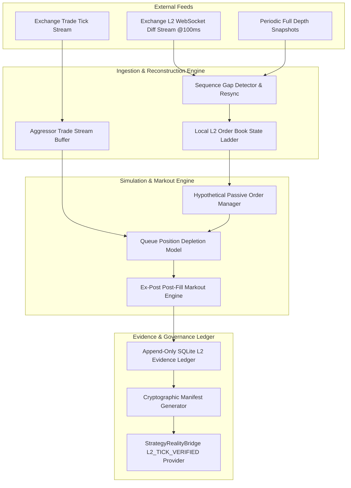

# Grade-E3: High-Frequency Level 2 Order Book & Tick Trade Reality Engine

> **Document Version:** 1.0.0  
> **Status:** SPECIFICATION / CANDIDATE RESEARCH CONTRACT  
> **Target Epistemic Grade:** `GRADE-E3: L2_TICK_VERIFIED`  
> **Predecessor References:** [`docs/grade_e1/`](file:///c:/Users/azims/CBT/docs/grade_e1/), [`docs/grade_e2/`](file:///c:/Users/azims/CBT/docs/grade_e2/), `manifest_k9.json`  
> **Governing Constitution:** `.specify/memory/constitution.md` (Zero Lookahead, Empirical Realism, Risk Primacy)  

---

## 1. Executive Purpose & Epistemic Grounding

Milestones K9, Grade-E1, and Grade-E2 established that **passive maker execution assumptions cannot be validated on OHLCV candle bars**. 

In Grade-E1, evaluating maker order fills across 15m, 1h, and 4h bars demonstrated that:
- Real market adverse selection moves violently against resting limit orders upon execution.
- Conservative Net Maker Edge on BTC 15m was $-89.50$ bps and ETH 15m was $-12.85$ bps.
- The research verdict was strictly **`QUARANTINE`** for major pairs.

However, Grade-E1 was constrained to the epistemic classification `GRADE-E1: OHLCV_APPROXIMATION`. A 15-minute candle hides the sequence of internal price movements, aggressor order sweeps, and microsecond queue depletion.

The purpose of **Grade-E3** is to transition the research platform to **empirical Level 2 order book depth and tick trade streams**, providing the necessary microstructural resolution to empirically validate or reject maker execution viability.

---

## 2. Scientific Temporal Resolution Axioms

To prevent unscientific claims of precision, Grade-E3 formalizes two orthogonal temporal concepts:

```
┌─────────────────────────────────────────────────────────────────────────────┐
│ 1. SIMULATION TIMESTAMP RESOLUTION (Internal Modeling Engine)               │
│ Precision: 1 microsecond (1 µs) event clock                                 │
│ Models: Latency buffers, cancellation racing, and discrete state transitions│
├─────────────────────────────────────────────────────────────────────────────┤
│ 2. EMPIRICAL TEMPORAL RESOLUTION (Source Feed Ground Truth)                 │
│ Precision: 100 milliseconds (100 ms) depth snapshots + Millisecond trades   │
│ Reality: Exchange packet batching, network jitter, matching-engine queuing │
└─────────────────────────────────────────────────────────────────────────────┘
```

> [!WARNING]
> **Anti-Hallucination Directive:**
> A simulator running on a $1\,\mu\text{s}$ event loop does **NOT** possess microsecond-verified empirical certainty. If the underlying data feed provides snapshots every $100\,\text{ms}$, market events between snapshots are unobserved. Grade-E3 explicitly models inter-snapshot uncertainty rather than fabricating intra-millisecond order books.

---

## 3. Dual-Venue Feasibility Matrix: Binance Spot vs. Bybit Linear Perpetual

Rather than prematurely selecting a single exchange venue, Grade-E3 defines a structured evaluation matrix across two institutional candidates:

| Dimension | Candidate A: Binance Spot (`BTCUSDT`, `ETHUSDT`) | Candidate B: Bybit Linear Perpetual (`BTCUSDT`, `ETHUSDT`) | Empirical Requirement |
|---|---|---|---|
| **L2 Depth Feed** | `@depth@100ms` diff stream + REST snapshot initialization | `orderbook.50` / `orderbook.200` 100ms push stream | Gap-free sequence tracking (`U`, `u`, `pu` sequence IDs) |
| **Trade Tick Stream** | `@trade` WebSocket stream (monotonic trade ID, price, size, buyer-is-maker) | `publicTrade` WebSocket stream (tradeId, price, size, side) | Exact tick matching against top-of-book at trade time |
| **Historical Archive Availability** | Binance Monthly Vision Data (`data.binance.vision`) & Tardis.dev archives | Bybit historical data portal & Tardis.dev archives | Minimum 90 continuous days of uncorrupted tick+L2 data |
| **Market Microstructure Factors** | Pure asset exchange, VIP0–VIP4 fee schedules, zero liquidation cascade pollution | Funding rate payments, leverage mark-price divergence, aggressive liquidation engine sweeps | Liquidation sweeps must be isolated from natural flow toxicity |
| **VIP Fee Tiers** | Maker: 7.5 bps (VIP0) $\to$ -0.5 bps (VIP4+); Taker: 7.5 $\to$ 2.0 bps | Maker: 2.0 bps (VIP0) $\to$ -0.5 bps (VIP4); Taker: 5.5 $\to$ 2.0 bps | Fee schedules must be causally tied to institutional tier assumptions |

### Feasibility Protocol:
1. **Pilot Data Ingestion Phase:** Ingest a continuous 7-day sample from both Binance Spot and Bybit Linear Perps.
2. **Data Integrity Audit:** Compute sequence gap frequency, timestamp monotonicity, and spread inversion rate.
3. **Execution Decision:** Select the primary research venue based on empirical data integrity, retaining the secondary venue as out-of-venue validation.

---

## 4. Grade-E3 Data Pipeline Architecture



### Key Architectural Invariants:
1. **Local Order Book Synchronization:**
   - Follows exchange-certified sequencing: diffs are buffered until snapshot arrival, then verified that `snapshot.lastUpdateId` falls within `[first_update.U, first_update.u]`. Any sequence breach drops state and forces resync.
2. **Queue Matching Model ($Q_{\text{empirical}}$):**
   - When a hypothetical limit order is submitted at price $P$, all resting depth at price $P$ ahead of our order constitutes the *queue ahead* ($Q_{\text{ahead}}$).
   - Only subsequent aggressive market trades at price $P$ (where aggressor side matches) deplete $Q_{\text{ahead}}$.
   - Our order fills only when cumulative aggressive volume $\ge Q_{\text{ahead}} + Q_{\text{order}}$.
3. **Cancellation & Latency Racing:**
   - Incorporates realistic cancel latency ($\Delta t_{\text{cancel}} \sim 20\text{--}50\,\text{ms}$). A cancel request does not protect against aggressive sweeps already in flight.

---

## 5. Ex-Post Markout & Adverse Selection Protocol

For every simulated fill at price $P_{\text{fill}}$ and timestamp $t_{\text{fill}}$, adverse selection is measured across standardized institutional horizons:

$$\text{Markout}_{\tau} = \begin{cases} 
\frac{P_{t_{\text{fill}} + \tau} - P_{\text{fill}}}{P_{\text{fill}}} \times 10^4 & \text{for BUY orders} \\
\frac{P_{\text{fill}} - P_{t_{\text{fill}} + \tau}}{P_{\text{fill}}} \times 10^4 & \text{for SELL orders}
\end{cases}$$

### Standardized Horizons ($\tau$):
- **Immediate Microstructure:** $\tau = 100\,\text{ms}$ (measures instant sweep impact)
- **High-Frequency Horizon:** $\tau = 1\,\text{s}$ (measures queue replenishment drift)
- **Short Horizon:** $\tau = 5\,\text{s}$ (primary Grade-E1/E2 comparability baseline)
- **Medium Horizon:** $\tau = 30\,\text{s}$ (inventory hold duration)
- **Regime Horizon:** $\tau = 5\,\text{min}$ (macro trend continuation)

### The Winner's Curse Metric:
$$\text{Winner's Curse Bias} = E[\text{Markout}_{\tau} \mid \text{Filled}] - E[\Delta P_{\tau} \mid \text{Unconditional}]$$

A negative Winner's Curse bias proves that the order filled specifically because the market was moving against the quoter.

---

## 6. Epistemic Promotion Gate: Elevating to `L2_TICK_VERIFIED`

To elevate a candidate trading strategy from research viability to live execution authority in `ExecutionAuthorizationGateway`, the following criteria must be satisfied simultaneously:

1. **Evidence Grade:** The research model must consume genuine Level 2 order book and trade tick data certified as `GRADE-E3: L2_TICK_VERIFIED`.
2. **Net Maker Edge:** Under conservative VIP fee schedules, the net maker edge must be statistically positive ($E[\text{Net Edge}] > 0$ with $p < 0.01$).
3. **Trial Deflation Penalty:** The Deflated Sharpe Ratio (DSR) and White's Reality Check (WRC) must remain positive after penalizing for all strategy permutations tested.
4. **Execution Authority Boundary:** `ExecutionAuthorizationGateway` will only transition `is_tradeable` from `False` to `True` when these four independent conditions are cryptographically proven.

---

## 7. Deliverables & Next Steps

1. **Step 1:** Construct the Binance & Bybit L2 archive down-loader and validator (`core/research/grade_e3/dataset_ingestor.py`).
2. **Step 2:** Build the deterministic L2 order book reconstructor (`core/research/grade_e3/l2_book_builder.py`).
3. **Step 3:** Implement the queue-depletion matching simulator (`core/research/grade_e3/l2_queue_engine.py`).
4. **Step 4:** Execute the pilot benchmark comparing Binance Spot vs Bybit Perps to populate the Feasibility Matrix.
