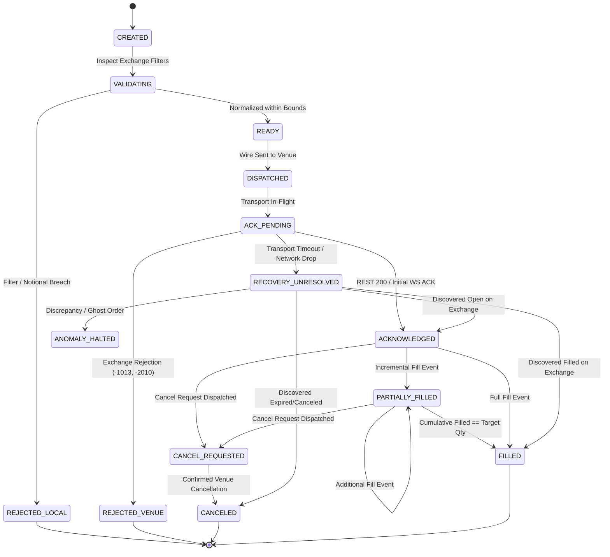

# Milestone 22: Hardened Institutional Specification & Execution Lifecycle Rehearsal Protocol

**System:** SKY / Crypto Brain Terminal (CBT)  
**Milestone:** 22 — Live Testnet Execution Flight Runner & Multi-Venue Order Lifecycle Engine  
**Governance Classification:** Class D / Class H (Architectural & Live/Paper Boundary Governance)  
**Date:** September 2026  
**Status:** SPECIFICATION HARDENED — PENDING NEXT SESSION EXECUTION  

---

## 1. Executive Summary & Epistemic Boundaries

Milestone 20 established the **Gate 5 14-Day Testnet Burn-In Rehearsal Engine** with 6 qualification gates and persistent SQLite recovery.  
Milestone 21 delivered the **Physical External Testnet Connectors** for Binance Spot and Bybit V5 Unified with strict endpoint whitelisting, production hostname blocking, and credential scope enforcement (certified across 55 passing test gates at commit `62fb60f` / `c26ed06`).

**Milestone 22** closes the loop between algorithmic execution and external exchange testnets:
It establishes the **Live Testnet Execution Flight Runner & Order Lifecycle Engine**, connecting algorithmic order slicing and routing to real testnet APIs with exchange filter normalization, millisecond latency decomposition, authoritative post-reconnect recovery, and continuous feeding into the 14-day qualification burn-in ledger.

### Epistemic Foundations & Constitutional Restraint:
1. **Permanent Capital Firewall:** `REAL_CAPITAL_ENABLED = False` is permanently hardcoded. Live capital deployment remains strictly **DENIED**.
2. **Testnet Non-Equivalence:** Passing testnet flights prove execution protocol compliance, order lifecycle durability, and reconciliation integrity. They do **NOT** prove live market profitability, real liquidity availability, or execution queue priority.
3. **M18 Certified Surface Isolation:** All 14 Milestone 18 certified files (`c9cc1cad`, 149 tests) remain **100% frozen and untouched**. Milestone 22 operates as an isolated orchestration layer.

---

## 2. Component Architecture & Authority Hierarchy

To eliminate competing state mutations and ambiguity, Milestone 22 enforces strict single-responsibility boundaries:

```
┌─────────────────────────────────────────────────────────────────────────────┐
│                          STRATEGY / OPERATOR DESK                           │
└──────────────────────────────────────┬──────────────────────────────────────┘
                                       │ Parent Order Intent (Symbol, Side, Target Qty, Strategy)
                                       ▼
┌─────────────────────────────────────────────────────────────────────────────┐
│ 1. TestnetFlightRunnerService (core/execution/testnet/flight_runner.py)      │
│    • Flight orchestration supervisor, schedule dispatch, safety watchdog     │
│    • Real-time clock skew sentinel (|t_local - t_server| <= 1000ms)          │
│    • Emergency panic cancel-all trigger                                     │
└──────────────────────────────────────┬──────────────────────────────────────┘
                                       │
                                       ▼
┌─────────────────────────────────────────────────────────────────────────────┐
│ 2. OrderLifecycleCoordinator (core/execution/testnet/order_lifecycle.py)    │
│    • SOLE CANONICAL AUTHORITY for order state transitions                    │
│    • Dual ID mapping: Client Order Link ID (cid) <-> Exchange Order ID (oid)│
│    • Exact Decimal quantity conservation:                                   │
│      Q_target = Q_filled + Q_open + Q_canceled + Q_unresolved               │
└──────────────────┬───────────────────────────────────────┬──────────────────┘
                   │ Child Slice Intent                    │ Fills & Receipts
                   ▼                                       ▲
┌──────────────────────────────────────┐ ┌────────────────────────────────────┐
│ 3. ExchangeFilterRulesEngine         │ │ 5. TestnetFillReconciliationEngine │
│    (core/execution/testnet/filters.py)│ │    (core/execution/testnet/       │
│    • Ingests exchangeInfo / filters  │ │     reconciliation.py)             │
│    • tickSize & stepSize clamping    │ │    • 4-tier fill deduplication     │
│    • minNotional & dust handling     │ │    • Conflict detection            │
└──────────────────┬───────────────────┘ └─────────────────┬──────────────────┘
                   │ Normalized Slice                      │ Clean Fills
                   ▼                                       │
┌───────────────────────────────────────────────────────┐  │
│ 4. MultiVenueTestnetBridge                            │  │
│    (core/execution/testnet/multi_venue_bridge.py)     │  │
│    • Dispatches to BinanceSpot & BybitV5 adapters     │  │
│    • Correlates transport ACKs & execution streams    │  │
│    • Lost ACK recovery flight orchestration           │  │
└──────────────────┬────────────────────────────────────┘  │
                   │ REST / WS                             ▼
                   ▼                     ┌────────────────────────────────────┐
    ┌──────────────────────────────┐     │ 6. TestnetQualificationLedger      │
    │ Binance Spot & Bybit V5      │────▶│    (core/execution/testnet_        │
    │ External Testnets (M21)      │     │     qualification.py)              │
    └──────────────────────────────┘     │    • Feeds 14-day Gates 1-6        │
                                         └────────────────────────────────────┘
```

---

## 3. Canonical Order Lifecycle State Machine

Milestone 22 rejects simplistic 4-state models in favor of an institutional 15-state deterministic finite state machine (FSM):



### State Definitions & Transition Rules:
- **`CREATED`:** Parent order created in memory.
- **`VALIDATING`:** `ExchangeFilterRulesEngine` inspecting `tickSize`, `stepSize`, `minNotional`.
- **`REJECTED_LOCAL`:** Terminal state. Order rejected pre-socket due to filter violation or insufficient balance.
- **`READY`:** Order price and quantity normalized and clamped to venue tick/step boundaries.
- **`DISPATCHED`:** Bytes sent to network transport; monotonic dispatch timestamp $T_1$ recorded.
- **`ACK_PENDING`:** Awaiting exchange matching engine HTTP 200 / WS acknowledgment.
- **`ACKNOWLEDGED`:** Exchange order ID (`orderId`) assigned and mapped to client order ID (`cid`).
- **`PARTIALLY_FILLED`:** Cumulative filled quantity $0 < Q_{\text{filled}} < Q_{\text{target}}$.
- **`FILLED`:** Terminal state. $Q_{\text{filled}} == Q_{\text{target}}$.
- **`CANCEL_REQUESTED`:** Cancellation message in flight. Fills arriving during this state remain valid economic fills.
- **`CANCELED`:** Terminal state. Exchange confirmed remainder canceled. Residual quantity moved to $Q_{\text{canceled}}$.
- **`RECOVERY_UNRESOLVED`:** Transport disconnected while in `ACK_PENDING` or `DISPATCHED`. FSM frozen; no assumptions permitted until authoritative REST query returns.
- **`ANOMALY_HALTED`:** Terminal safety halt. Discrepancy detected (overfill, quantity conservation breach, unmapped exchange fill). Trips kill switch.

---

## 4. Key Engineering Workstreams for Milestone 22

### Workstream 1: Exchange Filter Rules & Precision Normalizer (`filters.py`)
- Ingests and parses `exchangeInfo` from Binance Spot and `instruments-info` from Bybit V5.
- Implements exact `Decimal` rounding algorithms:
  - **Price Clamping:** Clamped to `tickSize`. Buy orders round DOWN (`ROUND_FLOOR`), sell orders round UP (`ROUND_CEIL`) to avoid unintentional aggressive crossing.
  - **Quantity Clamping:** Clamped to `stepSize` using strict `ROUND_DOWN` to prevent over-allocation or breaching risk limits.
  - **Notional Clamping:** Asserts $\text{clamped\_price} \times \text{clamped\_qty} \ge \text{minNotional}$. Sub-notional child slices are either absorbed into adjacent slices or rejected pre-wire.

### Workstream 2: Multi-Venue Testnet Execution Bridge (`multi_venue_bridge.py`)
- Holds active instances of `BinanceSpotTestnetAdapter` and `BybitV5TestnetAdapter`.
- Manages dual-venue client order link ID (`cid`) mapping:
  - Binance: `newClientOrderId` (max 36 chars)
  - Bybit: `orderLinkId` (max 36 chars)
- Implements **Lost-ACK Resolution**:
  - If a REST placement returns a network timeout (`aiohttp.ClientError`), the bridge queries `query_order(client_order_id=cid)` before retrying.
  - If found, it transitions to `ACKNOWLEDGED` with the discovered `orderId`.
  - If not found after backoff retries, it marks the slice failed and returns the quantity to the parent allocation.

### Workstream 3: Algorithmic Slicing & Order Lifecycle Coordinator (`dispatcher.py` & `order_lifecycle.py`)
- Implements TWAP and Iceberg slicing across Binance and Bybit.
- Enforces the non-negotiable **Quantity Conservation Identity**:
  $$Q_{\text{target}} = Q_{\text{filled}} + Q_{\text{open}} + Q_{\text{canceled}} + Q_{\text{unresolved}}$$
- Enforces that upon parent order completion:
  $$Q_{\text{unresolved}} = \text{Decimal}("0")$$

### Workstream 4: 7-Stage Latency Decomposition & Clock Sentinel (`telemetry.py`)
- Records decomposed timestamp pipeline:
  - $T_0$: Slicing intent generated
  - $T_1$: Wire dispatch to REST
  - $T_2$: Exchange HTTP ACK receipt
  - $T_3$: WebSocket execution event arrival
  - $T_4$: Reconciliation ledger update complete
- Calculates hotpath latencies:
  - REST Transport RTT: $T_2 - T_1$
  - WebSocket Fill Latency: $T_3 - T_2$
  - End-to-End Processing: $T_4 - T_0$
- Clock Skew Sentinel: calculates round-trip midpoint offset $\hat{\theta} = \frac{T_0 + T_1}{2} - T_{\text{server}}$. If $|\hat{\theta}| > 1000\,\text{ms}$, trips circuit breaker to prevent distorted markout analytics.

### Workstream 5: Post-Reconnect Gap Recovery (`recovery.py`)
- When WebSocket disconnects, `AuthoritativeRecoveryManager` takes ownership:
  1. Freezes new slice dispatch.
  2. Re-establishes private WebSocket feed.
  3. Executes authoritative REST query flight across both venues: fetches open orders and execution list since disconnect timestamp.
  4. Deduplicates fills using 4-tier shield (executionId, sequence number, canonical hash, DB uniqueness).
  5. Updates `ParentOrderLifecycle` to verify quantity conservation.
  6. Resumes dispatch only when $Q_{\text{unresolved}} == 0$.

### Workstream 6: Live Flight Runner & Qualification Ledger Integration (`flight_runner.py`)
- Autonomous async flight daemon executing controlled micro-rehearsals (e.g. 50-100 micro-slices across BTC/USDT and ETH/USDT).
- Continuously streams verified fills, markout variance, and slippage into Milestone 20's `TestnetQualificationLedger`.
- Automatically evaluates the 6 continuous qualification gates towards the 14-day / 336-hour qualification requirement.

---

## 5. Milestone 22 Measurable Acceptance Gates

To ensure institutional falsifiability, Milestone 22 must satisfy **7 Concrete Acceptance Gates**:

| Gate | Criterion | Target Threshold | Falsification Condition |
|:---:|:---|:---:|:---|
| **Gate 1** | **Filter Conformance** | $100\%$ | Any exchange rejection due to tickSize, stepSize, or minNotional breach (0 permitted). |
| **Gate 2** | **Quantity Conservation** | $100\%$ | $|Q_{\text{target}} - (Q_{\text{filled}} + Q_{\text{open}} + Q_{\text{canceled}} + Q_{\text{unresolved}})| > 0$. |
| **Gate 3** | **Lost-ACK Resolution** | $100\%$ | Any duplicated order placement on exchange after network timeout. |
| **Gate 4** | **Fill Deduplication** | $100\%$ | Any double-counted fill in economic ledger (0 phantom fills). |
| **Gate 5** | **Post-Reconnect Gap Recovery** | $100\%$ | $Q_{\text{unresolved}} > 0$ after recovery flight completion. |
| **Gate 6** | **Latency Pipeline Monotonicity** | $100\%$ | Any negative duration ($T_{i+1} < T_i$) or uncaptured latency stage. |
| **Gate 7** | **M18 Certification Invariant** | **149 / 149 PASS** | Any modification to the 14 certified M18 files or test identity mismatch. |

---

## 6. Execution Protocol for Next Session

When starting the next coding session:
1. Verify preflight baseline: `.venv\Scripts\python scripts/system_preflight.py`.
2. Verify M18 integrity: `.venv\Scripts\python scripts/verify_m18_certification.py`.
3. Implement `core/execution/testnet/filters.py` (Exchange Filter Rules Engine).
4. Implement `core/execution/testnet/multi_venue_bridge.py` (Multi-Venue Execution Bridge).
5. Implement `core/execution/testnet/dispatcher.py` (Slicing Dispatcher & Lifecycle Coordinator).
6. Implement `core/execution/testnet/flight_runner.py` (Autonomous Flight Runner Service).
7. Create comprehensive test battery: `tests/execution/test_milestone22_flight_runner.py`.
8. Execute verification suite, achieve 7/7 Milestone 22 gates green, commit, and push.
