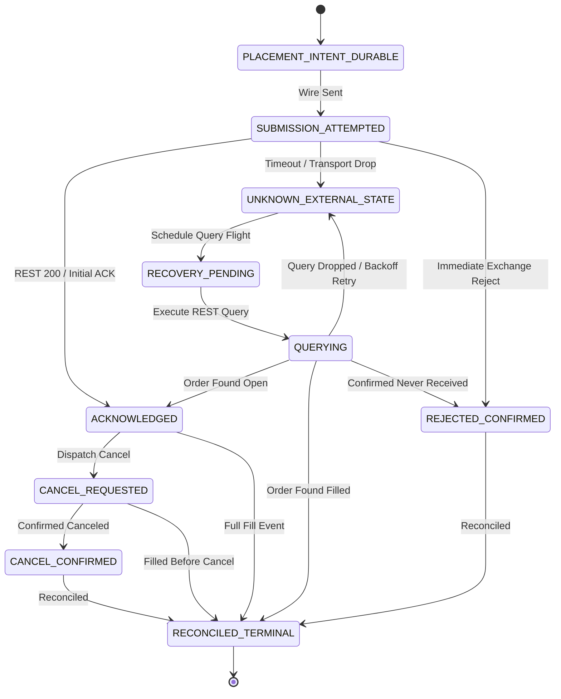
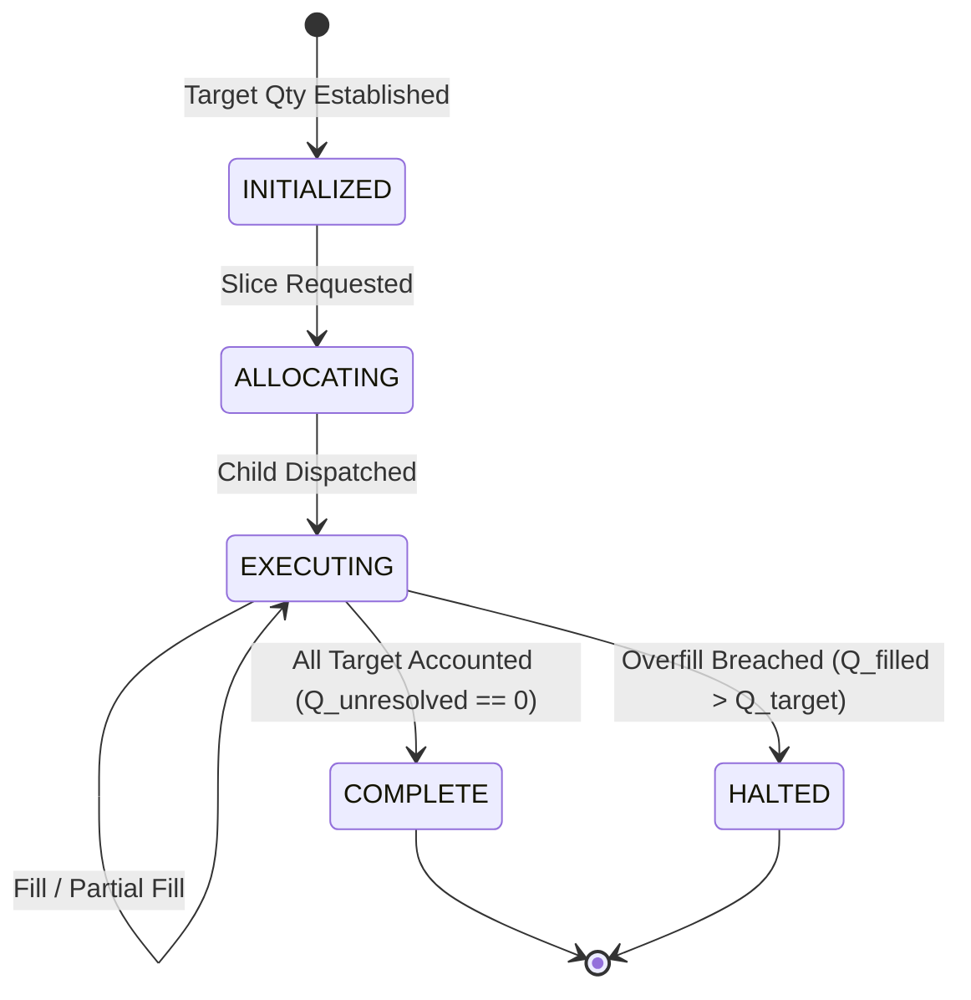

# Milestone 22 State Machine Specification & Transition Tables

> **System:** SKY / Crypto Brain Terminal (CBT)  
> **Milestone:** 22 — Live Testnet Execution Flight Runner & Multi-Venue Order Lifecycle Engine  
> **Date:** September 2026  

---

## 1. Formal 10-State Lost-ACK Recovery Finite State Machine

The `LostAckRecoveryFSM` governs the lifecycle of a placement intent when transport ambiguity or network drops occur:

### Transition Matrix:

| Current State | Permitted Next States | Trigger / Invariant | Falsification / Rejection Rule |
|:---|:---|:---|:---|
| `PLACEMENT_INTENT_DURABLE` | `SUBMISSION_ATTEMPTED` | Intent durably persisted in SQLite; wire dispatch initiated. | Cannot dispatch before persistence. |
| `SUBMISSION_ATTEMPTED` | `ACKNOWLEDGED`, `UNKNOWN_EXTERNAL_STATE`, `REJECTED_CONFIRMED` | Exchange HTTP 200 / Timeout / Exchange Reject. | Cannot jump directly to canceled. |
| `UNKNOWN_EXTERNAL_STATE` | `RECOVERY_PENDING` | Transport error caught; recovery flight scheduled. | Cannot mark resolved without venue query. |
| `RECOVERY_PENDING` | `QUERYING` | Query flight dispatched to matching engine. | Cannot skip query. |
| `QUERYING` | `ACKNOWLEDGED`, `RECONCILED_TERMINAL`, `REJECTED_CONFIRMED`, `UNKNOWN_EXTERNAL_STATE` | Authoritative query result inspected. | `ORDER_NOT_FOUND != ORDER_CANCELED`. |
| `ACKNOWLEDGED` | `CANCEL_REQUESTED`, `RECONCILED_TERMINAL`, `UNKNOWN_EXTERNAL_STATE` | Operator cancel / full fill / stream drop. | Cannot duplicate placement. |
| `CANCEL_REQUESTED` | `CANCEL_CONFIRMED`, `RECONCILED_TERMINAL`, `UNKNOWN_EXTERNAL_STATE` | Exchange confirms remainder canceled or fill received. | Ambiguous cancellation forbidden. |
| `CANCEL_CONFIRMED` | `RECONCILED_TERMINAL` | Unfilled residual moved to $Q_{\text{canceled}}$. | Terminal state. |
| `REJECTED_CONFIRMED` | `RECONCILED_TERMINAL` | Slice returned to unallocated parent balance. | Terminal state. |
| `RECONCILED_TERMINAL` | None (Terminal) | All quantities reconciled; $Q_{\text{unresolved}} == 0$. | No further transitions permitted. |

---

## 2. Parent Execution Ledger State Machine

### Ledger Invariants:
1. **Fundamental Identity:**
   $$Q_{\text{target}} = Q_{\text{filled}} + Q_{\text{open}} + Q_{\text{canceled}} + Q_{\text{unresolved}}$$
2. **Submission Boundary:**
   $$Q_{\text{submitted}} \le Q_{\text{target}}$$
3. **Overfill Circuit Breaker:**
   $$\text{If } Q_{\text{filled}} > Q_{\text{target}} \implies \text{OverfillCircuitBreakerError} \land \text{is\_halted} = \text{True}$$
4. **Completion Invariant:**
   $$\text{mark\_complete}() \implies Q_{\text{unresolved}} == \text{Decimal}("0")$$
