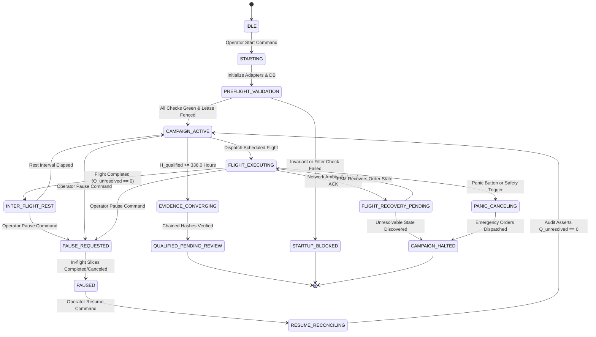

# Milestone 23 Specification: Continuous 14-Day Live Testnet Burn-In Campaign & Real-Time Flight Cockpit

**System:** SKY / Crypto Brain Terminal (CBT)  
**Milestone:** 23  
**Status:** **SPECIFICATION HARDENED — READY FOR STAGE 1 IMPLEMENTATION**  
**Governance Classification:** Class D (Major Architecture) / Class H (Execution Boundary)  
**Permanent Capital Firewall:** $\text{REAL\_CAPITAL\_ENABLED} = \text{False}$  

---

## 1. Executive Purpose & Epistemic Boundaries

Milestone 23 establishes the long-running operational endurance, distributed supervision, and forensic evidence collection layer of SKY's execution infrastructure.

### The 4-Stage Operating Principle:
1. **`STAGE 1: IMPLEMENTED`** — All software modules compile, unit tests pass, and integration points with Milestone 20, 21, and 22 are verified.
2. **`STAGE 2: VERIFIED`** — Automated unit and adversarial test batteries demonstrate adherence to state transitions, quantity conservation, rate-limit reserves, lease fencing, and recovery semantics.
3. **`STAGE 3: BURN-IN COMPLETED`** — The system executes continuously across testnets for 336 qualified operating hours without fatal failure.
4. **`STAGE 4: CERTIFIED`** — Cryptographic forensic evidence logs are audited, reconciled, and verified green across all 8 acceptance gates.

> [!CAUTION]
> Milestone 23 **MUST NOT** be certified at the end of implementation or unit testing. The code delivery satisfies **Stage 1 (Implemented)** and **Stage 2 (Verified)**. Stages 3 and 4 require physical continuous execution and subsequent forensic review.

---

## 2. Formal Qualification Mathematics & Time Accounting

The simplistic formula $H_{\text{accumulated}} \ge 336.0$ is strictly rejected as inadequate. Milestone 23 partitions operational time into three non-overlapping, verifiable streams:

$$\Delta t_{\text{interval}} = t_{\text{end}} - t_{\text{start}}$$

$$H_{\text{elapsed}} = \sum_{k=1}^{N} \Delta t_k = t_{\text{now}} - t_{\text{campaign\_start}}$$

$$H_{\text{qualified}} = \sum_{k \in \mathcal{Q}} \Delta t_k \quad \text{where } \mathcal{Q} = \{k \mid \text{Interval } k \text{ satisfies all 6 qualification invariants}\}$$

$$H_{\text{disqualified}} = \sum_{k \in \mathcal{D}} \Delta t_k \quad \text{where } \mathcal{D} = \{k \mid \text{Interval } k \text{ degraded, paused, unverified, or faulted}\}$$

$$H_{\text{elapsed}} = H_{\text{qualified}} + H_{\text{disqualified}}$$

### Qualification Threshold Requirement:
A campaign is eligible for **Stage 3 (Burn-In Completed)** only when:
$$H_{\text{qualified}} \ge 336.0 \text{ hours} \quad (14 \times 24\text{ hours})$$
$$\frac{H_{\text{qualified}}}{H_{\text{elapsed}}} \ge 0.95 \quad (\le 5\% \text{ allowable external disruption window})$$
$$N_{\text{fatal\_accounting\_breaches}} = 0$$

---

## 3. 7-Tier Event Classification Taxonomy

| Tier | Event Class | Examples | Impact on $H_{\text{qualified}}$ | System Action |
|:---:|:---|:---|:---|:---|
| **1** | `EXPECTED_OPERATION` | Clean order fill, normal cancellation, TWAP interval tick | **Qualifying** ($+ \Delta t$) | Normal flight progression |
| **2** | `RECOVERABLE_DEGRADATION` | Transient WS drop with clean reconnect and 0 lost fills | **Qualifying** ($+ \Delta t$) | Log recovery event in forensic audit |
| **3** | `EXTERNAL_VENUE_FAULT` | Exchange 502/504 Bad Gateway, testnet scheduled maintenance | **Excluded** ($+ \Delta t \to H_{\text{disqualified}}$) | Freeze flight dispatch; pause timer |
| **4** | `OPERATOR_CONTROL` | Intentional maintenance pause, parameter reconfiguration | **Excluded** ($+ \Delta t \to H_{\text{disqualified}}$) | Enter `PAUSED` state; preserve state |
| **5** | `EVIDENCE_FAILURE` | Missing latency timestamp, unjournaled execution ACK | **Disqualified** ($+ \Delta t \to H_{\text{disqualified}}$) | Quarantine affected interval |
| **6** | `SYSTEM_SAFETY_HALT` | Overfill trip, duplicate order dispatch, rate reserve breach | **Disqualifying** | Emergency halt; requires post-mortem |
| **7** | `ACCOUNTING_FAILURE` | $Q_{\text{unresolved}} \ne 0$ bypassed, quantity conservation breach | **FATAL** | **Total Campaign Reset Required** |

---

## 4. Distributed SQLite Lease & Fencing Architecture

To eliminate split-brain execution across process restarts or multi-instance scenarios, every campaign supervisor instance must obtain an atomic lease with a strictly monotonic fencing token:

```
┌──────────────────────────────────────────────────────────────┐
│ SQLite WAL Database (data/testnet_campaign.db)               │
│                                                              │
│ Table: testnet_campaign_leases                               │
│ - campaign_id: TEXT PRIMARY KEY                              │
│ - supervisor_id: TEXT NOT NULL                               │
│ - fencing_token: INTEGER NOT NULL (AUTO-INCREMENT)           │
│ - acquired_at_epoch: REAL NOT NULL                           │
│ - expires_at_epoch: REAL NOT NULL                            │
│ - heartbeat_epoch: REAL NOT NULL                             │
│ - status: TEXT ('ACTIVE', 'EXPIRED', 'RELEASED')             │
└──────────────────────────────────────────────────────────────┘
```

### Fencing Invariant:
Every state change, flight manifest generation, and wire dispatch must assert:
$$\text{token}_{\text{active\_process}} == \text{token}_{\text{lease\_store}}$$
If the lease store contains a higher fencing token, the local process must immediately terminate its flight runner fail-closed with `StaleLeaseFencingError`.

---

## 5. Formal 16-State Campaign State Machine



---

## 6. Regime Observation vs Test Coverage Policy Separation

To prevent unvalidated machine-learning or econometric predictions from masquerading as execution signals:

```
Observed Market Metric (Spread, Imbalance, Micro-volatility)
                           │
                           ▼
              MarketRegimeObservation
        (Provenance, Timestamp, Method, Confidence)
                           │
                           ▼
                CampaignCoveragePolicy
   (Selects stress test profile: BURST, WIDE, BASIS, NORMAL)
                           │
                           ▼
                    FlightManifest
        (Deterministic bounds, Q_target, SlicingStrategy)
                           │
                           ▼
                 M22 Slicing Dispatcher
```

If regime telemetry is absent or stale ($> 60\text{s}$), the orchestrator falls back to `DEFAULT_CONSERVATIVE_PROFILE`. It **NEVER** interprets missing data as a benign regime.

---

## 7. Concrete Measurable Acceptance Gates

| Gate | Criterion | Target Threshold | Falsification Condition |
|:---:|:---|:---:|:---|
| **Gate 1** | **Time Accounting & Partitioning** | $100\%$ | $H_{\text{elapsed}} \ne H_{\text{qualified}} + H_{\text{disqualified}}$. |
| **Gate 2** | **Fencing Token Lease Protection** | $100\%$ | Split-brain execution permitted when old supervisor wakes up. |
| **Gate 3** | **Safe Pause & Resume Semantics** | $100\%$ | $Q_{\text{unresolved}} > 0$ left lingering after pause or resume. |
| **Gate 4** | **Rate Limit Emergency Capacity Under Load** | $100\%$ | Emergency cancel blocked when normal rate limit is saturated. |
| **Gate 5** | **Regime Signal Firewall** | $100\%$ | Directional trading signal generated from regime detector. |
| **Gate 6** | **Cockpit Sequence Monotonicity & Stale Watermarking** | $100\%$ | Frontend displays un-watermarked stale data when backend lags $>3\text{s}$. |
| **Gate 7** | **Chained SHA-256 Forensic Audit Bundle** | $100\%$ | Any broken link in the 1-hour interval cryptographic chain. |
| **Gate 8** | **M18 Frozen Surface Area Isolation** | **149 / 149 PASS** | Any modification to the 14 certified M18 files or test checksums. |

---

## 8. Implementation Phases

- **Phase 1:** Core Campaign State Machine, Fencing Leases, and SQLite Persistence (`core/execution/testnet/campaign_orchestrator.py`).
- **Phase 2:** Time Accounting Engine, Event Classifier, and Chained Audit Ledger (`core/execution/testnet/qualification_tracker.py`).
- **Phase 3:** Market Regime Test Coverage Policy Engine (`core/execution/testnet/regime_coverage.py`).
- **Phase 4:** Isolated FastAPI Telemetry & Control Router (`core/execution/testnet/routes.py`).
- **Phase 5:** Real-Time Desktop Cockpit Telemetry & Watermarking (`frontend/src/components/TestnetBurnInHUD.tsx`).
- **Phase 6:** Comprehensive Adversarial Pytest Suite (`tests/execution/test_milestone23_campaign_orchestrator.py`).
- **Phase 7:** Full Preflight Scorecard, Documentation, and Git Synchronization.
