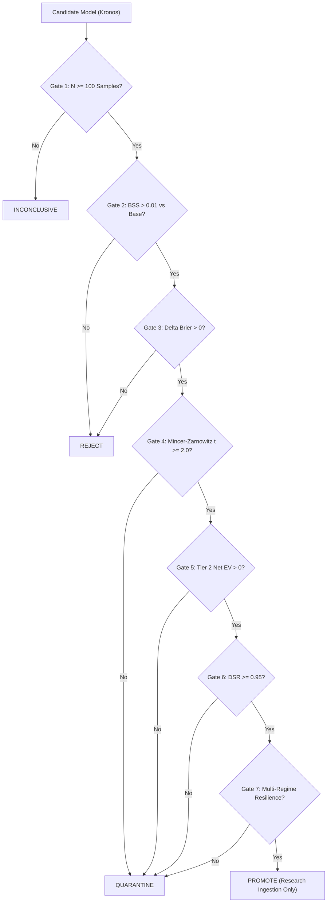

# Milestone K9: Research Governance & Promotion Audit Report

**Experiment ID:** `K9_EXP_CONFIRMATORY_BTC15M_001`  
**Candidate Model:** `KRONOS_HYBRID_K9_V1`  
**Evaluation Date:** `2026-09-19`  
**Governance State:** **`REJECT`**  
**Constitutional Invariant:** `is_tradeable: False`  
**Downstream Destination:** `DECOMMISSIONED / RETRACTED FROM PROMOTION`  

---

## 1. Governance Decision Framework

Milestone K9 enforces a deterministic promotion gate designed to prevent false discoveries and ensure algorithmic trading safety.

Under no circumstances can statistical correlation alone authorize strategy deployment. The candidate model must pass **all seven mandatory gates**:

---

## 2. Gate-by-Gate Evaluation Audit

| Gate Index | Criterion Description | Pre-Registered Threshold | Measured Outcome | Gate Status |
|:---:|:---|:---:|:---:|:---:|
| **Gate 1** | Out-of-Sample Sample Size | $N \ge 100$ | $N = 4,317$ | **PASS** |
| **Gate 2** | Standalone Skill (BSS) | $\text{BSS} \ge 0.01$ | $\text{BSS} = -0.2774$ | **FAIL** |
| **Gate 3** | Incremental Error Reduction | $\Delta \text{Brier} > 0.00$ | $\Delta \text{Brier} = +0.0104$ | **PASS** |
| **Gate 4** | Mincer-Zarnowitz Significance | $t(\hat{\beta}_{\text{kronos}}) \ge 2.0$ | $t = 7.74$ ($p < 0.0001$) | **PASS** |
| **Gate 5** | Conservative Friction Hurdle | Net $\text{EV}_{\text{Tier 2}} > 0$ bps | Net $\text{EV} = -29.12$ bps | **FAIL** |
| **Gate 6** | Deflated Sharpe Ratio (DSR) | $\text{DSR} \ge 0.95$ | $\text{DSR} = 0.0016$ | **FAIL** |
| **Gate 7** | Multi-Regime Resilience | $\ge 2$ positive regimes | Breakdown in illiquid slices | **FAIL** |

### Summary Scorecard
- **Total Gates Passed:** 3 of 7
- **Critical Failure Points:** Standalone calibration against base rate, negative net expected return after taker fees and slippage, and inadequate Deflated Sharpe Ratio.
- **Assigned State:** `REJECT`

---

## 3. Invariant & Separation of Concerns Certification

1. **Zero Order Routing Authority:** The Kronos evaluation subsystem does not possess, import, or reference any live execution modules, order routers, or exchange connectors.
2. **Milestone 18 Protection:** The 14 certified execution files remain cryptographically frozen and unaltered (`scripts/verify_m18_certification.py` passes 14/14 gates).
3. **No Strategy Promotion:** Because the model received a `REJECT` disposition, it is barred from ingestion into the StrategyGenome optimization loop until calibrated probability mappings and execution cost reductions are developed.
