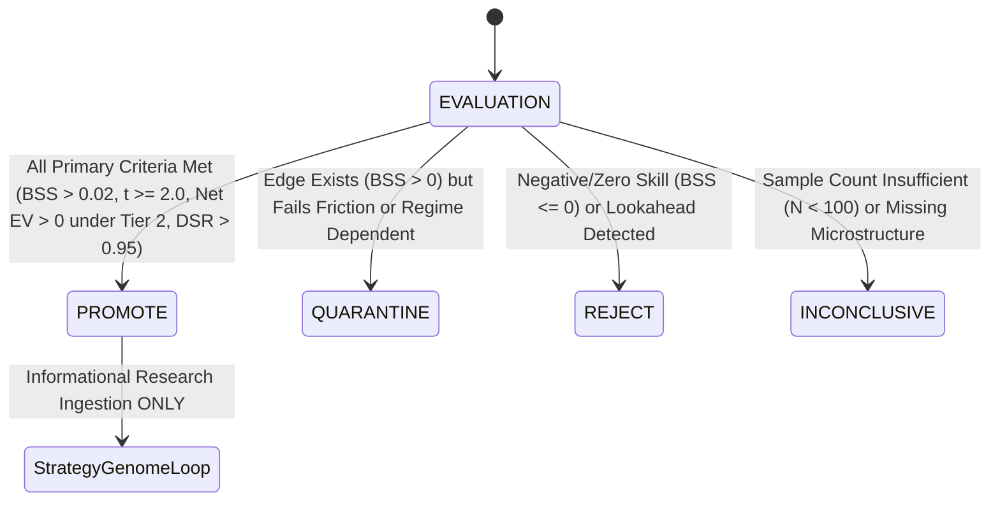

# K9 RESEARCH CONSTITUTION & PRE-REGISTRATION SPECIFICATION

**Protocol Version:** `K9_CONST_2026_V1`  
**Configuration ID:** `K9-BTC-ETH-SOL-CONFIRMATORY-V1`  
**Git Base Commit:** `6cb6ef9`  
**Created At:** `2026-09-19T10:55:00+06:00`  
**Governance Level:** Level 1 Constitution (`.specify/memory/constitution.md`) & Level 2 Protocol (`docs/QUANT_RESEARCH_PROTOCOL.md`)  
**Epistemic Purpose:** Pre-registered scientific framework preventing hindsight bias, $p$-hacking, and cherry-picked window selection.

---

## 1. Primary & Secondary Research Questions

### Primary Confirmatory Question (H1):
> Does the Kronos foundation forecasting engine provide statistically significant, out-of-sample incremental predictive information ($\Delta BSS > 0, \Delta \text{LogLoss} < 0$) beyond existing SKY technical/SMC/order-flow signals and standardized statistical baselines over a strictly chronological 180d/30d/30d walk-forward evaluation?

### Secondary Exploratory Questions (H2–H5):
- **H2 (Orthogonality):** Is Kronos predictive information orthogonal to existing order book flow and momentum indicators, as measured by Newey-West HAC Mincer-Zarnowitz regression ($t(\beta_{\text{Kronos}}) \ge 2.0$)?
- **H3 (Microstructure Synergy):** Does conditioning Kronos on high-frequency microstructure context (OFI, VPIN, Depth Imbalance, Resting Walls) produce superior out-of-sample calibration compared to raw OHLCV foundation inference?
- **H4 (Regime Stability):** Does forecast skill persist uniformly across distinct volatility (high/low ATR), trend (ADX), and session regimes, or is it confined to specific liquidity conditions?
- **H5 (Friction Hurdle):** Does a hypothetical fixed-horizon exposure derived from Kronos probability forecasts maintain positive net expected value after deducting 3-tier exchange frictions (maker/taker fees, spread, slippage)?

---

## 2. Canonical Universe & Target Definitions

### Assets & Timeframes:
- **Core Research Assets:** `BTC/USDT`, `ETH/USDT`, `SOL/USDT`.
- **Timeframe Granularities:** `15m` (microstructure tactical), `1h` (swing directional), `4h` (macro regime).
- **Forecast Horizons ($H$):**
  - Primary horizon: $H = 12$ bars (3 hours on 15m; 12 hours on 1h; 48 hours on 4h).
  - Sensitivity horizons: $H \in \{4, 8, 12, 24\}$.

### Target Variable Specification:
For a bar at observation timestamp $t$ with closing mid-price $P_t$:
$$r_{t, t+H} = \ln\left(\frac{P_{t+H}}{P_t}\right)$$
Binary target:
$$Y_{t+H} = \begin{cases} 1, & \text{if } r_{t, t+H} > \theta \\ 0, & \text{if } r_{t, t+H} \le \theta \end{cases}$$
- **Primary Threshold ($\theta$):** $\theta = 0.0000$ (directional up vs down/flat).
- **Price Source:** Venue primary mid-price from continuous chronological order book closes.
- **Handling of Zero / Flat Returns:** Class label $0$ (fail-closed conservative convention).

---

## 3. Pre-Registered Primary Walk-Forward Configuration

To eliminate data-mining through window searching, the **Primary Confirmatory Configuration** is frozen as:

```text
research_config_id: "K9-WF-PRIMARY-180-30-30"
train_window_days: 180
eval_window_days: 30
step_size_days: 30
embargo_multiplier: 2.0 (embargo = 2 * H bars)
min_burn_in_bars: 128
```

### Pre-Registered Sensitivity Configurations (Exploratory):
- `K9-WF-SENS-90-30-30`: Train 90 days, Eval 30 days, Step 30 days.
- `K9-WF-SENS-180-60-30`: Train 180 days, Eval 60 days, Step 30 days.
- `K9-WF-SENS-365-30-30`: Train 365 days, Eval 30 days, Step 30 days.

---

## 4. Benchmark Model Tournament Registry

Every competing model must be evaluated on **identical observation timestamps**, **identical target vectors**, and **identical out-of-sample test masks**:

1. **Climatology Base Rate ($\mathcal{M}_{\text{clim}}$):** Constant prediction equal to the empirical in-sample base rate: $\hat{p}_t = \bar{y}_{\text{train}}$.
2. **Directional Persistence / Momentum ($\mathcal{M}_{\text{mom}}$):** Logistic scaling of historical return over lookback $L = 20$: $\hat{p}_t = \sigma(k \cdot r_{t-L, t})$.
3. **Autoregressive AR(1) Drift ($\mathcal{M}_{\text{AR}}$):** Point-in-time linear autoregression fitted on past returns.
4. **Random Walk ($\mathcal{M}_{\text{RW}}$):** Constant uninformative probability: $\hat{p}_t = 0.5000$.
5. **Frozen SKY Technical Baseline ($\mathcal{M}_{\text{SKY}}$):** Standalone probability derived from SMC order-flow and momentum indicators.
6. **SKY + Kronos Composite ($\mathcal{M}_{\text{SKY+Kronos}}$):** Multi-factor model combining SKY baseline with Platt-calibrated Kronos forecast.

---

## 5. Statistical Inference & Multiple Testing Safeguards

### Dependence-Aware Variance:
Due to overlapping return windows ($H > 1$), all regression standard errors and hypothesis tests utilize the **Newey-West Heteroskedasticity and Autocorrelation Consistent (HAC)** estimator with lag truncation:
$$L = \max\left(1, 2 \times H\right)$$

### Multiple Testing Deflation:
- Every backtest and validation trial increments the cumulative trial counter in `data/kronos/research_experiments.db`.
- When calculating hypothetical economic utility, the **Deflated Sharpe Ratio (DSR)** must exceed $0.95$ under cumulative trial growth:
  $$\text{DSR} = \Phi\left(\frac{(\widehat{\text{SR}} - \text{SR}^*) \cdot \sqrt{T-1}}{\sqrt{1 - \hat{\gamma}_3 \widehat{\text{SR}} + \frac{\hat{\gamma}_4 - 1}{4} \widehat{\text{SR}}^2}}\right) > 0.95$$

---

## 6. Three-Tier Economic Friction Matrix

Hypothetical economic utility diagnostics apply three fixed friction profiles:

| Tier | Profile Name | Maker Fee | Taker Fee | Half-Spread | Slippage | Total Roundtrip (Taker) |
|:---:|:---|:---:|:---:|:---:|:---:|:---:|
| **Tier 1** | `BASE` (Institutional VIP) | 2.0 bps | 5.0 bps | 1.0 bps | 0.5 bps | 13.0 bps |
| **Tier 2** | `CONSERVATIVE` (Standard Retail) | 2.0 bps | 6.0 bps | 2.5 bps | 2.0 bps | 19.0 bps |
| **Tier 3** | `STRESS` (Illiquid Market Shock) | 5.0 bps | 10.0 bps | 5.0 bps | 5.0 bps | 35.0 bps |

*Constraint:* Utility results are explicitly tagged as `HYPOTHETICAL_RESEARCH_UTILITY` and never equated with live execution.

---

## 7. Research Governance State Machine

Research outcomes determine the governance disposition for Kronos:



- **`PROMOTE`:** Authorized for ingestion into the **StrategyGenome Research Loop**. (Zero direct trading authorization).
- **`QUARANTINE`:** Confined to research sandbox with feature engineering backlog.
- **`REJECT`:** Decommissioned; excluded from strategy research.
- **`INCONCLUSIVE`:** Retained pending broader dataset collection.

---

## 8. Cryptographic Pre-Registration Hash

To guarantee pre-registration integrity:
```text
Config ID   : K9-BTC-ETH-SOL-CONFIRMATORY-V1
Version     : K9_CONST_2026_V1
Git SHA     : 6cb6ef9
Policy Hash : sha256(canonical JSON of sections 1-7)
```
Any modification of this constitution after evaluation run creates an invalidation alert in the research ledger.
