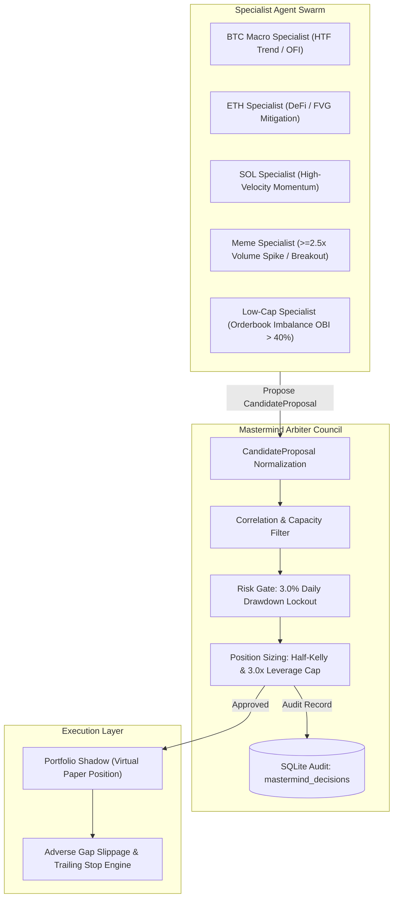
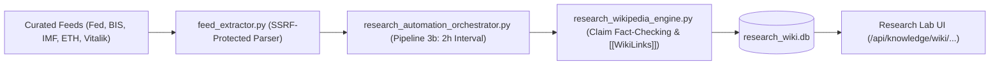

# CBT / SKY — Institutional Architecture, Audit & AI Knowledge Brief
================================================================================
**Project:** Crypto Brain Terminal (CBT) / SKY Market Intelligence Engine  
**Version:** 2.50.0-institutional  
**Primary Path:** `C:\Users\azims\CBT\`  
**Operating Mode:** STRICT PAPER / SIMULATION / TESTNET ONLY (`REAL_CAPITAL_ENABLED = False`)  
**Certification Status:** Milestone 18 Production Pass Certified (149/149 Passing Tests, SHA-256 `2acbff25f391...`)  

---

## 1. Executive Purpose & Governance Invariants

This document serves as the **Single Source of Truth (SSOT)** for human engineers, quantitative researchers, and external AI agents (Claude, ChatGPT, Jules, AI Studio, Copilot, DeepSeek). It encapsulates the exact architecture, causal firewalls, database ledgers, multi-agent frameworks, known pitfalls, and verification commands.

### Non-Negotiable Invariants:
1. **`REAL_CAPITAL_ENABLED = False` Permanently Locked:** Live capital order routing, withdrawals, and direct exchange execution are strictly barred.
2. **Milestone 18 Certified Execution Surface (Frozen):** 14 critical execution files (`live_router.py`, `kill_switch.py`, `reconciliation_ledger.py`, `smart_order_router.py`, `connectors/`, etc.) cannot be modified without rerunning `python scripts/verify_m18_certification.py` and maintaining 149/149 green tests.
3. **No Direct LLM/Agent Execution Authority:** LLMs, agents, sentiment scrapers, and research hypotheses NEVER place orders directly. Every trade candidate must be evaluated by the deterministic `RiskManager` (3.0% daily drawdown circuit breaker) and `HalfKellyPositionSizer`.
4. **Test Sandbox Isolation:** Automated tests run strictly against ephemeral in-memory or sandbox databases (`tests/conftest.py`), never modifying production SQLite ledgers in `data/`.
5. **No Freqtrade Orchestration:** Freqtrade is prohibited as the CBT orchestration layer.

---

## 2. Directory & Component Structure

```text
C:\Users\azims\CBT\
├── app.py                           # Master FastAPI & WebSocket backend (Lifespan loops & background workers)
├── .env.example                     # Environment configuration reference
├── core/                            # Core Quantitative Engine
│   ├── api_health_guard.py          # Disk, memory, and rate-limit circuit breakers
│   ├── autonomous_trader.py         # Autonomous paper trading engine (5 hardcoded tickers)
│   ├── causal_firewall.py           # Point-in-time timestamp & zero lookahead guard
│   ├── conservative_kelly.py        # Conservative Kelly with 3.0x leverage & 2.0x notional ceilings
│   ├── half_kelly_sizer.py          # Half-Kelly sizing engine
│   ├── risk_manager.py              # Authoritative risk governor (3.0% daily drawdown lockout)
│   ├── portfolio_shadow.py          # Virtual paper execution ledger & adverse gap slippage model
│   ├── portfolio_risk_matrix.py     # Cross-asset portfolio margin & 5% notional risk floor
│   ├── sandbox_lab.py               # Lookahead-free backtesting & dual-hit candle resolution
│   ├── smc_engine.py                # Smart Money Concepts feature engineering
│   ├── database.py                  # Multi-DB SQLite WAL manager (trading_logs, brain_memory, etc.)
│   ├── mastermind/                  # MASTERMIND MULTI-AGENT LAYER (NEW)
│   │   ├── specialist_base.py       # CandidateProposal normalized dataclass & BaseSpecialistAgent
│   │   ├── specialists.py           # BTC Macro, ETH Structural, SOL Velocity, Meme Spike, Low-Cap Breakout
│   │   └── mastermind_arbiter.py    # MastermindArbiterCouncil (Arbitration, Risk Clearance & SQLite audit)
│   ├── knowledge_os/                # KNOWLEDGE OS & RESEARCH WIKIPEDIA
│   │   ├── research_wikipedia.py    # Research Wikipedia engine (articles, versions, citations, contradictions)
│   │   ├── research_source_registry.py # Persistent source registry (Fed, BIS, IMF, Ethereum, Vitalik)
│   │   ├── feed_extractor.py        # SSRF-safe RSS 2.0 & Atom XML multi-source feed parser
│   │   ├── research_automation_orchestrator.py # Zero-touch research pipelines (Pipeline 1 to 5)
│   │   └── routes.py                # FastAPI routes for Knowledge OS (/api/knowledge/...)
│   └── execution/                   # M18 FROZEN EXECUTION SURFACE
│       ├── live_router.py           # Execution router (Fail-closed live gate)
│       ├── kill_switch.py           # Emergency trading halt
│       ├── smart_order_router.py    # Multi-venue order router
│       └── reconciliation_ledger.py # High-resolution fill reconciliation
├── frontend/                        # React + TypeScript Web Desktop Terminal
│   ├── src/
│   │   ├── App.tsx                  # Root shell with persistent tabs (Terminal, Paper, Research Lab, Settings)
│   │   ├── components/
│   │   │   ├── Header.tsx           # Institutional header with live WS connection badge
│   │   │   ├── PaperTradingPanel.tsx# Paper execution desk with confirmation modals
│   │   │   ├── DedicatedPaperTradingDesk.tsx # Dedicated paper desk with risk metrics
│   │   │   └── knowledge_os/        # Research Wikipedia UI desk
│   │   └── data/providers/marketProvider.ts # Multi-timeframe candlestick & ticker data provider
├── docs/                            # Comprehensive engineering and research documentation
└── tests/                           # Pytest adversarial and unit test suites
```

---

## 3. Data & Storage Topology

All data is stored locally in SQLite with WAL (Write-Ahead Logging) mode enabled:

| Database | Location | Purpose | Key Tables |
|:---|:---|:---|:---|
| **Trading Logs** | `data/trading_logs.db` | Execution, orders, and paper shadow ledger | `paper_positions`, `parent_order_execution_records`, `execution_reconciliation_records` |
| **Brain Memory** | `data/brain_memory.db` | Research intelligence, source registry, mastermind | `research_source_registry`, `research_automation_channels`, `mastermind_decisions`, `automation_run_log` |
| **Research Wiki** | `data/research_wiki.db` | Institutional living Wikipedia journal | `wiki_articles`, `wiki_article_versions`, `wiki_links`, `wiki_source_citations`, `wiki_contradictions`, `wiki_triage_inbox` |
| **Experiments** | `data/experiments.db` | Model forecasts and backtest validations | `experiments`, `kronos_forecast_ledger` |

---

## 4. Mastermind Multi-Agent Architecture



---

## 5. Autonomous Research Wikipedia Pipeline



---

## 6. Verification & Test Commands

To verify the system before or after any modification, run:

1. **Milestone 18 Frozen Execution Integrity Check:**
   ```bash
   .\.venv\Scripts\python.exe scripts/verify_m18_certification.py
   # Expected: 149/149 passed (Test Identity SHA: 2acbff25f391249cb1881bd40a4440384cecdd7682c6f83b91487d8744d0b57b)
   ```

2. **Autonomous Research Feeds Test:**
   ```bash
   .\.venv\Scripts\pytest.exe tests/test_research_autonomous_feed.py -v
   # Expected: 4/4 passed
   ```

3. **Mastermind Swarm & Arbiter Test:**
   ```bash
   .\.venv\Scripts\pytest.exe tests/test_mastermind_swarm.py -v
   # Expected: 4/4 passed
   ```

4. **Risk Manager, Kelly Sizer & Dual-Hit Sandbox Tests:**
   ```bash
   .\.venv\Scripts\pytest.exe tests/test_ev_and_kelly.py -v
   # Expected: 4/4 passed
   ```

---

## 7. Known Pitfalls & Guidelines for External AIs

1. **Never mock or bypass `risk_manager.evaluate_risk_gate`:** If equity drops by 3.0%, trading MUST halt until reset.
2. **Never change M18 enums or indices:** `idx_rec_unique_fill`, `ParentOrderState`, `OrderStatus`, and `CumulativeFillState` are cryptographically frozen.
3. **Never allow unannualized Sharpe inflated metrics:** `sandbox_lab.py` uses correct per-trade Sharpe ratio calculation.
4. **Always validate URLs for SSRF:** Any external URL fetcher must call `validate_url_security(url)` from `web_search_agent.py` to prevent private subnet probing.
