# SKY / CBT — M33 Execution Path Coverage & Call Graph Audit

**AUDIT MANDATE:** Institutional Execution Surface Reconnaissance  
**AUDIT ROLE:** Independent Execution Architect & Systems Auditor  
**EVALUATED SURFACE:** Order routers, adapters, paper gateways, background daemons, API handlers, Telegram dispatchers, recovery loops, and direct DB insertion pathways.

---

## 1. COMPREHENSIVE EXECUTION-PATH CALL GRAPH

Every path in SKY / CBT capable of creating, increasing, modifying, or closing exposure was inspected. The execution architecture converges through the following graph:

```mermaid
flowchart TD
    subgraph L0_Trigger_Sources [External & Autonomous Trigger Sources]
        UI[FastAPI REST Endpoints /api/paper/*]
        TG[Telegram Bot Dispatcher /trade, /snipe]
        CM[Central Mind Autonomous Brain Loop]
        AT[Autonomous Trader 15m Loop]
        OR[Opportunity Radar Alpha Scanner]
        CR[Collective Reconciler Replay]
    end

    subgraph L1_Order_Construction [Order Ingestion & Construction]
        UI -->|req payload| PS_OPEN[core/portfolio_shadow.py::open_position]
        TG -->|command parsing| PS_OPEN
        CM -->|proposal| PS_OPEN
        AT -->|signal| PS_OPEN
        OR -->|satellite scan| PS_OPEN
        UI -->|replace req| PS_REPLACE[core/portfolio_shadow.py::replace_position]
        CR -->|canonical replay| CR_REPLAY[core/collective/reconciler.py::rebuild_projections]
    end

    subgraph L2_Deterministic_Risk_Authority [Portfolio Risk Guardian - Gatekeeper]
        PS_OPEN -->|evaluate_proposed_order| PRG[core/risk/portfolio_risk_guardian.py]
        PS_REPLACE -->|evaluate_proposed_order| PRG
        
        PRG --> G0[Gate 0: Real Capital Lockout - REAL_CAPITAL_ENABLED == False]
        PRG --> G0B[Gate 0b: Monitoring Daemon Heartbeat Watchdog <= 5s]
        PRG --> G0C[Gate 0c: Single-Use Order Context Replay Protection]
        PRG --> G1[Gate 1: Circuit Breaker State != HARD_FREEZE / INVESTIGATION]
        PRG --> G2[Gate 2: Market Data Freshness <= 15s & Clock Drift <= 500ms]
        PRG --> G3[Gate 3: Deterministic Asset Eligibility & Whitelist]
        PRG --> G4[Gate 4: Initial Stop Geometry & Denominator Floor]
        PRG --> G5[Gate 5: Single-Position Risk Cap <= 0.25% & <= $25.00]
        PRG --> G6[Gate 6: Aggregate Open Risk Cap <= 0.75% / $75.00]
        PRG --> G7[Gate 7: Max Concurrent Positions <= 3]
        PRG --> G8[Gate 8: Gross Notional <= $30k & Leverage <= 3.0x]
        PRG --> G9[Gate 9: Correlated Crypto Long Cap <= 2]
    end

    subgraph L3_Execution_Ledgers [Persistence & Execution Ledgers]
        PRG -->|APPROVED| DB_INS[(data/trading_logs.db::shadow_positions)]
        PRG -->|REJECTED| FAIL_CLOSED[Rollback Transaction & Raise ValueError]
        CR_REPLAY -->|Direct Projection Replay| DB_INS
    end

    subgraph L4_Live_Canary_Boundary [Isolated Live Canary Subsystem]
        LCR[core/execution/live_canary_runner.py]
        LCR --> LG[core/execution/live_gatekeeper.py]
        LG -->|REAL_CAPITAL_ENABLED == False| LCR_BLOCK[Permament Fail-Closed Rejection]
    end
```

---

## 2. CALL-SITE EXPOSURE INVENTORY & AUDIT VERDICT

| # | Route / Source | Entrypoint | Risk Guardian Defense | Status | Audit Findings |
| :---: | :--- | :--- | :--- | :---: | :--- |
| **01** | **Standard Paper Order** | `core/portfolio_shadow.py::open_position()` | `guardian.evaluate_proposed_order()` before DB `BEGIN IMMEDIATE` insert. | `VERIFIED` | Intercepts all 12 risk gates fail-closed. |
| **02** | **Position Replacement** | `core/portfolio_shadow.py::replace_position()` | `guardian.evaluate_proposed_order()` before replacement lot insertion. | `VERIFIED` | **Remediated in M33.** Previously bypassed guardian; now strictly audited. |
| **03** | **REST API Trading** | `app.py::/api/paper/trade` | Invokes `portfolio_shadow.open_position()`. | `VERIFIED` | Bound to sovereign gatekeeper. |
| **04** | **Telegram Bot Execution** | `ai_quant_sentinel/telegram_bot.py` | Invokes `portfolio_shadow.open_position()`. | `VERIFIED` | Passes through full guardian check. |
| **05** | **Autonomous Trader** | `core/autonomous_trader.py` | Invokes `portfolio_shadow.open_position()`. | `VERIFIED` | Controlled by guardian concurrency and daily loss limits. |
| **06** | **Central Mind Loop** | `core/central_mind.py` | Invokes `portfolio_shadow.open_position()`. | `VERIFIED` | Cannot override risk limits via AI opportunity score. |
| **07** | **Opportunity Radar** | `core/opportunity_reserve.py` | Invokes `portfolio_shadow.open_position()` under satellite book. | `VERIFIED` | Throttled during `WARNING` and halted in `HARD_FREEZE`. |
| **08** | **Direct Database Insertion** | Raw SQLite writes to `shadow_positions` | Continuous `monitor_portfolio_state()` marks all unvetted positions to market. | `VERIFIED` | Daemon trips `HARD_FREEZE` within 1s if unvetted exposure violates risk caps. |
| **09** | **Collective Event Replay** | `core/collective/reconciler.py::rebuild_projections()` | Rebuilds read projection from append-only events. | `VERIFIED` | Replay reconstructs historical state; does not open live external exposure. |
| **10** | **Live Canary Runner** | `core/execution/live_canary_runner.py` | `live_gatekeeper.evaluate_order_clearance()` | `VERIFIED` | **Hardened in M33.** `REAL_CAPITAL_ENABLED = False` permanently blocks live order execution. |
| **11** | **Testnet Order Dispatcher** | `core/execution/testnet/dispatcher.py` | Slices testnet TWAP/Iceberg orders. | `VERIFIED` | Isolated to testnet API endpoints; zero real capital pathway. |
| **12** | **Partial Exits / Closures** | `core/portfolio_shadow.py::close_position()` | `PositionRiskLedger.register_partial_exit()` | `VERIFIED` | Proportional initial risk deallocation verified. |

---

## 3. AIRGAP AND ISOLATION VERIFICATION

1. **Direct Exchange Connector Invocations:**
   - Certified Milestone 18 connectors (`binance_connector.py`, `bybit_connector.py`) can only be invoked by `LiveExecutionRouter` or `LiveCanaryRunner`.
   - `LiveExecutionRouter` is protected by `live_kill_switch` (M18 certified invariant).
   - `LiveCanaryRunner` is blocked by `REAL_CAPITAL_ENABLED = False` (M33 reinforced).
2. **AI Signal Non-Authority Proof:**
   - `ai_opportunity_score` in `ProposedOrder` is purely informational metadata.
   - Code inspection in `core/risk/portfolio_risk_guardian.py` confirms that `ai_opportunity_score` is never evaluated in any branching decision to loosen, waive, or adjust risk limits.
3. **Recovery Pathway Airgap:**
   - Transition to `INVESTIGATION` requires manual invocation with supervisory audit notes.
   - Transition to `PAPER_RECOVERY` enforces a strict $50\%$ sizing haircut (`max_position_risk_usd * 0.50`).
   - Neither state can transition to real-capital execution.

