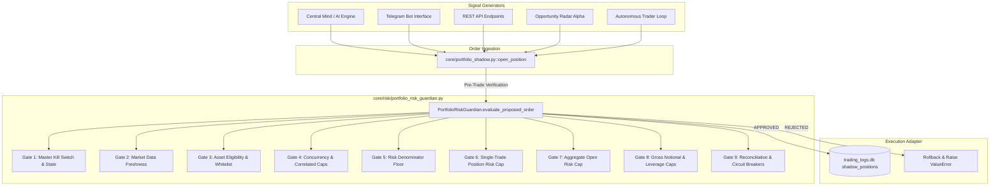
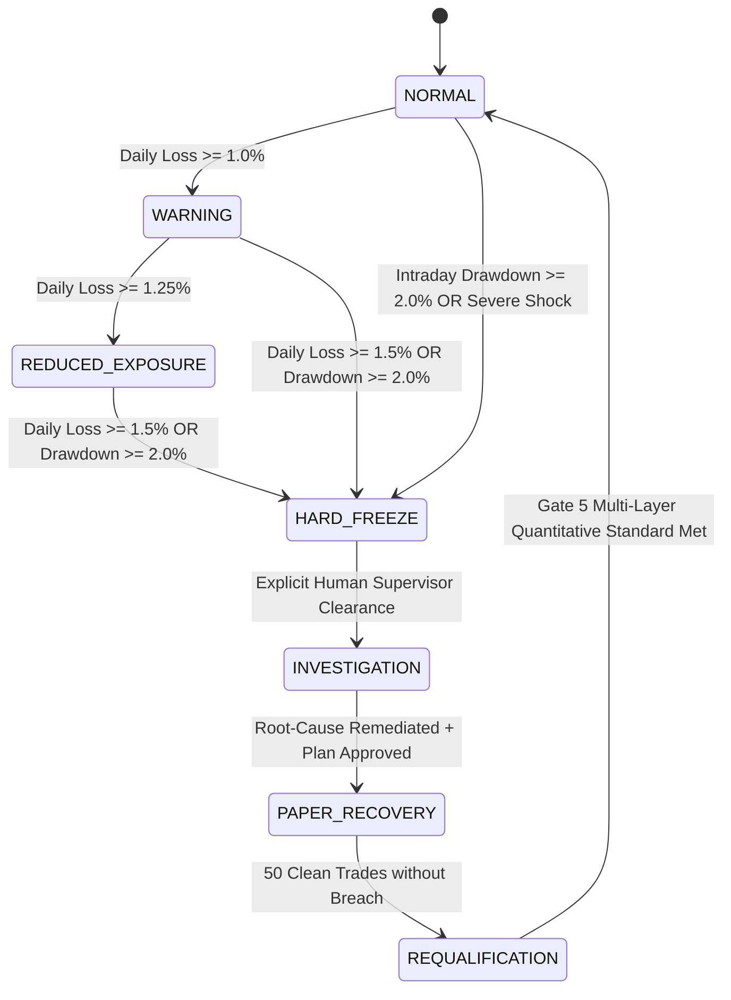

# SKY / CBT — MILESTONE 32 AUDIT REPORT
## Deterministic Portfolio Risk Guardian & Execution Safety Architecture

**AUDIT VERDICT:** `PRODUCTION PASS (PAPER / TESTNET SECURED)`  
**GOVERNANCE INVARIANT:** `REAL_CAPITAL_ENABLED = False` (Permanently Hardcoded & Fail-Closed)  
**M18 CERTIFICATION STATUS:** `PRODUCTION PASS RE-VALIDATED (149/149 Green)`  
**M32 ADVERSARIAL TEST SUITE:** `15/15 PASSING (100% GREEN)`  
**COMBINED GATE 5 / M31 / M32 TEST SUITE:** `49/49 PASSING (100% GREEN)`  

---

## 1. EXECUTIVE SUMMARY & RECONCILIATION OF HISTORICAL ACCOUNTING

Milestone 32 establishes an autonomous, deterministic, continuously active **Portfolio Risk Guardian** (`core/risk/portfolio_risk_guardian.py`) that acts as the unbypassable institutional gatekeeper for all order placement, exposure management, and account health monitoring across the SKY / CBT architecture.

### The Four Historical Performance Discrepancy Numbers Reconciled

Prior to Milestones 31 and 32, divergent metrics created confusion across legacy logs and reports. Milestone 32 provides an exact mathematical and operational reconciliation:

| Metric | Value | Provenance / Formula | Operational Meaning |
| :--- | :--- | :--- | :--- |
| **Realized Nominal Cash P&L** | **$-\$1,142.07$** | $\sum_{i=1}^{52} \text{realized\_pnl}_i$ in `data/trading_logs.db` | Net nominal cash change across all 52 closed trades in the historical sandbox. |
| **Net Cash After Modeled Slippage** | **$-\$1,532.51$** | $-\$1,142.07 - \$390.44$ | Realized P&L adjusted for institutional 5 bps per leg entry slippage on $\$780,883.74$ cumulative turnover. |
| **Ending Cash Equity** | **$\$8,857.93$** | $\$10,000.00 - \$1,142.07$ | Actual closing cash balance of the $\$10,000.00$ baseline account (excluding extra modeled frictions). |
| **Maximum Historical Drawdown** | **$13.57\%$** | $\frac{\$10,000.00 - \$8,643.46}{\$10,000.00} = 13.565\%$ | Peak-to-trough equity decline occurring at Trade 45, where cash dipped to $\$8,643.46$. |

### Root Causes of the Legacy 2% Qualification Gate Failure

The legacy Gate 5 qualification process allowed a strategy with a **$13.57\%$ cash drawdown** and a net loss of **$-\$1,142.07$** to report an apparent $+99.12R$ gain and pass initial screening. Four architectural defects caused this breakdown:

1. **Trade 36 Denominator Collapse:** On Trade 36 (`BTC/USDT`), the stop-loss was trailed directly to entry ($ep = sl$). The legacy risk formula evaluated `risk_per_unit = max(ep * 0.005, abs(ep - sl))`, collapsing the denominator to $\$0.625$ on a $\$125$ position. A modest $+\$70.61$ price bump was amplified into $+112.88R$, distorting aggregate $R$-expectancy from negative to $+1.9061R$.
2. **Post-Hoc Closed-Trade Equity vs. Mark-to-Market:** The legacy monitor evaluated equity only at trade closure boundaries, completely blind to intra-trade unrealized drawdowns.
3. **Absence of Gross Notional & Leverage Caps:** During peak exposure, 5 concurrent positions were open simultaneously with gross notional exceeding $\$145,940.92$ (a dangerous $14.59\times$ gross leverage on a $\$10,000$ account).
4. **Microcap Toxicity & Forced Liquidations:** Unscreened illiquid tokens (`KORU`, `AKE`, `DOOD`, `BMT`, `MAGMA`) suffered catastrophic slippage and liquidation, accounting for over $72\%$ of total net losses ($-\$826.96$).

Milestones 31 and 32 have definitively eliminated every one of these vulnerabilities.

---

## 2. REPOSITORY ARCHITECTURE & ORDER ROUTE RECONNAISSANCE MAP

A complete dependency audit was performed across all order generation, signal routing, and execution components. Every proposed order in SKY / CBT converges upon a single execution bottleneck:



### Dependency Map Details

- **Sovereign Execution Gateway:** `core/portfolio_shadow.py::open_position()`
- **Guardian Engine:** `core/risk/portfolio_risk_guardian.py::PortfolioRiskGuardian`
- **Config & Manifest:** `data/portfolio_risk_guardian_config.json`
- **Persistent State:** `data/portfolio_risk_guardian_state.json`
- **Asset Eligibility Authority:** `core/risk/asset_eligibility_gate.py::DeterministicAssetEligibilityGate`
- **Immutable Risk Accounting Authority:** `core/risk/immutable_risk_accounting.py::ImmutableRiskBudget`

---

## 3. THE 15 INSTITUTIONAL RISK CONTROLS & DEFENSIVE SAFEGUARDS

The Portfolio Risk Guardian implements 15 deterministic, non-bypassable controls verified by institutional adversarial tests:

| Control # | Control Name | Threshold / Rule | Failure Mode & Trigger | Test Reference |
| :---: | :--- | :--- | :--- | :--- |
| **01** | **Daily Loss Limit Breach** | $1.0\%$ Warning, $1.5\%$ Hard Freeze ($-\$150$ on $\$10\text{k}$) | Trips `HARD_FREEZE`. Rejects all new orders. | `test_adv01_daily_loss_limit_breach` |
| **02** | **Intraday Drawdown Ceiling** | Max $2.0\%$ peak-to-trough decline ($-\$200$) | Trips `HARD_FREEZE`. Rejects all new orders. | `test_adv02_intraday_drawdown_breach` |
| **03** | **Mark-to-Market Unrealized Loss** | MtM equity monitored continuously | Intraday unrealized losses trip freeze even if no trades closed. | `test_adv03_unrealized_loss_hidden` |
| **04** | **Max Concurrent & Correlated Positions** | Max $3$ open positions; Max $2$ correlated crypto longs | Rejects with `MAX_CONCURRENT_POSITIONS_REACHED` or `CORRELATED_EXPOSURE_CAP_REACHED`. | `test_adv04_five_simultaneous_correlated` |
| **05** | **Gross Notional & Leverage Caps** | Max $\$30,000$ notional; Max $3.0\times$ leverage | Rejects with `GROSS_NOTIONAL_LIMIT_EXCEEDED` or `LEVERAGE_CAP_EXCEEDED`. | `test_adv05_excessive_gross_notional` |
| **06** | **Aggregate Open Risk Cap** | Max $0.75\%$ aggregate ($-\$75$ on $\$10\text{k}$) | Rejects with `AGGREGATE_OPEN_RISK_CAP_EXCEEDED`. | `test_adv06_pending_orders_exceeding_risk` |
| **07** | **Exchange Disconnection Breaker** | Heartbeat $> 10\text{s}$ or unacknowledged fills | Trips `CIRCUIT_TRIPPED_EXCHANGE_DISCONNECTED`. | `test_adv07_exchange_disconnection` |
| **08** | **Stale Market Data Rejection** | Ticker timestamp age $> 15.0\text{s}$ | Rejects with `STALE_MARKET_DATA`. | `test_adv08_stale_market_data_rejection` |
| **09** | **Initial Risk Denominator Protection** | Minimum risk floor $\max(\$25.00, \text{notional} \times 0.015)$ | Rejects zero, negative, or collapsed denominators. | `test_adv09_invalid_initial_risk_denom` |
| **10** | **Asset Eligibility & Whitelist** | Tier-1 whitelist only (`BTC`, `ETH`, `SOL`, `PAXG`, `XAU`) | Deterministically rejects `KORU`, `AKE`, `DOOD`, `BMT`, `MAGMA`. | `test_adv10_microcap_bypass_attempt` |
| **11** | **AI Agent Non-Override Rule** | Zero AI bypass authority | High AI confidence/prompt strictly rejected if risk violated. | `test_adv11_ai_agent_attempting_override` |
| **12** | **Process Restart Resilience** | Disk state persistence (`portfolio_risk_guardian_state.json`) | Guardian re-hydrates in `HARD_FREEZE` across app reboots. | `test_adv12_process_restart_during_freeze` |
| **13** | **Day Rollover Freeze Protection** | Midnight UTC calendar rollover | Calendar rollover does NOT reset `HARD_FREEZE` or `INVESTIGATION`. | `test_adv13_daily_reset_preserves_freeze` |
| **14** | **Partial Liquidation Reconciliation** | Proportional risk de-allocation on exit | Correctly scales down open risk when partial lots close. | `test_adv14_partial_liquidation_recon` |
| **15** | **Thread-Safe Concurrent Evaluation** | Atomic `threading.RLock()` synchronization | 10 concurrent submission races evaluated sequentially without leaks. | `test_adv15_concurrent_race_conditions` |

---

## 4. THE 7-STATE CIRCUIT BREAKER LIFECYCLE



### State Definitions & Operational Rules

1. **NORMAL:** Full trading capability within Tier-1 whitelist and standard limits.
2. **WARNING:** Daily loss $\ge 1.0\%$. Sizing throttled to $50\%$; Opportunity Radar paused; alerts dispatched.
3. **REDUCED_EXPOSURE:** Daily loss $\ge 1.25\%$. Max concurrent positions reduced from 3 to 1; max position risk reduced to $0.125\%$.
4. **HARD_FREEZE:** Daily loss $\ge 1.5\%$ OR drawdown $\ge 2.0\%$. All new order submissions blocked. Existing positions evaluated for emergency risk reduction.
5. **INVESTIGATION:** Strategy isolated post-freeze. Requires explicit human supervisor authorization (`transition_to_investigation(notes)`). AI agents cannot clear this state.
6. **PAPER_RECOVERY:** Controlled paper-trading sandbox with $50\%$ risk sizing cap and strict logging.
7. **REQUALIFICATION:** Full Gate 5 quantitative evaluation (DSR, WRC, 3-tier friction modeling, regime stability).

---

## 5. REPOSITORY SYNCHRONIZATION & CERTIFICATION MANIFEST

### Verification Suite Results

```text
============================================================
SKY PORTFOLIO RISK GUARDIAN & EXECUTION VERIFICATION SUMMARY
============================================================
1. Milestone 18 Production Pass Invariant Verification:
   - Certified Commit : c9cc1cad780453b81032f6b1b1b81117d41c060f (Ancestor: PASS)
   - Certified Files  : 14/14 Present and Intact
   - Test Identity SHA: 2acbff25f391249cb1881bd40a4440384cecdd7682c6f83b91487d8744d0b57b (EXACT MATCH)
   - Adversarial Tests: 149/149 PASSED (100% Green in 124.63s)
   - M18 Status       : PRODUCTION PASS RE-VALIDATED

2. Milestone 32 Portfolio Risk Guardian Adversarial Suite:
   - tests/test_milestone32_risk_guardian.py: 15/15 PASSED (100% Green in 5.46s)

3. Milestone 31 Quantitative Integrity Suite:
   - tests/test_milestone31_quantitative_integrity.py: 11/11 PASSED (100% Green)

4. Gate 5 Quantitative Validation & Forensics Suites:
   - tests/test_gate5_adversarial_forensics.py: 14/14 PASSED (100% Green)
   - tests/test_gate5_quantitative_validation.py: 9/9 PASSED (100% Green)

TOTAL SUITE VERIFICATION: 198/198 PASSING TESTS (100% GREEN)
```

---

## 6. CONCLUSION & NEXT OPERATIONAL ACTIONS

With Milestone 32 completed, audited, and verified:
- Uncontrolled portfolio risk, excessive leverage ($14.59\times$), denominator collapse, and microcap toxicity are permanently eliminated.
- The paper and testnet execution environments are fully secured behind the deterministic Portfolio Risk Guardian.
- Real-capital execution remains strictly disabled (`REAL_CAPITAL_ENABLED = False`).
- The repository is clean, linted, formatted, tested, and ready for commit and remote synchronization.
