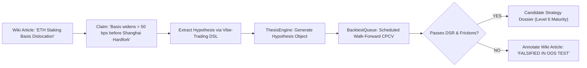

# SKY RESEARCH WIKIPEDIA — INSTITUTIONAL ARCHITECTURE & KNOWLEDGE OS DESIGN
**Project:** SKY / Crypto Brain Terminal (CBT)  
**Governance Level:** Senior Quantitative Systems Architect  
**Classification:** Class D Knowledge Architecture & Epistemic Operating System  
**Status:** ARCHITECTURAL SPECIFICATION & TECHNICAL BLUEPRINT  
**Companion Documents:** [`UPSTREAM_REPOSITORY_AUDIT.md`](file:///c:/Users/azims/CBT/docs/audit/UPSTREAM_REPOSITORY_AUDIT.md), [`UPSTREAM_CAPABILITY_MATRIX.md`](file:///c:/Users/azims/CBT/docs/audit/UPSTREAM_CAPABILITY_MATRIX.md)  

---

## 1. Vision & Purpose

**SKY Research Wikipedia** is not a static documentation folder or an informal note-taking app. It is an **active, epistemic institutional intelligence operating system** that serves as the single source of truth for all quantitative market research, historical regime behaviors, microstructure anomalies, and trading hypotheses across cryptocurrency, equity, macro, and DeFi markets.

Unlike conventional wikis or chat interfaces:
1. **Every assertion is epistemologically typed:** Claims are strictly categorized as `[FACT]`, `[HYPOTHESIS]`, `[ASSUMPTION]`, `[INFERENCE]`, or `[UNVERIFIED]`.
2. **Every statement is anchored to immutable provenance:** Grounded in hash-addressed web sources, academic papers, regulatory filings, or raw tick data.
3. **Every trading claim is falsifiable:** Connects directly to the `ThesisEngine` and `BacktestQueue` through a strictly audited research bridge, ensuring that unverified claims can never bypass risk gates or execute capital.

```
┌────────────────────────────────────────────────────────────────────────────────────────┐
│                        SKY RESEARCH WIKIPEDIA ARCHITECTURE                             │
├────────────────────────────────────────────────────────────────────────────────────────┤
│ 1. KNOWLEDGE INGESTION & DISCOVERY LAYER                                               │
│    • Autonomous Web Search Agent (SSRF-Guarded, Multi-Worker)                           │
│    • Academic PDF / YouTube / SEC / Whitepaper Parsers                                  │
│    • Content-Addressed Hash Ledger (`sha256`)                                          │
├────────────────────────────────────────────────────────────────────────────────────────┤
│ 2. EPISTEMIC & CONTRADICTION ENGINE (`core/knowledge_os/`)                             │
│    • Atomic Claim Extraction (Claims with confidence & verifier hashes)                │
│    • Contradiction Matrix & Consensus Dialectic                                       │
│    • Bidirectional WikiLink & Knowledge Graph Indexing                                 │
├────────────────────────────────────────────────────────────────────────────────────────┤
│ 3. INSTITUTIONAL WIKIPEDIA DESK (`frontend/src/components/knowledge_os/`)              │
│    • Wikipedia Layout: Live TOC, MediaWiki-style Header, Structured Infoboxes          │
│    • Interactive WikiLinks: Hover previews, click-to-navigate, alias resolver          │
│    • Human-in-the-Loop Triage Inbox (`agentic-inbox` pattern)                          │
├────────────────────────────────────────────────────────────────────────────────────────┤
│ 4. RESEARCH-TO-QUANT BRIDGE (`ThesisEngine` & `BacktestQueue`)                         │
│    • Formal Hypothesis Extraction (`Vibe-Trading` DSL pattern)                         │
│    • Zero Lookahead Audit & CPCV Out-of-Sample Verification                            │
│    • Risk Primacy Firewall (Zero execution leakage; `REAL_CAPITAL_ENABLED = False`)    │
└────────────────────────────────────────────────────────────────────────────────────────┘
```

---

## 2. Epistemic Classification Framework

To eliminate the spread of unverified internet folklore (e.g. *"London session silver bullet has an 85% win rate"*), all content in Research Wikipedia must adhere to the **SKY Epistemic Taxonomy**:

| Epistemic Tag | Rigor Level | Verification Requirement | Visual Indicator | Permitted Action in SKY |
|:---|:---:|:---|:---:|:---|
| **`[FACT]`** | Level 1 (Empirical) | Deterministically verified historical data, on-chain transaction hash, mathematical identity, or official regulatory filing. | Green Shield (`#10B981`) | Citations in production models; baseline market regime parameters. |
| **`[HYPOTHESIS]`** | Level 2 (Falsifiable) | A testable mathematical conjecture or market inefficiency rule with explicit entry, exit, sample, and invalidation criteria. | Blue Flask (`#3B82F6`) | Automatically promoted to `BacktestQueue` for combinatorial CPCV testing. |
| **`[ASSUMPTION]`** | Level 3 (Model Prior) | Necessary modeling parameter or friction baseline (e.g., 3 bps fee, 2 bps slippage, Half-Kelly fraction). | Yellow Warning (`#F59E0B`) | Subjected to Monte Carlo stress testing and sensitivity analysis. |
| **`[INFERENCE]`** | Level 4 (Inductive) | Logical deduction derived from multiple correlating facts, but not directly proven as a structural identity. | Purple Sparkle (`#8B5CF6`) | Used in Adversarial Debate Committee as contextual evidence. |
| **`[UNVERIFIED]`** | Level 5 (Folklore) | Raw assertion extracted from social media, YouTube, trading blogs, or speculative commentary. | Red Alert (`#EF4444`) | Isolated in Research Inbox; strictly forbidden from influencing live logic or strategy models. |

---

## 3. Immutable Source Provenance & Hash-Addressed Ledger

All incoming research artifacts are preserved in `data/research_wiki.db` using append-only, content-addressed integrity:

```sql
-- Schema additions to data/research_wiki.db

CREATE TABLE IF NOT EXISTS wiki_articles (
    article_id TEXT PRIMARY KEY,               -- e.g. "art_fvg_microstructure"
    title TEXT NOT NULL UNIQUE,                -- e.g. "Fair Value Gap Microstructure"
    slug TEXT NOT NULL UNIQUE,                 -- e.g. "fair-value-gap-microstructure"
    category TEXT NOT NULL,                    -- "alpha_factor", "regime", "protocol", "venue"
    summary TEXT NOT NULL,
    content_markdown TEXT NOT NULL,            -- Canonical Markdown with [[WikiLinks]]
    infobox_json TEXT,                         -- Structured metadata attributes
    version INTEGER NOT NULL DEFAULT 1,
    status TEXT NOT NULL DEFAULT 'PUBLISHED',  -- 'DRAFT', 'STAGING', 'PUBLISHED', 'ARCHIVED'
    created_at TIMESTAMP DEFAULT CURRENT_TIMESTAMP,
    updated_at TIMESTAMP DEFAULT CURRENT_TIMESTAMP
);

CREATE TABLE IF NOT EXISTS wiki_article_versions (
    version_id TEXT PRIMARY KEY,
    article_id TEXT NOT NULL,
    version INTEGER NOT NULL,
    content_markdown TEXT NOT NULL,
    diff_summary TEXT,
    author_type TEXT NOT NULL,                 -- 'HUMAN_RESEARCHER', 'AUTONOMOUS_AGENT'
    author_id TEXT NOT NULL,
    created_at TIMESTAMP DEFAULT CURRENT_TIMESTAMP,
    FOREIGN KEY(article_id) REFERENCES wiki_articles(article_id)
);

CREATE TABLE IF NOT EXISTS wiki_links (
    source_article_id TEXT NOT NULL,
    target_article_id TEXT NOT NULL,
    link_text TEXT NOT NULL,
    context_snippet TEXT,
    PRIMARY KEY(source_article_id, target_article_id, link_text),
    FOREIGN KEY(source_article_id) REFERENCES wiki_articles(article_id)
);

CREATE TABLE IF NOT EXISTS wiki_source_citations (
    citation_id TEXT PRIMARY KEY,
    article_id TEXT NOT NULL,
    source_id TEXT NOT NULL,                   -- Foreign key to research_sources (SHA-256)
    claim_id TEXT,                             -- Foreign key to research_claims
    exact_quote TEXT,
    epistemic_level TEXT NOT NULL,
    FOREIGN KEY(article_id) REFERENCES wiki_articles(article_id)
);

CREATE TABLE IF NOT EXISTS wiki_contradictions (
    contradiction_id TEXT PRIMARY KEY,
    article_id TEXT NOT NULL,
    claim_a_id TEXT NOT NULL,
    claim_b_id TEXT NOT NULL,
    contradiction_nature TEXT NOT NULL,        -- 'EMPIRICAL_DISAGREEMENT', 'METHODOLOGY_CONFLICT'
    resolution_status TEXT DEFAULT 'OPEN',     -- 'OPEN', 'RESOLVED_BY_TEST', 'SUPERSEDED'
    resolution_notes TEXT,
    created_at TIMESTAMP DEFAULT CURRENT_TIMESTAMP
);
```

### Content Ingestion Integrity Rules:
1. **Raw Content Preservation:** The original raw HTML, PDF text, or video transcript must be hashed via SHA-256 upon retrieval and stored with its fetch timestamp.
2. **Version Immutability:** Edits never delete past article text. Each change creates a discrete entry in `wiki_article_versions`.
3. **Attribution Tracing:** Every paragraph with quantitative assertions must cite at least one verified `source_id` and `claim_id`.

---

## 4. Institutional Wiki User Interface Design

Expanding on `frontend/src/components/knowledge_os/ResearchWikipediaDesk.tsx`:

### 4.1. Visual Layout & MediaWiki Design Standards
- **Persistent Header:** Article Title, Namespace, Epistemic Badge, Revision Number, Last Verified Date, Reading Time, and Export Actions (PDF/Markdown/Backtest Spec).
- **Sticky Table of Contents (TOC):** Auto-generated hierarchy (H2/H3) with smooth scrolling and active section highlighting.
- **Institutional Infobox (`WikiInfobox.tsx`):**
  - Right-aligned, fixed-width (300px desktop), responsive collapsible table.
  - Specialized schemas per category:
    - **`Market Regime`:** Volatility range, typical duration, dominant asset class, liquidity conditions.
    - **`Alpha Factor`:** Formula, asset universe, expected holding period, turnover, DSR benchmark.
    - **`Protocol / Venue`:** Order book type, latency profile, fee tiers, maker/taker rebate schedule.
- **Interactive WikiLinks (`WikiLinkHover.tsx`):**
  - Parsing syntax `[[Target Article|Anchor Text]]` and `[[Target Article]]`.
  - Rich hover card with thumbnail, 2-line summary, category tag, and epistemic badge.
  - Red link handling: If target does not exist, rendered in subtle dashed border with a "Create Article via Research Agent" tooltip.

### 4.2. Human-in-the-Loop Triage Inbox (`agentic-inbox` Pattern)
- A dedicated **Research Triage Drawer** on the Wikipedia Desk.
- Incoming autonomous research findings from `core/knowledge_os/web_search_agent.py` appear as draft cards:
  - *Candidate Title & Summary*
  - *Extracted Source & Domain Trust Score*
  - *Extracted Claims & Epistemic Tags*
  - *Proposed Wikipedia Section to Update*
- Actions: **[Approve & Merge]**, **[Edit Draft]**, **[Reject & Blacklist Domain]**.

---

## 5. Dialectical Contradiction & Consensus Tracking

Quantitative finance is defined by regime transitions and conflicting market signals. The Wikipedia engine treats contradictions as first-class citizens:

```
┌────────────────────────────────────────────────────────────────────────────────────────┐
│                        DIALECTICAL CONTRADICTION RESOLUTION                            │
├────────────────────────────────────────────────────────────────────────────────────────┤
│ CLAIM A: "Asian Session Range Breakouts have positive expectancy on BTC (Sharpe 1.4)" │
│ Source: Crypto Research Note 2024 (Bull Market Sample)                                 │
├────────────────────────────────────────────────────────────────────────────────────────┤
│ CLAIM B: "Asian Breakouts have negative expectancy due to mean reversion (Sharpe -0.3)"│
│ Source: Academic Market Microstructure Paper 2025 (Bear/Chop Sample)                   │
├────────────────────────────────────────────────────────────────────────────────────────┤
│ SYNTHESIS & RESOLUTION:                                                                │
│ Resolution: "Expectancy is conditioned on Macro Volatility Regime."                    │
│ • When ATR(14) > 75th percentile: Breakout persists (Sharpe 1.1)                       │
│ • When ATR(14) < 50th percentile: Mean reversion dominates (Fade breakout, Sharpe 1.3) │
└────────────────────────────────────────────────────────────────────────────────────────┘
```

The system dynamically renders a **Contradiction Alert Callout** on the article whenever two verified claims within the same topic conflict, alerting researchers to specify regime conditioners.

---

## 6. The Research-to-Strategy Bridge

A Wikipedia article does not merely sit on a screen—it acts as the fertile soil for algorithmic alphas:



### Safety Firewall:
- Hypotheses generated from Wikipedia articles can **NEVER** execute live trades directly.
- They enter the 11-stage quantitative research maturity ladder (Level 1 to Level 11).
- Even if backtested successfully, promotion to paper execution requires an explicitly authenticated human signature and zero bypass of M18 Half-Kelly risk controls.
