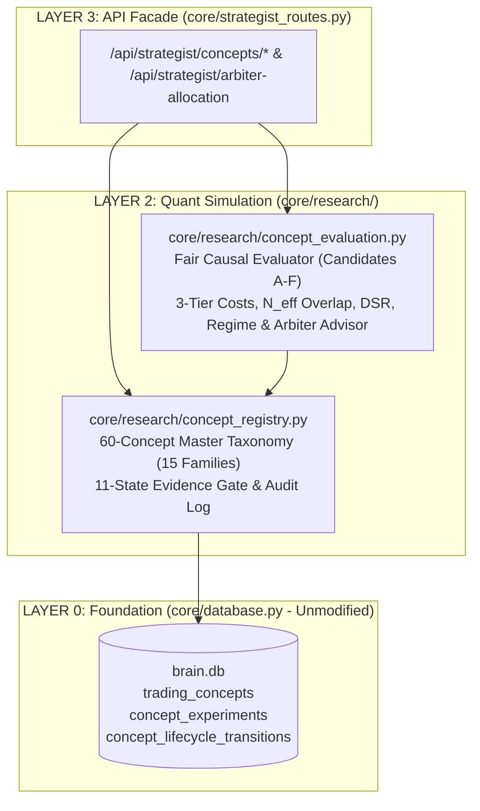

# Trading Concept Intelligence System — Surgical Implementation Plan

**Date:** 2026-10-13  
**Governance Class:** Class E / Class F (Trading Strategy Discovery & Quantitative Research Methodology)  
**Milestone 18 Surface Impact:** `0 / 14` certified files modified (`VERIFIED` zero-blast-radius architecture)

---

## 1. Architectural Design & Layer Firewall Compliance

Per [`core/governance/architecture_registry.py`](file:///c:/Users/azims/CBT/core/governance/architecture_registry.py) and [`core/execution/m18_certification_manifest.json`](file:///c:/Users/azims/CBT/core/execution/m18_certification_manifest.json):
- `core/research` is registered in `LAYER_2_QUANT_SIMULATION` with `ExecutionAuthority.SIMULATION_RESEARCH_ONLY`.
- Modules in `core/research` may import only from `LAYER_0_FOUNDATION` (`core.database`, `core.config`), `LAYER_1_DATA_STORAGE`, or `LAYER_2_QUANT_SIMULATION` (`research.*`, `engine.*`, `data.*`). They must **never** import `app`, `src`, `frontend`, `core.execution.live_router`, or `core.execution.connectors`.
- [`core/strategist_routes.py`](file:///c:/Users/azims/CBT/core/strategist_routes.py) is registered in `LAYER_3_API_FACADE`, is already mounted in [`app.py`](file:///c:/Users/azims/CBT/app.py#L221) under `/api/strategist`, and is **not** one of the 14 Milestone 18 certified files.

---

## 2. Affected Files, Rationale & Regression Analysis

| File Path | Action | Why Change Is Necessary | Possible Regressions & Mitigation |
|:---|:---|:---|:---|
| `core/research/__init__.py` | **Create** | Establish `core.research` package mapped to `LAYER_2_QUANT_SIMULATION` in `core/governance/architecture_registry.py`. | Zero regression risk (new package). |
| `core/research/concept_registry.py` | **Create** | Implements Phase 2, Phase 4, and Phase 6: 60-concept master taxonomy across 15 families, SQLite persistence (`trading_concepts`, `concept_experiments`, `concept_lifecycle_transitions` via `db_manager.get_brain_conn()`), search/filter/compare, feature-overlap detection, versioned rule specs, experiment history linking, and fail-closed 11-state lifecycle state machine (`RESEARCH` $\to$ `SPECIFIED` $\to$ `IMPLEMENTED` $\to$ `BACKTESTED` $\to$ `OUT_OF_SAMPLE_VALIDATED` $\to$ `PAPER_QUALIFIED` $\to$ `PAPER_VALIDATED`, plus `REJECTED`, `QUARANTINED`, `NEEDS_MORE_DATA`, `DEMOTED`). | Uses `CREATE TABLE IF NOT EXISTS` inside `db_manager.get_brain_conn()` so `core/database.py` (an M18 certified file) remains completely untouched. Respects `CBT_BRAIN_DB_PATH` sandbox fixture in `tests/conftest.py`. |
| `core/research/concept_evaluation.py` | **Create** | Implements Phase 5, Phase 7, and Phase 8: Fair baseline strategy evaluation framework for Candidates A–F (TSMOM/Vol-Trend, Trend Pullback, Volatility-Compression Breakout, Regime Mean Reversion, Funding/Positioning Carry-Filter, and Formalized SMC/ICT Sweep/FVG), enforcing strict point-in-time causality ($t$ uses only $\le t$), chronological Train / Validation / Sealed-OOS splits, 3-tier cost sensitivity (`base`, `conservative_1_5x`, `stress_2_5x`), non-overlapping effective sample size $N_{\text{eff}}$, Deflated Sharpe Ratio (DSR), regime attribution, and `RegimeOrchestrationAdvisor` for the SKY Arbiter. | Pure causal simulation module (`REAL_CAPITAL_ENABLED = False` verified); zero dependency on live execution routers. |
| `core/strategist_routes.py` | **Modify (Additive)** | Exposes REST endpoints under `/api/strategist/concepts` (list/search/filter/compare, get detail, evaluate candidate on OHLCV, request evidence-gated lifecycle transition, and compute regime-aware Arbiter portfolio allocation). | Additive endpoints only; all existing `/api/strategist/status`, `/league`, `/run-cycle`, `/lineage`, and `/validate-execution-isolation` routes remain 100% unchanged. |
| `tests/test_trading_concept_intelligence.py` | **Create** | Implements Phase 9 comprehensive automated test suite covering all 10 mandatory verification categories. | Executes strictly in isolated `tmp_path` SQLite sandboxes via `tests/conftest.py`. |

---

## 3. Lifecycle State Machine & Fail-Closed Promotion Gates (Phase 6)

Every concept in `core/research/concept_registry.py` is governed by `ConceptLifecycleStatus`:
1. `RESEARCH` — Initial theoretical / literature concept entry.
2. `SPECIFIED` — Exact mathematical hypothesis, required data, causal features, entry/exit/stop rules, and failure modes documented.
3. `IMPLEMENTED` — Deterministic, point-in-time causal signal generator implemented and verified against lookahead leakage.
4. `BACKTESTED` — Evaluated across historical dataset with 3-tier transaction costs and recorded in `concept_experiments`.
5. `OUT_OF_SAMPLE_VALIDATED` — Passes all quantitative out-of-sample evidence gates on chronological Train / Validation / Sealed-OOS split:
   - Non-overlapping effective sample size $N_{\text{eff}} \ge 30$ in OOS ($N_{\text{total}} \ge 100$ for full multi-regime qualification, configurable via strict gate policy).
   - Net expectancy $E[R_{\text{net}}] > 0$ under `base` (realistic) and `conservative_1_5x` cost tiers.
   - Profit Factor $\text{PF}_{\text{net}} \ge 1.15$.
   - Maximum drawdown $\le \text{MaxDD}_{\text{limit}}$ and Monte Carlo 95th-percentile tail check passed.
   - Deflated Sharpe Ratio $\text{DSR} \ge 0.95$ (or positive OOS Sharpe across both validation and sealed OOS windows).
6. `PAPER_QUALIFIED` — Passes portfolio correlation/diversification check ($\rho < 0.80$ or positive marginal Sharpe contribution) and deterministic Risk Gate audit (`REAL_CAPITAL_ENABLED == False`).
7. `PAPER_VALIDATED` — Completes $\ge 14$ days (or $\ge 30$ non-overlapping shadow paper trades) with positive realized net expectancy and bounded slippage drift relative to backtest expectations.
8. **Exception / Governance States:**
   - `REJECTED` — Empirically falsified (negative net expectancy or structural flaw on real data) or out-of-scope for BTC/ETH futures router.
   - `QUARANTINED` — Failed cost sensitivity ($1.5\times$ cost turns net expectancy negative), suffers lookahead/L3 simulation ambiguity, or breached drawdown/expectancy drift in shadow trading.
   - `NEEDS_MORE_DATA` — Promising gross/24h lead or implemented engine lacking required historical data depth (e.g., $N_{\text{eff}}$ too small, missing historical L2/OI/options archive).
   - `DEMOTED` — Previously qualified strategy automatically stepped down due to rolling paper/OOS decay or correlation crowding.

---

## 4. Verification & Validation Plan (Phase 9)

1. **Unit & Integration Suite (`tests/test_trading_concept_intelligence.py`):**
   - Verify all 60 concepts and 15 families load into SQLite, validate schema invariants, support filtering/search/comparison, and detect overlapping feature dependencies.
   - Verify fail-closed lifecycle state transitions (attempting to jump to `OUT_OF_SAMPLE_VALIDATED` or `PAPER_QUALIFIED` without passing evidence metrics raises/blocks transition and records audit trail).
   - Verify causal no-lookahead guarantee: mutating future bars ($t+1 \dots T$) never alters signals emitted at bar $t$ across all Candidate A–F evaluators.
   - Verify 3-tier cost deduction (`base` < `conservative_1_5x` < `stress_2_5x` friction) monotonically reduces net R and quarantines marginal strategies whose gross edge is smaller than transaction costs.
   - Verify historical CBT setup audit statuses (`TC_009` `REJECTED`, `TC_017` `QUARANTINED`, `TC_013` `NEEDS_MORE_DATA`).
   - Verify automatic demotion (`DEMOTED` / `QUARANTINED`) when rolling paper expectancy or drawdown breaches thresholds.
   - Verify FastAPI routes under `/api/strategist/concepts/*` and `REAL_CAPITAL_ENABLED == False`.
2. **Regression & Certification Suite:**
   - Run `python scripts/verify_m18_certification.py` (`14/14` files intact).
   - Run `.venv\Scripts\pytest tests/test_milestone18_sor_and_slicing.py tests/test_milestone18_boss_adversarial.py tests/test_milestone18_final_certification.py` (`149/149` passing).
   - Run `.venv\Scripts\pytest tests/test_architecture_imports.py` (`7/7` passing).

